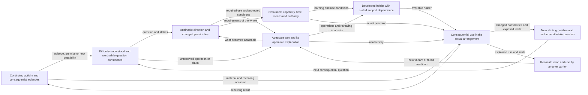

# Development and Self-Development Practice Principles Framework

First edition of the Development and Self-Development Practice series, 12 October 2026. [Edition, series and scope](#docareference6---edition-series-and-scope).

Construct and sustain worthwhile development from the position actually reached. Obtain the missing contribution, make its realization feasible, and use success as a new starting position for further development.

Anatoly Levenchuk, with AI-assisted development and review.

**License:** [CC BY 4.0](https://creativecommons.org/licenses/by/4.0/) for original framework content; third-party material retains its own terms.

Publication repository: [ailev/FPF](https://github.com/ailev/FPF).

# Table of Contents

Find the question that needs an answer. PatternIDs are stable addresses within this framework; Parts and positions are reading order, not a required workflow. Dependencies name direct governors and conditional returns, not a checklist to execute.

## Public units

| Unit | Reader use |
| :--- | :--- |
| [Development and Self-Development Practice Readme](#development-and-self-development-practice-readme) | Enter a development undertaking, opportunity inquiry, portfolio construction or advice question at its missing contribution. |
| [Preface](#preface) | Understand the connected practice, independently useful branches, continuation after success and the limits of each result. |
| [DOCA.Application - Cross-pattern applications](#cross-pattern-applications) | Follow a person's development question, an organization inquiry, and unlike uses with the specialist contributions they need. |
| [DOCA.Reference - Framework boundary, sources and refresh](#framework-boundary-sources-and-refresh) | Recover field coverage, direct supplier results, source limits, and the smallest affected refresh. |

**Part I — Enter and characterize the inquiry**

| § | ID & Title | Status | Keywords & Search Queries | Dependencies |
| :--- | :--- | :--- | :--- | :--- |
| 1 | [DOCA.1 - Bound the Development-Opportunity Inquiry](#doca1---bound-the-development-opportunity-inquiry) | Evolving | inquiry, receiving use, horizon, protected conditions. What development question can usefully be investigated now? | Direct holder or domain premises; DOCA.1.CHR when characterization is missing. |
| 2 | [DOCA.1.CHR - Characterize the Development Subject and Intended Change](#doca1chr---characterize-the-development-subject-and-intended-change) | Evolving | characteristics, baseline, intended change, scales, uncertainty. What changes besides one maturity score? | FPF C.16 and C.11.CRC; qualified holder meanings and evidence. |

**Part II — Construct opportunities**

| § | ID & Title | Status | Keywords & Search Queries | Dependencies |
| :--- | :--- | :--- | :--- | :--- |
| 3 | [DOCA.2 - Search Neighboring Uses, Technologies, Characteristics, and Supports for Development Opportunities](#doca2---search-neighboring-uses-technologies-characteristics-and-supports-for-development-opportunities) | Evolving | search, neighboring uses, supports, plural leads. What materially different opportunity have we not considered? | A bounded inquiry; direct sources; C.18 and C.19 only for their actual archive or live-pool questions. |
| 4 | [DOCA.3 - Construct a Worthwhile Problem and Proposed Contribution](#doca3---construct-a-worthwhile-problem-and-proposed-contribution) | Evolving | worthwhile problem, receiver, promise, acceptance. What receiving contribution would make this lead matter? | PSD.3 for competing formulations; FPF A.2.3 for promise meaning; receiver and domain evidence. |
| 5 | [DOCA.4 - Construct Development Directions with Their Support Configurations](#doca4---construct-development-directions-with-their-support-configurations) | Evolving | directions, finite change, support, pattern contribution. What configuration could make the intended contribution possible? | C.11.CRC; HCD, OCE and other holder practices; DOCA.5 for joint reachability. |

**Part III — Qualify reachability and retain options**

| § | ID & Title | Status | Keywords & Search Queries | Dependencies |
| :--- | :--- | :--- | :--- | :--- |
| 6 | [DOCA.5 - Qualify Development-Direction Dependencies and Bound Joint Reachability](#doca5---qualify-development-direction-dependencies-and-bound-joint-reachability) | Evolving | joint conditions, shared resources, transition, conditional branch. Can these individually plausible ingredients hold together? | A.15.9; C.11.CRC; qualified direct feasibility and permission results. |
| 7 | [DOCA.6 - Maintain an Opportunity Portfolio and Preserve Stepping Stones](#doca6---maintain-an-opportunity-portfolio-and-preserve-stepping-stones) | Evolving | retention, stepping stones, stage baselines, burden. Which later possibilities are worth keeping available for reconsideration? | C.18; C.19 for live-pool treatment; C.11.CRC for stage-specific comparison; DOCA.8 for change. |

**Part IV — Bound advice and requalify change**

| § | ID & Title | Status | Keywords & Search Queries | Dependencies |
| :--- | :--- | :--- | :--- | :--- |
| 8 | [DOCA.7 - Bound the Development-Direction Advising Engagement](#doca7---bound-the-development-direction-advising-engagement) | Evolving | adviser, recipient, sponsor, competence, confidentiality, conflicts. Can this service responsibly provide the requested help? | PSD.1; applicable professional conditions; A.15.9; PSD.8–PSD.13 for the missing advice contribution. |
| 9 | [DOCA.8 - Requalify Changed Development Opportunities](#doca8---requalify-changed-development-opportunities) | Evolving | changed premise, actual dependence, scope, history. What can still be used after this change? | A.10/A.10.1, A.15.9 and direct subject practices; PSD.14 for affected advice; G.11 for currentness. |

**Part V — Construct, enact and continue development**

| § | ID & Title | Status | Keywords & Search Queries | Dependencies |
| :--- | :--- | :--- | :--- | :--- |
| 10 | [DOCA.9 - Construct and Sustain a Connected Development Undertaking](#doca9---construct-and-sustain-a-connected-development-undertaking) | Evolving | development, self-development, weak difficulty, problematisation, transformation network, next problem. How do the necessary contributions work together and continue after success? | DOCA results as needed; B.5.PI, C.39, C.40.CD/CU, C.32.MWA; ME.6, HCD, OCE and the actual subject practices. |
| 11 | [DOCA.10 - Construct a Feasible Development Portfolio with Shared or Branch-Specific Support](#doca10---construct-a-feasible-development-portfolio-with-shared-or-branch-specific-support) | Evolving | independent research, product, performer development, common support, resources. Which worthwhile undertakings and support arrangements can actually coexist? | STR.8/11/14, RMP.1/2/8, MA.1–3/8, OCE.8/9/11 and qualified receiving results. |

# Development and Self-Development Practice Readme

## Practical entries

These ordinary practical entries show useful ways into the connected practice and its independently usable Methods. They are not a catalogue or coverage boundary. Bring the actual question and start from an adequate existing result; use the Table of Contents and the PatternID and title for direct help.

Development can be organized by the subject itself, with others, or by an authorized provider. It need not begin with a settled problem, selected Method, office or development programme. Learning or implementing a Method can contribute without constituting the whole development. Opportunity construction needs no adviser. Advice from a distinct practitioner can begin with an already formed question or programme comparison, without reconstructing an earlier opportunity inquiry. You can ask an assisting agent to explain or apply the methods in the language of your work, without framework jargon.

### DOCA-CONDUCT-DEVELOPMENT — Connect a development undertaking and continue from its result

- **Situation:** A person or organization can name courses, tools and improvement projects, but cannot explain how they change its reachable contributions or how development continues after a local success.
- **Question:** What connected work would discover a worthwhile next problem, construct and obtain its means, enact the change and make further development possible?
- **First useful result or blocker:** A connected construction with usable supplier results, feasible provision, a bounded start and a meaningful return from what actually happens; or an exact unavailable contribution.
- **Start with:** [DOCA.9](#doca9---construct-and-sustain-a-connected-development-undertaking). Enter at the missing connection; use an already adequate opportunity, Method, performer or provision result directly.
- **Stop or return:** A sufficient construction can finish this design work. Its enactment needs the actual performers, resources and powers; development continues from the result actually obtained, not from the completed drawing.

DOCA.9 develops the typical connections before comparing their enactment through workplaces, ordinary managers, specialist help, a common service or a dedicated office. Its worked case shows a lead replacing an inadequate planning premise and then discovering a different problem after success: others copy the exercise without learning the judgement. The next undertaking develops transmission and independent use of the reasons, rather than repeating the course. A provider-supplied result and a person's acquired capability remain different outcomes.

### DOCA-COMMIT-A-PORTFOLIO — Preserve independent purposes under shared means

- **Situation:** Research, products, performer development and public contributions are each worthwhile, but compete for the same experts, money or provision.
- **Question:** Which combination can be undertaken, and should particular support be shared or supplied within its branches?
- **First useful result or blocker:** Feasible alternative portfolios, their actual trade-off and decisions, or the exact conflict preventing the combination. Authorized bounded commitments are a separate result.
- **Start with:** [DOCA.10](#doca10---construct-a-feasible-development-portfolio-with-shared-or-branch-specific-support) when the joining construction is missing; use a sufficient STR, research and operating account directly when it already answers the question.
- **Stop or return:** Return the proposed portfolio to its real commitment holders. A funding decision does not decide a scientific conclusion or authorize a client's organizational change. Reopen the affected arrangement when resources, contribution needs or permissions change.

The worked provider case preserves research with its own epistemic purpose while two products use an already adequate Method. Shared support includes adaptation and maintenance; it is compared with complete provision inside the branches. A changed resource limit reverses the support choice without inventing a product dependency or sacrificing the research by default. DOCA.6 remains the different Method for keeping possibilities available without allocating a programme.

### DOCA-CONSTRUCT-OPPORTUNITY — Find a contribution before choosing a course or tool

- **Situation:** An organization proposes a new platform, but the receiving problem, alternatives and conditions for combining them remain unsettled.
- **Question:** Which development directions could improve the receiving result, and which combinations or later steps remain possible?
- **First useful result or blocker:** Differentiated directions with their qualified or missing premises, a supported limit on their combination, and the next question that can change their use.
- **Start with:** [DOCA.1](#doca1---bound-the-development-opportunity-inquiry) when the inquiry boundary is missing; otherwise use the first missing construction or qualification result.
- **Stop or return:** A problem account, conditional direction or ruled-out combination can finish the inquiry. A direction commitment, realization or advice request has its own receiving question.

If you have usable material but no settled future contribution, [DOCA.2:5.4](#doca254---a-useful-question-emerges-from-available-material) shows a different entry: C.40 helps examine a feasible change; DOCA.3 investigates a possible use suggested by it; DOCA.4 and DOCA.5 become relevant when a direction and its support need construction and qualification. Stop at a sufficient local result if no further opportunity inquiry is worthwhile.

In [Larch Engineering's application](#docaapplication2---app-doca-02--an-engineering-companys-next-development-opportunities), “replace the analytics platform” opens a two-week return window for an inquiry about improving an industrial monitoring service over nine months. DOCA.1 identifies the receiving service and protections, then selects a review of available qualified results because it can expose a limiting dependency within the return window. DOCA.1.CHR separates fault-detection usefulness, false alarms, response time, work burden and protected conditions. Engineering and operations supply the readings; an unknown reading remains unknown.

DOCA.2 looks beyond platform vendors. DOCA.3 asks which receiving problem each lead would address. The resulting directions can concern a better detection component, operators' ability to interpret alarms, a revised escalation arrangement or a specialist provider. DOCA.4 explains the proposed contribution with the support that would make it usable. A course, purchase or change in responsibilities is a possible means, not evidence that the monitoring result improves. If comparing whole arrangements for one already specified result is the complete question, use the existing OCE.8 contribution directly.

DOCA.5 then consumes the qualified local capacity results. In the case, the technology and provider transitions each need a distinct six-hour contribution from the same specialist every week; eight hours are available during their overlap. Each can fit alone, but their concurrent combination needs twelve hours and fails this condition. This conclusion does not select one direction or invalidate its individual basis.

DOCA.6 can retain a sequential possibility without declaring it feasible. Its second step starts from the arrangement the first step would leave, including continuing work and support. If the first step has occurred, use the arrangement actually obtained; otherwise keep that starting point conditional. The missing transition comparison must show what the later step would deliver, its transition and continuing costs, its effects on customers, and whether protections still hold. Merely changing the order does not establish enablement or a preferred programme.

The inquiry can therefore return the directions, the ruled-out overlap and the missing sequential-transition result. Through A.15.9, inspect an adequate existing specialist result first; request more only when its obtainable contribution warrants the acquisition effort and delay. The later commitment belongs to Strategy; implementation and operation use the relevant professional methods.

Now suppose a provider notice removes access to one data class. DOCA.8 traces which direction relied on that access. The provider-supported route may need narrowing or retirement while an independently qualified operator-practice direction remains usable. Use the earlier result only where it still answers the narrower route's support and comparison questions. The notice does not itself switch the operating system. Any operating change needs its applicable authority, and PSD.14 receives affected advice when there is advice to reconsider.

### DOCA-ADVISE-DIRECTION — Return warranted advice without taking the choice

- **Situation:** A person wants advice about improving their work; personal development and better external support are both plausible, with different evidence and resource needs.
- **Question:** What advice can be supported now, and how does its result enter the person's later direction and programme choices?
- **First useful result or blocker:** A supported recommendation or conditional set, with the missing contribution or service condition that limits stronger advice.
- **Start with:** [DOCA.7](#doca7---bound-the-development-direction-advising-engagement) only when the advising boundary is missing; otherwise enter the needed PSD comparison or recommendation with the available DOCA or HCD result.
- **Stop or return:** Return the supported advice. The recipient retains the relevant choice; a missing result can warrant a narrower answer, referral or abstention rather than another study.

In [Mira's application](#docaapplication1---app-doca-01--miras-development-direction-programme-comparison-and-guide), the engineer-manager initially wants to “learn more patterns.” A qualified HCD account instead identifies the work: decide when a specialist report can support a release-review question and when another contribution is needed. With the stated checklist and reference, three of five representative uses are adequately qualified; two changed-configuration uses rely on unsupported transfer. Those observations concern the named tasks and support, not a general ability score.

DOCA.1 reuses the supplied performance account to begin constructing conditional directions for Mira's work over four months. Two offered discussion sessions add no capacity evidence while the support owner cannot yet supply it. Development must fit within the existing thirty-eight-hour week; up to three hours may be reassigned, with the displaced work and any burden on colleagues established. Using the problem and performance account, DOCA.4 contrasts supported practice of specialist-result use with changing the review service so a qualified reviewer supplies more of that contribution. The latter may improve the receiving result without developing Mira's personal capability. The personal-practice direction still needs the HCD transfer basis; both directions need their relevant support capacity. DOCA.5 qualifies these dependencies, and DOCA.6 can keep both conditional directions and a later unfamiliar-task possibility.

The first direction gives Mira something to practise: given a release question and specialist reports, decide what can be reused and at what strength, retain its limitation, and seek a further result only when the attainable answer warrants the work. A request does not supply the requested result. The support direction instead needs the provider's qualified output, response time and capacity, including consequences for other teams. Comparing the directions must retain those different contributions and burdens.

When Mira requests advice, DOCA.7 uses the established competence, participation and information-use conditions to bound the service. In this constructed scene, private feedback stays with Mira and the employer receives only agreed work implications. Employer payment does not authorize disclosure of the assessment. PSD can use the qualified inputs to return conditional directions while capacity and transfer remain unresolved; those gaps do not identify a winner. A conflict affecting who may advise can change the service while leaving an independently qualified technical result usable.

The later scene supplies the missing capacity and comparison results, and Mira separately chooses the personal-development direction. HCD.2 then compares programme candidates for that stake, compatible later tasks and support: a coached sequence and a reference-supported sequence with scheduled expert checks. Both need three learner hours a week; their stated provider demands are one mentor hour and half an expert hour respectively. The case separately supplies availability, displacement and other comparison conditions. Lower expert time alone proves neither greater effectiveness nor preference.

Programme advice, if wanted, uses that HCD.2 comparison. Mira's authorized programme choice is separate from her earlier direction choice. Learning Product practice then realizes the chosen programme's instructional part as a Guide. Its cases and exercises must make Mira perform and check the report-use decision; publishing the Guide establishes neither performed practice nor learning.

After the scheduled attempts, the case supplies a qualified result for all five familiar tasks with the allowed reference, but an unfamiliar configuration still produces an unsupported transfer. DOCA.8 reopens the stronger unfamiliar-work claim and any dependent later step; HCD retains the transfer question, and PSD.14 receives affected advice. The familiar-task result remains within its supported conditions.

An already adequate HCD.2 programme comparison can enter the programme-advice question directly, as the application's learning-product-author branch shows. No earlier personal inquiry or direction choice is invented. An audience description can support programme design without establishing fit for a named learner.

## Reading and citing a pattern

Use the full framework name outside a context that already identifies it. DOCA is its short reference code, not an expansion of the title; within this text a PatternID such as DOCA.5 is enough. Name the publication and edition when a particular body matters. A PatternID alone does not identify an edition or make different publications interchangeable. See [edition, series and scope](#docareference6---edition-series-and-scope). A Part or title change does not by itself change a PatternID.

Read the direct body's working situation, Solution, case and assurance limit before making a stronger claim. Its position in this file does not make every preceding pattern a prerequisite. The applications show conditional uses of results, not a procedure everyone must complete. The [unlike-subject cases](#docaapplication3---app-doca-03--unlike-subjects-exact-recipients-and-an-anti-case) explain where human development, engineering, cultural and research contributions differ. These constructed applications illustrate use; they do not establish field effectiveness.


# Preface

Development can begin with a faint difficulty in ordinary work, a possibility that changes what is worth attempting, or a newly noticed limit after success. The problem, the way forward and the means of development can all need construction. This framework helps people conduct that work, join its necessary contributions and continue from the position actually reached. It also retains independently useful opportunity inquiry and advice: a bounded useful result can finish such an undertaking without pretending that development itself is complete.

The developed subject, the provider of help and the chooser of a commitment need not be the same. Self-development is the branch in which the subject itself makes the relevant contribution to conducting its own development. An externally supplied improvement does not establish that contribution. A technical or non-agent subject can develop under another performer's work without being assigned agency by analogy.

## DOCA.Preface:1 - One connected practice and independently useful contributions

The connected question is how a worthwhile change becomes attainable and actual, and how the changed position becomes a basis for further development. DOCA.9 supplies the construction linking current work, problematisation, direction and Method construction, performer preparation, provision, consequential work and further inquiry. DOCA.10 handles a different recurring difficulty: independently worthwhile undertakings whose shared means and support must fit together. The opportunity and advice branches below supply useful results within that practice and remain usable independently.

**Connected formulation.** Notice what matters in the current situation; make the unresolved question worth answering; construct a reachable change with its means; qualify the contributions together; obtain the real commitment and provision; perform the work and distinguish the result from what was learned; use the changed position to find the next worthwhile attainable problem; improve the way development is done when that change is worth its cost. Enter at an adequate existing result, preserve independent work, and return to the particular missing contribution when a connection fails.

This formulation helps retain the joins explained by the patterns. It is not a compulsory lifecycle or an assertion that every described relation already obtains. A local performance can skip unnecessary learning because a qualified performer exists. A known adequate Method can avoid fresh research. A genuine inquiry can continue for its own scientific result without waiting for a sale. A branch can end, rest or consolidate while the subject retains a way to notice and pursue its next development. Endless activity and ever-larger obligations are not the meaning of open continuation.

The practical result of one complete use is a meaningful bounded start, actual work through qualified Methods, an intelligible account of the changed contribution and a reasoned next development question. It need not be a document package. Where a company or provider needs strategic descriptions, programmes, work arrangements and learning material, those are expressions of the relevant construction and separate instructional work; their existence is not evidence of the capability they describe.

### DOCA.Preface:1.1 - Opportunity construction and advice remain independent entries

**Development Opportunity Construction** investigates what could change, why it would matter to a recipient, and which support configuration could make that contribution possible. It can return a conditional direction, a qualified opportunity, a retained possibility or a precise gap. It needs no adviser.

The future contribution can emerge from examining material already available. With an affordable local question and a usable operation, use C.40 to develop that material. C.40.CD helps change the question and the way of answering it when both need development. DOCA then investigates any suggested receiving use. A useful local finding can finish the work without a programme, customer or opportunity being invented.

**Development-Direction Advising** concerns help from a distinct performer to a recipient. [DOCA.7](#doca7---bound-the-development-direction-advising-engagement) bounds that service; Problem Structuring and Decision Support supplies the actual comparison, recommendation or other warranted decision-support return. A formed question, qualified opportunity or adequate programme comparison can enter directly. Neither branch requires the other to have been performed.

These two branches share inquiry, characterization, joint conditions and changed-premise qualification because the same development claim can be used in construction and in advice. Sharing those questions does not make them four mandatory checkpoints. Use an adequate existing result and obtain only what the receiving question still lacks. A whole arrangement comparison already answered by OCE, a human programme comparison already answered by HCD.2, or an ordinary choice with sufficient inputs can go directly to its actual use.

Consider Mira, the engineer-manager in APP-DOCA-01. She is considering supported practice of qualified specialist-result use, or a change in the review service that supplies more technical support. The first is a prospective personal-development direction; the second may improve the receiving result without demonstrating a new personal capability. A missing independent-review transfer result is a specific HCD question. It does not erase a separately supported result for familiar tasks.

If Mira asks a career adviser for help, the adviser needs suitable competence, participation and information-use conditions. Employer funding does not itself authorize disclosure of private assessment notes. Even with an adequate service boundary, the missing transfer result limits the stronger advice while a qualified direction or conditional set can remain useful. A request or probe needs its own attainable contribution and whole-burden justification. Mira's direction choice remains separate. HCD.2 can then compare programmes for the selected stake; any requested programme advice and the authorized programme choice are further distinct results. Learning Product practice realizes the chosen programme's instructional part as a Guide. The application shows these uses with explicit assumptions, including a direct programme-level entry that invents no prior personal opportunity history.

## DOCA.Preface:2 - From an available result to a useful return

A direction needs more than an attractive label. DOCA.1 bounds the inquiry; DOCA.1.CHR makes the subject's relevant characteristics, current readings, intended changes and unknowns explicit. DOCA.2 varies uses, technologies, characteristics and supports. DOCA.3 asks what worthwhile receiving problem the proposed contribution would answer. DOCA.4 keeps that contribution with the configuration needed to obtain it.

Enter at the first missing result. A team with a sound inquiry can search without repeating intake. A practitioner with a qualified direction can examine its joint conditions through [DOCA.5](#doca5---qualify-development-direction-dependencies-and-bound-joint-reachability). [DOCA.6](#doca6---maintain-an-opportunity-portfolio-and-preserve-stepping-stones) can retain useful possibilities and conditional enabling relations without selecting a programme or committing resources. If responsible advice is wanted, use the actual missing service or PSD contribution. A request for a specialist result is fulfilled by an adequate return, not by sending the request.

This division preserves useful work at several stopping points. An inquiry can end with a better question. A direction can remain useful while one permission or support result is missing. A retained path can name a later possibility without asserting that its first step happened. The person or arrangement with the relevant authority retains each choice and intervention.

When the needed result is a continuing development undertaking, carry these returns into DOCA.9. It connects them with the professional work that can realize and qualify the change. When independently worthwhile undertakings draw on common means, DOCA.10 constructs the joint portfolio and compares support arrangements; Strategy still supplies strategic commitment and the actual holders make the decisions. Neither addition changes the finite result or non-use boundary of DOCA.1–8.

## DOCA.Preface:3 - Qualify the combination as well as its ingredients

Joining results requires three judgements: each result is adequately qualified; it fits the receiving subject, configuration, use and horizon; and the proposed combination meets its shared conditions. A sound result for another data class or support arrangement may fail the second judgement. Individually feasible directions can fail the third.

For the combined use, establish the receiving contribution, compatible premises, jointly available resources and permissions, protected conditions and the remaining uncertainty. Identify the next responsible receiver for a missing result. Reuse the detailed qualifications already supplied by the patterns and direct practices; a new combined demand, audience, configuration or horizon needs its own answer. Recognition means that a reader can recover this account. Assurance requires the actual measurements, domain evidence, competence, permissions and other qualified results on which it relies.

In DOCA.5's constructed eight-week case, directions A and B each require the same specialist for two hours every week; only two hours are available after existing obligations. Each direction fits alone. Together they need four hours and fail the joint condition under the no-overtime and urgent-cover protections. Doing A and then B takes sixteen weeks, outside the eight-week horizon. Shared support would be another configuration whose combined demand needs qualification. Preserve the individual directions and the exact joint limit. A combined-work estimate, alternative-support result, or revised-horizon result becomes a request only when its obtainable contribution warrants acquisition.

All pairs can fit while the whole set does not. In a separate arithmetic illustration, three non-shareable seven-hour activities each draw on one eighteen-hour budget. Every pair needs fourteen hours; all three need twenty-one. The deficit rules out that combination under those premises. It does not choose an optimal subset. APP-DOCA-02's six-plus-six versus eight-hour case shows another shared-capacity conflict in an organization inquiry.

**Constituent actions in ongoing work.** During programme advising, estimating a participant's available practice time can be part of comparing the feasibility of directions, which is itself part of constructing advice for that participant. If the intended programme requires coordinated practice with a partner, solitary free time is no longer the same usable resource. Arithmetic skill and knowledge of the desired profession can coexist with a missing ability to construct a feasible practice arrangement. Recover that intermediate contribution and its support before recommending the programme. B.1.5.EW supplies the general vertical question; the domain and HCD supply the requisite Methods and capability account. A feasible single step does not establish the feasibility of the advised combination.

## DOCA.Preface:4 - Compare a later step from its own starting point

DOCA.6's constructed ninety-day review-support case distinguishes an independent improvement from a later enabling possibility:

| Configuration | Estimated time per case | Weekly maintenance | Setup |
| --- | ---: | ---: | ---: |
| Existing manual support | 60 minutes | 0 hours | Baseline |
| Index added | 40 minutes | 2 hours | 6 hours |
| Retrieval added to the index | 30 minutes | 3 hours | 4 additional hours |

The index-to-retrieval increment is ten minutes per case, one extra maintenance hour per week and four extra setup hours. A whole-path comparison against manual support instead considers the thirty-minute per-case estimate, the full maintenance burden and ten setup hours on the appropriate time basis. Complete result, resource, affected-person/team and protected coordinates still matter; these figures alone establish no preferred direction or aggregate saving.

An enabling relation needs engineering evidence that the later configuration can actually reuse the index and its supports. Keep custody, representative verification, quality, access and joint feasibility explicit. If the index has been realized, use that actual arrangement as the next baseline and retain its incurred setup history. A reversible arrangement does not recover spent time. If the retrieval connection fails, an independently qualified manual-support contribution can remain useful.

## DOCA.Preface:5 - Respond to a change without rewriting the past

[DOCA.8](#doca8---requalify-changed-development-opportunities) starts from the changed premise and the opportunity or service claim that used it. Obtain the smallest affected qualification and preserve independently supported uses.

In its constructed data-permission case, the indexed manual arrangement is already actual, while broad retrieval over classes A and B remains prospective. A new restriction on external use of B retires that broad retrieval direction. An A-only direction is a new conditional candidate: the old whole-workload estimate does not qualify its performance, maintenance or incremental transition. The actual manual arrangement can remain usable within its unchanged permission and support basis.

A service conflict can require a different adviser or referral while an independently produced technical comparison remains qualified. A corrected report can defeat a transfer premise even when the person's performance history did not change. An inaccessible receiving use remains a coverage gap, and a missed necessary observation supplies no favourable result.

Preserve what was previously returned and distinguish a correction, a later recommendation, the recipient's actual choice and an implemented change. PSD.14 supplies the affected advice-follow-up contribution. Professional and operational owners retain their actual duties and authority. For an accessible source moved without a relevant meaning or use change, repairing the reference can be enough; this is not an instruction to reconstruct every opportunity.

## DOCA.Preface:6 - Architectural Rationale

The language connects three scales of result without treating them as interchangeable. A worthwhile opportunity or responsible advice can be enough for a bounded inquiry. A development undertaking needs the further joins by which necessary contributions become usable together, work occurs and a new position is obtained. A provider or organization with several independent ends needs a portfolio whose common demand and support can be chosen coherently. The shorter result remains useful without claiming the larger one.

DOCA.1–8 retain opportunity construction and advice because their results are reused in the larger practice and can be sought independently. DOCA.9 supplies the missing connected construction; its subject-specific learning, engineering, inquiry, cultural and organization work use their actual professional suppliers. DOCA.10 supplies the joining construction for independent purposes, shared support, resource competition and real commitments. Retaining a possibility in DOCA.6 does not allocate it, and comparing a human programme in HCD.2 does not construct an organization's research/product/development portfolio.

Using PSD alone remains a serious simpler alternative for a recommendation question with adequate inputs. HCD, OCE, Strategy or another professional Method can likewise finish their own question directly. A list of those suppliers is insufficient when the reader still has to invent how their outputs become one feasible development undertaking or how the first success opens a different worthwhile question. The connected Methods make that joining work explicit without absorbing the supplying disciplines.

The pattern language is broader than one composite Method. A DPF may offer several independently reusable ways whose results constrain one another; its publication Parts are not Method constituents or a mandatory action order. DOCA.1.CHR's suffix remains an address, not proof of specialization or parthood. A supplied domain result is a premise under qualified conditions, not the domain's entire Method.

The opportunity, advice and continuing-practice contributions are independently useful within the connected development language. Keeping them in one publication lets a practitioner discover and use their joins while retaining precise PatternIDs. A separate publication becomes preferable when a branch has an independently useful whole and the revised distribution serves its use, learning and change better. Reconsider the organization when changed uses or contributions make another arrangement more useful.

A useful narrower profile can inherit applicable guidance and explain its changed situation, contribution, conditions and evidence needs. More than one level of narrowing is possible, and a contribution can serve several profiles. State whether the actual relation is bounded-use projection, specialization, composition, reuse or result dependence.

## DOCA.Preface:7 - Source synthesis, costs and limits

The shared answer combines opportunity inquiry with result-specific qualification. DOCA adapts ISO 56007's public scope for opportunity and idea work before solution development: broaden the inquiry, examine the receiving problem and keep the proposed contribution prospective. A full paid-standard interpretation or effectiveness claim needs additional evidence. ISO 56008 supplies a bounded organization-measurement comparator; it does not furnish measurements for people, AI or facilities. OECD mission-portfolio work contributes retention, dependencies, adaptation and termination under uncertainty, while actual strategy and funding decisions remain external.

FPF C.16 helps preserve characteristic meaning, scales and qualified readings. C.11.CRC keeps finite comparisons relative to actual or conditional starting configurations and their complete oriented coordinates. A.15.9 supports reuse or acquisition of the missing qualified contribution. C.18 and C.19 retain their archive/front and actual live-pool questions. These contributions support the local moves; they do not supply a client's performance, feasibility or permission. The [source account](#docareference3---source-responsibility-and-references) gives the exact roles and reopening conditions.

For human advice, NCDA's identified ethics provisions and the scoped ICMCI engagement and responsible-AI contributions help bound the service. Their applicability, the professional's actual competence and local requirements still need their own basis. AI assisting an adviser and AI as a development subject raise different questions: professional responsibility governs the former; configuration-specific engineering and evaluation govern the latter. NIST Map contributes context and support-risk guidance, not that evaluation. A research taxonomy or a bounded search example likewise supplies no universal development mechanism. HCD and Learning Product retain human development, programme and instructional claims.

These distinctions matter for whose work the language serves. Sponsor pressure can displace the recipient's question; provider interests can restrict the alternatives considered; fluent AI output can obscure a missing qualification. APP-DOCA-03 applies the boundaries to communities, AI configurations, facilities, research and a population with no population-local advice recipient. Obtain the actual recipient and authority where needed; transfer no human-learning mechanism or capability reading by analogy.

A bounded inquiry still gains a smaller usable return: a course label becomes a contribution-bearing direction or an exact HCD question; a model shortlist can reveal a support alternative; an advice request acquires meaningful disclosure limits; and a changed premise reopens only dependent uses. The cost is explicit qualification and the work of joining results. Retaining options also consumes attention and resources. Some inquiries properly end with a narrower claim, a request, referral or abstention. Constructed cases show how to make these distinctions; they establish neither field effectiveness, general transfer nor faster reading.

The whole-development gain is different: a practitioner can construct and revise the joins from a consequential question to changed possibilities and a next attainable problem. B.5.PI, C.39, C.40.CD/CU, C.32.MWA and the direct subject practices supply its underlying constructions. DOCA.10 brings qualified research, strategic, accounting and organization contributions together under one finite choice. The original sources and their professional limits remain operative; constructed cases explain conditional use, not observed general effectiveness.

Reopen the affected guidance when a source change or repeated practitioner difficulty defeats its working move, branch boundary, source use or affordable return. An accepted later Guide contribution can change the uses it actually supports; an unaccepted future contribution supplies no current instruction. The complete bodies and applications give the instructions and worked detail for the selected question; the source tail identifies its external contributions and sources.

## DOCA.Preface:End


# Part I — Enter and characterize the inquiry

## DOCA.1 - Bound the Development-Opportunity Inquiry

> **Type:** DPF pattern
>
> **Status:** Released; evolving
>
> **Normativity:** Normative unless marked informative.

### DOCA.1:0 - Use This When

What is the smallest useful inquiry when someone says “we should develop,” names a fashionable solution, or asks what to develop next before the receiving change is clear?

Use this pattern when a person, organization, community, AI arrangement, platform, facility, research programme, or another identified subject has a development concern or aspiration but the receiving use, horizon, protected conditions, reason to explore, or affordable inquiry effort is still loose. The first useful result is a bounded inquiry that another person can inspect, or one exact missing premise that prevents such an inquiry.

Begin here without appointing an adviser. A person can bound a self-inquiry and continue into opportunity construction. When a distinct performer is already being asked to advise a named recipient, this pattern can recover the subject, use, and horizon, but `DOCA.7` governs whether the advising relationship itself is admissible.

**Cheap exit.** Reuse an existing inquiry when it already identifies the same subject, receiving use, horizon, protections, posture, and effort boundary and no material premise changed. If a qualified domain practice owns the whole question, use it directly. If adequate alternatives already exist and the remaining need is comparison, recommendation, or authorized choice, stop opportunity construction and use the direct decision-support owner.

**Ordinary non-use boundary.** A research account of change in a non-cultural population or lineage is not advice to that population. A separately authorized researcher may have an opportunity or decision question, but the researcher or sponsoring organization—not the population—then supplies the recipient and authority boundary.

### DOCA.1:1 - Problem Frame

A broad wish such as “develop in AI,” “become more mature,” “modernize the platform,” or “build a learning culture” can point to several different subjects and receiving uses. It may concern a person's capability for later Work, an organization's contribution and arrangement, an engineered system's service, an episteme or problem formulation, a research programme, or a proposed intervention. The same words do not make those subjects develop in the same way.

The practical danger appears before alternatives or advice. A course, tool, reorganization, model, supplier, or PatternID can become the answer before anyone names the receiver, useful difference, protected conditions, or evidence needed. The opposite failure is an unlimited discovery exercise whose growing list never returns a result that can be tested or used.

This pattern governs the inquiry boundary: the identified subject, receiving use, declared horizon, protected conditions, reason to explore, posture, inquiry budget, and first missing result. It does not establish a worthwhile problem, qualified opportunity, recommendation, choice, programme, Guide, performed Work, or observed development effect.

### DOCA.1:2 - Problem

Without an explicit inquiry boundary:

- a solution label substitutes for the receiving contribution;
- “development” silently shifts among person, organization, technology, knowledge, and population meanings;
- a supplier's promise is treated as the receiver's problem;
- the horizon expands or contracts to make a favored direction look plausible;
- safety, workload, continuity, privacy, reversibility, or another protected condition appears only after a candidate has gained momentum;
- search effort grows without a proportional stopping reason; and
- missing authority or evidence is hidden by a polished opportunity statement.

The reader then cannot tell whether to characterize the subject, search neighboring possibilities, request a direct specialist result, bound an advising relationship, or stop.

### DOCA.1:3 - Forces

| Force | Tension to preserve |
| --- | --- |
| Early ambiguity | Discovery can begin before a full goal exists, but a slogan is too weak to support a useful return. |
| Cross-holder reuse | One inquiry shape should work across people, organizations, AI arrangements, engineered systems, and epistemes without inventing one development mechanism. |
| Openness | The inquiry must leave room for materially different contributions without becoming an exhaustive search mandate. |
| Protection | Conditions that must not be traded away need to appear before candidate enthusiasm, while their exact measures remain with their owners. |
| Proportional effort | A reversible preliminary inquiry may be cheap; a consequential commitment needs stronger evidence and authority. |
| Honest posture | Proposed, predicted, recommended, planned, performed, and observed claims must remain distinct. |
| Independent entry | Opportunity construction can begin without an adviser, and advice can begin from an already adequate opportunity. |

### DOCA.1:4 - Solution

Construct the smallest inquiry boundary that can direct one useful next action and expose one truthful stopping point.

#### DOCA.1:4.1 - Identify the subject and claim posture

Name what may develop or be changed at the grain that matters now: a particular person, organization, community arrangement, AI model-and-scaffold configuration, facility, platform, research programme, episteme, or another exact subject. If identification is provisional, state the candidate boundary and what would settle it.

Mark the claim posture. A proposed future contribution is not actual change. A plan is not performed Work. A model prediction is not an observed result. If *development* or *evolution* still hides the subject, continuity rule, or value claim, use [`E.10.DEV`](https://raw.githubusercontent.com/ailev/FPF/main/FPF-Spec.md) and return with the direct subject owner.

#### DOCA.1:4.2 - Identify a receiving use or an exploratory question

For a proposed contribution, state who or what could use it, in which situation, and what practical difference would matter. The receiving use may be the subject's later Work, a service used by another System, an organization's market or operating contribution, a research use, or a decision that consumes a qualified opportunity.

Keep the receiver's useful difference separate from the subject's desired learning, prestige, procurement, technology adoption, or internal activity. If no receiver or receiving situation can yet be named, keep that question open rather than inventing demand.

An inquiry can still start from material that someone can use or change: permitted records, a working procedure, a model or another construction. Name an available operation and a difference worth examining within the inquiry's resources and permissions. [C.40](https://raw.githubusercontent.com/ailev/FPF/main/FPF-Spec.md) supplies that development Method. Its result can suggest a receiving use for DOCA.2 or DOCA.3 to investigate. A useful local result can also finish the inquiry; it need not become a development opportunity.

#### DOCA.1:4.3 - Separate the return time from the development horizon

State when the inquiry's result must be usable and over what horizon the proposed development or its consequences matter. For example, an inquiry can return by Friday about a contribution intended to improve work over four months. The available effort within that window belongs in §4.5: six staff-hours is a resource ceiling, not the inquiry's elapsed duration. Add another development or consequence horizon only when it changes the question or protections.

Name conditions that the inquiry may not silently trade away. Depending on the subject and use, these can include safety, legal or professional limits, privacy, confidentiality, workload, service continuity, accessibility, resource ceilings, reversibility, distributional consequences, or preservation of future options. The direct practice owns their meaning and evidence.

#### DOCA.1:4.4 - State the reason to explore and separate its status

Write why exploration is warranted now. Distinguish:

- a qualified receiving problem or demand;
- an observed dissatisfaction or changed constraint;
- a proposed contribution or explicit problem hypothesis;
- a supplier promise, technology signal, or PatternID used only as a search lead; and
- curiosity that is valuable only if a bounded inquiry can be afforded.

Preserve competing formulations when they would send the inquiry toward different contributions. Use the direct problem-structuring pattern when deciding among those formulations is itself the current Work.

#### DOCA.1:4.5 - Establish available means and permissions

Identify what can actually be used before the inquiry must return: people's time and capability, source access, conversations, computation and other relevant means. Check who can obtain and interpret the proposed result. An available effort ceiling is not yet a reason to spend it; select the budget with the result in §4.6.

Count the work the inquiry would require from everyone affected, including preparation, obtaining the result, interpretation and use. Include delay, displaced work and downside where they can change the choice. A short interview can require substantial preparation or interrupt someone whose contribution is needed elsewhere.

Permission to inspect a source, interview a participant, or run a desk study does not authorize an intervention, access to restricted records, procurement, advice, or implementation. If the proposed inquiry cannot respect a protected condition, select a permitted alternative or return the exact gap. Keep any stronger evidence condition for a later consequential commitment visible.

#### DOCA.1:4.6 - Choose a worthwhile first result and enough inquiry

Identify a result that could improve the answer or next inquiry. Depending on what is already known, it may be:

- a development-facing characterization from `DOCA.1.CHR`;
- materially different search leads from `DOCA.2`;
- a worthwhile problem and proposed contribution from `DOCA.3`;
- an admissible advising question or blocker from `DOCA.7`; or
- a qualified result from the practice that owns a missing premise.

Say what plausible answers would change: the next question, a possible contribution, a supported claim, an admissible action or a justified stop. When the future receiver is unknown, use the local exploratory question from §4.2. Discriminating explanations or discovering a useful operation can justify inquiry before an intervention is selected.

Compare the attainable inquiry with what the present basis already supports. A narrower answer, smaller probe, different source, deferral or stop may serve the use better. Compare their whole burdens under §4.5 and the protections, not uncertainty alone. Use [C.11.DUA:4.1–4.4](https://raw.githubusercontent.com/ailev/FPF/main/FPF-Spec.md) when the connection between the receiving question, evidence demand and worthwhile continuation needs development. Qualitative judgement is enough when it settles that choice.

Select the affordable inquiry whose attainable contribution is worth that burden, or finish with the supported answer now. State what would be enough for this use before spending the selected budget: for example, one evidenced difficulty and a question that distinguishes two plausible contributions. This condition need not settle every unknown. If the inquiry cannot reach it within the permitted means, return the narrower supported result or exact gap; exhausting a budget supplies no missing evidence.

For an outside-practice contribution, [A.15.9:4.1](https://raw.githubusercontent.com/ailev/FPF/main/FPF-Spec.md), steps 2–3, connects reuse of an available answer with the decision to obtain more. When acquisition is worthwhile, its later steps bound the request and qualify the returned result for use. Asking for it does not supply it.

Start at that selected contribution. Publication order does not require the earlier PatternIDs to be used.

#### DOCA.1:4.7 - Return the bounded inquiry or exact gap

Use ordinary prose first. The following compact form can support a handoff when several people must inspect the same boundary:

```text
BoundedDevelopmentOpportunityInquiry@Context:
  subjectAndBoundary:
  claimPosture:
  receivingUseAndReceiver:
  inquiryReturnTime:
  developmentOrConsequenceHorizon:
  protectedConditions:
  reasonToExploreAndStatus:
  knownPremises:
  suggestedButUnqualifiedPremises:
  inquiryBudgetAndPermissions:
  selectedResultAndSufficiency:
  directOwnerOrNextPattern:
  stopOrReopenCondition:
```

This is a local working form. An unsettled future receiver can remain unknown while the local question guides the inquiry. Keep the fields that change the next action or how another reader can use the result.

A complete return can be modest: “By Friday, use three of the six available staff-hours to locate one evidenced incident-handoff difficulty and the next question it warrants, using permitted examples and two brief clarifications. Preserve service workload and confidential records. This is enough to choose what to investigate next for Mira's work over four months; it does not select a course.” Section 5.1 shows why that inquiry earns its budget.

#### DOCA.1:4.8 - Stop, reuse, and reopen locally

Finish the boundary-setting work when the selected result, worthwhile effort, sufficient return and responsible practice are clear, or when the supported answer or exact gap already completes the present use. The inquiry itself stops at that sufficient return, a relevant blocker or its agreed limit; extending it requires a changed contribution comparison. Do not widen merely to increase idea count.

Reopen only the affected boundary when the subject, receiver, receiving use, horizon, protected condition, posture, authority, source premise, or effort budget changes. A changed characteristic need not erase an otherwise usable inquiry; a changed receiving use may.

#### DOCA.1:4.9 - What changes in practice

Instead of starting with a course, tool, provider, maturity label, or long opportunity list, the practitioner can now say what is being explored and why, over what horizon, under which protections, at what cost, and which result is needed next. A proposed contribution also needs its prospective receiving use. That is enough to begin responsibly without pretending that a recommendation or choice already exists.

### DOCA.1:5 - Archetypal Grounding

#### DOCA.1:5.1 - Person entering construction without an adviser

Mira manages an engineering team and says, “I should develop in AI this quarter.” She names herself as the development subject, her incident-review and handoff work as the receiving use, and her team and service organization as its receivers. She wants to improve that contribution over four months. By Friday she needs a concrete question for the next improvement discussion. Current service work, confidential records and her ability to continue the role must stay protected. Six staff-hours, counting her time and colleagues' time, can be taken from optional reporting before Friday without shifting required work to others.

An existing summary establishes delayed handoffs but does not locate where they stall. Three permitted incident examples and two colleagues' fifteen-minute clarification slots are available. Mira compares what each feasible inquiry would add:

| Available continuation | Whole burden before Friday | Useful return and limit |
| --- | --- | --- |
| Use the existing summary | Half an hour to interpret it. | Enough to say that delayed handoffs deserve attention; insufficient to locate the next discriminating question. |
| Examine the three examples and clarify the handoffs | Three staff-hours: half an hour of preparation, one hour on records, one hour of conversations counting both sides, and half an hour of interpretation. | Can locate an evidenced difficulty and distinguish a question about review practice from one about missing information or support. |
| Review a larger incident sample | Six staff-hours, including preparation and interpretation, displacing more optional reporting. | Could add evidence about recurrence, but that estimate is unnecessary for Friday's first improvement question. It would not establish the benefit of AI. |

She selects the three-hour inquiry under `DOCA.1.CHR`. Its sufficient return is one evidenced handoff difficulty, the protected workload limit and the next question that could change the proposed contribution. A tool, a change in review support and personal development remain possible; none is selected from the word “AI.” If the examples cannot support that return, she brings the exact evidence gap on Friday instead of extending the study automatically.

**Changed condition.** If the existing summary already locates that difficulty and supports the next question under the same conditions, the half-hour interpretation is enough. She reuses it and ends this inquiry. The unused budget creates no obligation to interview anyone. Neither result requires an adviser or a course choice.

#### DOCA.1:5.2 - Organization with a fashionable solution

An engineering company announces that it should “become platform-led.” The inquiry identifies the organization and a specific product-development arrangement, the receiving use as faster and more reliable product-family delivery, a twelve-month horizon with two decision windows, and protected safety, customer continuity, regulatory obligations, and scarce specialist attention.

The provider proposal is recorded as a suggested premise. Strategy owns any commitment, organization-change practice owns changed arrangements, systems and platform engineering own enabling-system realization, and operations owns continuing service. The first missing result is not a platform purchase decision; it is the development-facing characterization that can distinguish materially different contributions.

#### DOCA.1:5.3 - Advice can enter elsewhere

A committee already has three qualified development directions for an identified facility, a complete characterization, and a current joint-reachability account. Its current need is an independent recommendation. Repeating `DOCA.1` adds no value. The adviser begins with `DOCA.7` to establish recipient, mandate, competence, conflicts, disclosure, and reliance, then uses current decision-support results. The committee retains the choice.

#### DOCA.1:5.4 - Population anti-case

A researcher asks, “What should this non-cultural lineage develop next?” No population-local recipient or choice owner is identified. This pattern does not manufacture one. Evolutionary description remains with the applicable domain owner. If the researcher is instead deciding whether to fund an experiment, the researcher or sponsor becomes the decision recipient and a separately bounded research opportunity or decision inquiry can begin.

### DOCA.1:6 - Bias-Annotation

- **Solution-first bias:** familiar technologies and providers can appear more concrete than the receiving use. Keep them as leads until a contribution is qualified.
- **Human-development default:** do not transfer learning, career, or capability mechanisms to organizations, AI arrangements, engineered systems, epistemes, or populations.
- **Sponsor-recipient collapse:** the funder, subject, receiver, adviser, and later choice owner may coincide, but name distinctions only when their difference changes protection, disclosure, authority, or use.
- **Open-search prestige:** a larger idea list can look more rigorous while avoiding the first discriminating question.
- **Benefit-by-word bias:** *development*, *progress*, and *maturity* establish no beneficial direction without characteristics, polarity, and evidence.
- **Form bias:** a completed record cannot compensate for an unidentified subject or the absence of a useful question.

### DOCA.1:7 - Conformance Checklist

A conforming use or companion account:

1. **MUST** name the exact subject or provisional subject boundary and claim posture.
2. **MUST** state the receiving use and receiver when known. Otherwise, identify the local question being investigated and keep the future receiving use open.
3. **MUST** distinguish the inquiry's return time, available effort and relevant development or consequence horizon.
4. **MUST** expose protected conditions before candidate selection.
5. **MUST** distinguish qualified grounds, explicit hypotheses, supplier promises, and search leads.
6. **MUST** select an inquiry budget from attainable contribution, whole burden, available means and permissions, or use a sufficient existing answer.
7. **MUST** identify the selected result, its direct owner or next pattern, and what makes the return sufficient for the present use.
8. **MUST NOT** present the inquiry as a recommendation, choice, programme, Guide, performed Work, observed effect, or intervention authority.
9. **MUST** preserve independent Construction and Advising entry; no PatternID order may be presented as a mandatory lifecycle.
10. **MUST** state a stop or local reopen condition.
11. **SHOULD** use ordinary prose before any compact form.
12. **MUST** return a specific gap or non-use case when the subject or a condition needed for the proposed inquiry cannot be established.

### DOCA.1:8 - Common Anti-Patterns and How to Avoid Them

| Anti-pattern | Why it fails | Repair |
| --- | --- | --- |
| “Develop in X” as the inquiry | It names a subject area or solution without a question worth investigating. | Name the subject, local question, horizon, protections and first useful result; identify the receiving use when investigating a proposed contribution. |
| Full goal required before discovery | It suppresses useful exploration when the problem is still provisional. | Permit an explicit hypothesis, but bind effort and the question that would qualify or reject it. |
| Uncertainty sets the budget | A large unknown attracts an expensive study even when its results cannot improve the present use. | Compare attainable answers and whole burden with a sufficient current answer or smaller inquiry; stop at the result this use needs. |
| One cross-holder development mechanism | It imports human, organizational, technical, epistemic, or evolutionary assumptions across unlike subjects. | Recover the exact subject and return substantive claims to its direct owner. |
| Inquiry as engagement authorization | Permission to explore is treated as authority to advise or intervene. | Keep inquiry permission, advising admissibility, choice authority, and implementation authority separate. |
| Horizon by convenience | Time is shortened or extended to favor one candidate. | Declare the horizon before comparison and reopen when it changes. |
| Protected conditions added late | Candidate momentum hides safety, continuity, workload, privacy, or option losses. | State protections before search or selection. |
| Publication order as workflow | Readers use every pattern in numeric order. | Start at the first missing result and stop when the receiving use is served. |

### DOCA.1:9 - Consequences

The inquiry becomes cheap enough to start and strong enough to direct a useful next move. A person can explore without inventing an adviser; an adviser can reuse an adequate boundary without forcing construction; and a missing premise becomes a named request rather than hidden uncertainty.

The cost is explicit incompleteness. The result may be only a question, blocker, or narrow source request. Naming the subject, horizon, protections, posture, and budget also makes attractive but unsupported directions visibly weaker. That is preferable to premature certainty.

This pattern does not guarantee that search will find a worthwhile opportunity, that the subject can change, or that any later recommendation, choice, programme, Work, or effect will succeed.

### DOCA.1:10 - Rationale

The earliest reusable contribution is not generic goal setting or decision-support engagement. Opportunity construction often begins before a decision, option set, or separate adviser exists. Yet a fully unbounded discovery activity cannot distinguish useful exploration from fashion following.

The selected boundary is therefore intentionally small: enough identity, use, horizon, protection, posture, and effort to choose one missing result. Characterization, opportunity search, problem construction, support configuration, reachability, portfolio retention, advising, and refresh remain separable because each changes the practitioner's action and can be entered or stopped independently.

### DOCA.1:11 - SoTA-Echoing

**Practice question.** How can early development inquiry remain revisable while earning its effort and returning enough to support the next useful move?

**Selected best-known line.** Phillips, [*Decision Analysis for Practitioners* (2025)](https://pubsonline.informs.org/doi/full/10.1287/deca.2025.0356), develops requisite modelling: revise the problem and model with participants, explore assumptions through sensitivity analysis, and seek enough understanding to move forward without settling every input. Its sections on decision conferences, transitional objects and decision-analysis technology already support exploration before commitment and the emergence of new options. This pattern **adopts** revisable inquiry and sufficiency from that line.

**Useful adaptation here.** DOCA.1 joins those contributions to development-subject identification from [E.10.DEV](https://raw.githubusercontent.com/ailev/FPF/main/FPF-Spec.md), inquiry appraisal from C.11.DUA and bounded outside-practice use from A.15.9. Sections 4.1–4.6 connect the subject, local question or receiving use, protections, available means and sufficient return. This supports a self-inquiry, an unsettled future receiver, or a question that an existing qualified result can already answer. None of those entries requires convening a decision conference or constructing a decision model.

**Serious alternative and price.** Requisite modelling is a strong direct choice when participants need to develop shared understanding, examine consequential trade-offs or test sensitivity to disputed judgements. Use the corresponding decision-support practice directly when it supplies the whole needed result. DOCA.1's smaller return can be useful before that need is established, but it supplies neither the model nor the facilitated shared understanding. Its explicit boundary costs attention too: repeating it around an adequate modelling brief adds work without a useful contribution.

**Source roles and limits.** [ISO 56007:2023](https://www.iso.org/standard/75068.html) provides the normative opportunity/idea-management boundary before solution development. Reliance here is on its public scope, not an inspected full standard or evidence of effectiveness. Phillips supplies a developed practitioner account and cases, not proof of DOCA's comparative performance. The FPF contributions retain their respective semantic, appraisal and reliance roles; subject practices supply the actual development evidence.

**Reopen condition.** Reconsider this adaptation when a more economical entry supplies the same distinctions about the subject of development, protected conditions and sufficient return, when requisite modelling already closes the local use, or when a relied-on source changes the operation it supplies.

### DOCA.1:12 - Relations

- **Uses:** `E.10.DEV` to recover the subject, posture, and direct owner when development wording changes the next action.
- **Uses:** `C.11.DUA` to compare attainable inquiry with its receiving value and whole burden; `A.15.9` to reuse or obtain and qualify an outside-practice result.
- **Prepares:** `DOCA.1.CHR` when selected characteristics and current, intended, protected, or unknown readings are the first missing result.
- **Prepares:** `DOCA.2` or `DOCA.3` when the inquiry needs materially different leads or a worthwhile problem and proposed contribution.
- **Coordinates with:** `DOCA.7` when a distinct recommending performer and recipient make advising admissibility current; this pattern does not establish that relationship.
- **Returns to:** the practice that owns a missing premise, retaining its qualification and authority boundary.
- **Hands later comparison and recommendation outward:** current Problem Structuring and Decision Support patterns own formed decision alternatives, comparison, recommendation, follow-up, and choice separation.


### DOCA.1:End


## DOCA.1.CHR - Characterize the Development Subject and Intended Change

> **Type:** DPF pattern
>
> **Status:** Released; evolving
>
> **Normativity:** Normative unless marked informative.

### DOCA.1.CHR:0 - Use This When

Which characteristics would actually change this development inquiry?

Use this pattern when a person, organization, community arrangement, AI configuration, engineered system, facility, research programme, episteme, or another subject is described by a maturity label, Method list, role name, benchmark, dashboard, or one score, but the opportunity depends on more specific current, intended, protected, or unknown characteristics. The first useful result is a bounded development-facing characterization with the unknown or limitation that matters to this inquiry. A measurement, comparison, or source request is a continuation only when its obtainable contribution warrants the whole burden.

Use it after `DOCA.1` when the subject, receiving use, and horizon were still loose, or enter directly when those are already clear. It can serve either opportunity construction or bounded advising. It does not diagnose every property of the subject, choose a direction, prove capability, authorize intervention, or establish that development occurred.

**Cheap exit.** Reuse an existing characterization when it covers the same subject and configuration, receiving use, horizon, characteristic meanings and scales, evidence window, protected conditions, and current question. If one domain practice already supplies the complete adequate characterization, use that result directly and retain its qualification.

**Ordinary non-use boundary.** Do not build a characterization merely because a dashboard exists. If no characteristic could change the next action, stop. Characterizations of populations, lineages, cultures, organizations, people, AI models, and engineered systems rely on different domain owners and evidence; similar metric labels do not justify transfer.

### DOCA.1.CHR:1 - Problem Frame

Development talk often compresses a subject into “junior,” “mature,” “ready,” “high potential,” “advanced,” “safe,” or a composite score. A list of methods or technologies can create the same illusion: possession or use is treated as a characteristic of the subject and then as proof of useful change.

A development opportunity needs a more selective account. The practitioner must know which characteristics can reverse the worthwhile problem, proposed contribution, supported direction, reachability claim, portfolio position, advice, or protected condition. The account must preserve distinct result, resource, affected-System or distributional, and explicitly protected coordinates rather than hiding them inside a single attractive number.

This pattern governs that inquiry-relative characterization. Measurement, diagnosis, capability, architecture, safety, financial, legal, professional, organizational, engineering, research, and other domain claims retain their direct owners.

### DOCA.1.CHR:2 - Problem

Without a development-facing characterization:

- a maturity word hides several unlike scales and value directions;
- a score is reused without its subject, characteristic, scale, method, uncertainty, or time stance;
- the intended condition is described without a current baseline;
- one desired gain suppresses resource use, affected-System consequences, distributional effects, or protected conditions;
- person evidence is transferred to an organization or AI configuration;
- architecture characteristics are applied when architecture is not the bearer;
- an unknown premise is silently converted to a favorable reading; and
- a later change cannot be traced to the smallest affected opportunity claim.

The resulting direction may sound specific while remaining unmeasurable, incomparable, or unsafe to rely on.

### DOCA.1.CHR:3 - Forces

| Force | Tension to preserve |
| --- | --- |
| Selectivity | The account should include only characteristics that can change the inquiry, but omitted protections can reverse the answer. |
| Cross-holder form | A common characterization move aids reuse, while characteristic meanings and evidence remain holder-specific. |
| Readability | A few ordinary claims should guide action, but scales, polarity, uncertainty, and time stance cannot disappear when relied on. |
| Direction | Intended change needs an orientation, while *development* and *maturity* do not establish that higher is better. |
| Multiple coordinates | Comparison needs a complete decision-relevant set without forcing all coordinates onto one scale. |
| Current evidence | A provisional inquiry may proceed with unknowns, while stronger reachability or advice must not launder them into facts. |
| Recognition and assurance | A well-formed characterization can still rely on weak measurement, transfer, or source evidence. |

### DOCA.1.CHR:4 - Solution

Build the smallest characteristic account that can change this inquiry, and expose every material unknown or protected coordinate.

#### DOCA.1.CHR:4.1 - Bind the characterization to one subject, use, and horizon

Name the exact subject and configuration. For an AI case, distinguish model, data, scaffold, tools, oversight, access, and surrounding operating arrangement when their differences matter. For an organization, name the organization or bounded arrangement rather than treating its chart or provider as the subject. For a person, name the person and relevant later-Work context.

State the receiving use, horizon, scenarios, and evidence window. A characterization for today's incident-review Work is not automatically valid for a future management role. A model benchmark in one configuration does not characterize another configuration with the same product label.

If those boundaries are missing, use `DOCA.1` and return only after they are adequate for the current question.

#### DOCA.1.CHR:4.2 - Select characteristics by decision difference

For each candidate characteristic, ask: if its current reading, intended reading, polarity, or uncertainty were different, could the worthwhile problem, contribution, direction, reachability, protection, advice, or next question change?

Keep it when the answer is yes. Otherwise omit it from the working account, while naming any intentionally unsearched area whose omission could reverse the result.

Start from several directions when useful:

- the receiver's required result or acceptance expectation;
- resources and burdens needed to obtain it;
- consequences for affected Systems or groups;
- conditions that must not worsen;
- the subject's current limitations or enabling strengths;
- prerequisites, complements, constraints, interactions, and transition conditions; and
- uncertainty or information whose resolution could change the next action.

A generic capability, maturity, readiness, quality, or performance catalogue is a source of questions, not an automatic closed set.

#### DOCA.1.CHR:4.3 - Define each selected characteristic and reading

For every selected characteristic, state in ordinary language:

1. what exact subject or relation bears it;
2. what the characteristic means for this receiving use;
3. its scale or admissible levels and any unit;
4. polarity—higher-is-better, lower-is-better, target-is-best, or no simple order;
5. time stance and evidence window;
6. current reading and uncertainty, or `unknown`;
7. intended, threshold, exploratory, or comparison reading;
8. explicitly protected reading or boundary when current;
9. source, method, and qualification needed for reliance; and
10. the next claim that this reading can change.

Use [`C.16`](https://raw.githubusercontent.com/ailev/FPF/main/FPF-Spec.md) when a value, score, sensor indication, rating, or comparison must be made interpretable as a measurement. A label, dashboard tile, method description, or evidence link is not the measurement result or the actual subject state.

#### DOCA.1.CHR:4.4 - Orient the complete comparison coordinate set

When a finite candidate change is current, use [`C.11.CRC`](https://raw.githubusercontent.com/ailev/FPF/main/FPF-Spec.md) to compare an actual or relied-on configuration `S0`, finite change `Δ`, and realizable candidate configuration `S1` under the same boundary, horizon, scenarios, constraints, interactions, transition basis, evidence window, and receiving decision.

Keep four coordinate families visible:

- **result coordinates:** what useful results may improve, worsen, or remain unchanged;
- **resource coordinates:** time, attention, capital, computation, energy, materials and other consumed means;
- **affected-System and distributional coordinates:** consequences for other Systems, groups, services, or environments and how gains and burdens are distributed; and
- **explicitly protected coordinates:** values that may not be silently exchanged for a gain elsewhere.

State required authority separately as a condition for proceeding. Include the time, fees or other resources needed to obtain or maintain permission when they matter, without treating permission itself as a consumed quantity.

Do not hide one family inside another or average incomparable scales. A Pareto-improvement claim is warranted only when the declared complete set has no worsening coordinate and at least one improving coordinate under the same basis. Otherwise use only supported language such as `beneficial`, `harmful`, `dominated`, `non-dominated`, or `indeterminate`. None of these selects the direction.

#### DOCA.1.CHR:4.5 - Return characteristic meaning and evidence to direct owners

Use the practice that owns the substantive characteristic:

- human capability and representative later-Work evidence remain with current HCD and capability patterns;
- organization contribution, positions, assignments, arrangements, culture, and change remain with current organization and strategy practices;
- AI/model evaluation, data, safety, security, oversight, and deployment claims remain with their direct engineering and governance owners;
- service, flow, reliability, safety, and operability remain with operations, engineering, safety, and domain practices as applicable;
- architecture characteristics use `C.32.ACS` or `C.32.ACE` only when architecture is the bearer;
- measurement meaning and work use `C.16`; and
- evidence reliance, provenance, and currentness use their direct FPF owners.

Record an available MethodDescription as a way a result might be obtained, not as the result. Mark a source-qualified unknown when measurement, access, or currentness is insufficient.

When a reading was established for a different bearer or configuration, rely on it only when the direct practice that owns the receiving characteristic supplies a qualified transfer basis covering the receiving bearer and configuration, characteristic meaning, scale, intended use, evidence window, and uncertainty. Without that basis, keep the receiving reading `unknown` and limit the affected opportunity claim. This can finish a useful characterization. Use A.15.9 and C.11.DUA to select an evidence request only when its obtainable contribution warrants formulation, qualification, supplier Work, delivery, interpretation, delay, and displaced work.

#### DOCA.1.CHR:4.6 - Write the bounded characterization

Use ordinary prose first. This compact form can carry a characterization across a multi-practice handoff:

```text
DevelopmentFacingCharacterization@Context:
  subjectAndConfiguration:
  receivingUse:
  horizonScenariosAndEvidenceWindow:
  selectedCharacteristics:
    - characteristicAndBearer:
      meaningForThisUse:
      scaleUnitPolarityAndTimeStance:
      currentReadingAndUncertainty:
      intendedOrExploratoryReading:
      protectedReadingOrBoundary:
      directOwnerAndSource:
      affectedOpportunityClaim:
  completeCoordinateSet:
    resultCoordinates:
    resourceCoordinates:
    affectedSystemOrDistributionalCoordinates:
    explicitlyProtectedCoordinates:
  materialUnknowns:
  selectedFurtherContributionIfNeeded:
  stopOrReopenCondition:
```

Include only fields that serve the receiving use; an inactive request needs no field or explanation. This local form is not a universal characteristic space, measurement result, diagnosis, criterion verdict, capability profile, decision, or authorization. Several selected characteristics may use different scales and result epistemes.

#### DOCA.1.CHR:4.7 - Choose the next truthful result

Return one of these outcomes:

- an adequate characterization ready for opportunity search or construction;
- a worthwhile obtainable measurement or evidence request tied to one affected claim;
- a comparison question with the complete coordinate set;
- a narrower characterization that supports only part of the opportunity;
- a blocker because a protected or decision-reversing reading is unavailable;
- an explicit unknown that limits the answer while the supported characterization remains useful; or
- a stop because the existing characterization already serves the receiving use.

Continue to `DOCA.2` when material opportunity-generating dimensions are now visible, to `DOCA.4` when a direction needs a finite characteristic change and support configuration, to `DOCA.5` when joint reachability is current, or to `DOCA.7` when a formed advice question needs an admissible relationship. These are conditional continuations, not a fixed order.

#### DOCA.1.CHR:4.8 - Reopen the smallest affected scope

Reopen when the subject or configuration, receiving use, horizon, scenario, characteristic meaning, scale, polarity, measurement method, evidence window, protected condition, or decision-relevant unknown changes. Trace that change to the smallest affected opportunity, comparison, or advice claim.

Do not discard unaffected readings merely because one characteristic changed. Do not retain a composite maturity score when its underlying meaning or weighting changed.

#### DOCA.1.CHR:4.9 - What changes in practice

The practitioner replaces “more mature,” “AI-ready,” “senior,” or “platform-capable” with the characteristics that alter this inquiry. Current, intended, protected, and unknown readings stay distinct. Missing evidence limits the affected reading; a worthwhile further contribution becomes a directed request. Later comparison retains benefits, burdens, affected Systems, distribution, and protections on their own scales.

### DOCA.1.CHR:5 - Archetypal Grounding

#### DOCA.1.CHR:5.1 - Person and representative later Work

Mira's bounded inquiry concerns incident-review and handoff Work over four months. “Become better at AI” is discarded as a characteristic. The selected characteristics are: time to identify a material handoff gap, quality of the explanation supplied to the next reviewer, ability to detect unsupported model output, confidential-data exposure, review workload, and transfer to two representative incident classes.

The current account has qualified examples for explanation quality and workload, but no comparable evidence for transfer or unsupported-output detection. Those readings remain unknown. The intended contribution is faster detection without worsening explanation quality, confidentiality, or sustainable workload. HCD owns the human demand, capability, support, and transfer evidence. The characterization returns those useful readings and unknowns; it supplies no course recommendation or transfer claim. Representative-Work evidence becomes a request only when the attainable contribution warrants acquisition for the next use.

#### DOCA.1.CHR:5.2 - Organization without one maturity score

An engineering organization is called “low maturity” because releases are slow. The inquiry concerns reliable product-family delivery over twelve months. The characterization separates release lead time, rework, service interruption, platform reuse, security exposure, scarce-specialist attention, team autonomy, and customer-impact distribution.

Lead time has a lower-is-better quantity scale under a stated window; team autonomy has an ordinal scale and no ratio arithmetic; security exposure uses separately governed risk results. The intended configuration may improve lead time while worsening specialist bottlenecks or security. The account therefore remains multi-coordinate and indeterminate until organization, platform, operations, and security owners provide the missing premises.

#### DOCA.1.CHR:5.3 - AI arrangement and configuration identity

A team wants to “improve the model.” The actual subject is a model edition with a retrieval corpus, tool permissions, evaluator, human escalation path, and operating environment. Selected characteristics include task success under the declared evaluation, false-action rate, explanation adequacy, data exposure, escalation latency, compute use, operator workload, and robustness to changed inputs.

A benchmark from the bare model does not characterize the deployed arrangement. Human learning evidence does not establish model adaptation. The next question is whether the current evaluation covers the intended tool-enabled configuration and protected safety/security conditions.

#### DOCA.1.CHR:5.4 - Already adequate characterization

A facility team already has current, source-qualified service, safety, operability, resource, and affected-community characteristics for the same configuration and horizon. No meaning, scale, or evidence window changed. The team reuses the account and proceeds to joint reachability. Reformatting it into this pattern's compact form would add burden without changing action.

### DOCA.1.CHR:6 - Bias-Annotation

- **Score realism:** a number can feel more objective than its method, scale, weighting, and uncertainty warrant.
- **Maturity ladder bias:** one ordered label invites a universal sequence and higher-is-better assumption.
- **Human transfer bias:** person learning and capability measures do not characterize organizations, AI arrangements, or engineered systems.
- **Architecture projection:** architecture characteristics are tempting general quality labels; use them only when architecture is the bearer.
- **Available-data bias:** easily measured coordinates can crowd out protected or distributional consequences that matter more.
- **Benefit-only selection:** desired result coordinates can hide resources, affected Systems, transition burdens, and option losses.
- **Unknown-to-zero bias:** missing evidence is neither absence nor a favorable baseline.
- **Form completion bias:** a full table does not supply qualified measurements or direct-owner conclusions.

### DOCA.1.CHR:7 - Conformance Checklist

A conforming characterization or companion account:

1. **MUST** identify the subject and configuration, receiving use, horizon, scenarios, and evidence window.
2. **MUST** select each characteristic by an explicit way it can change the current inquiry or a protected condition.
3. **MUST** state the bearer, meaning, Scale or levels, Unit when applicable, polarity, and time stance for every relied-on characteristic.
4. **MUST** distinguish current, intended or exploratory, protected, and unknown readings.
5. **MUST** keep result, resource, affected-System or distributional, and explicitly protected coordinate families visible when finite comparison is current.
6. **MUST NOT** force incomparable coordinates into one scalar or assert Pareto improvement without a complete oriented set under one basis.
7. **MUST** identify the direct owner, source, qualification, and uncertainty for every decision-reversing reading.
8. **MUST NOT** infer measurement Work or a qualified result merely from the presence of a MethodDescription, display, benchmark score, source link or tool output. **MUST** establish the measurement and evidence basis required for the receiving claim, reusing an adequate qualified result.
9. **MUST** return each missing premise as a bounded request, unknown, narrower claim, blocker, or stop.
10. **MUST** retain a next measurement, comparison, pattern, direct-owner use, or local reopen condition only where it changes the recipient's continuation or interpretation. A sufficient direct characterization creates no further-work or omission-record obligation.
11. **MUST NOT** present the characterization as a chosen direction, recommendation, programme, authorization, performed Work, or observed effect.
12. **SHOULD** make the first useful result readable without requiring the compact form.

### DOCA.1.CHR:8 - Common Anti-Patterns and How to Avoid Them

| Anti-pattern | Why it fails | Repair |
| --- | --- | --- |
| One maturity score | Meanings, weights, scales, protections, and uncertainty disappear. | Select the characteristics that can change this inquiry and preserve their distinct scales. |
| Method or tool inventory as characterization | Possession or use does not establish the subject's state or contribution. | Ask which result or protected condition each item changes and obtain the direct evidence. |
| Target without baseline | The proposed delta cannot be interpreted. | State the current reading or an explicit unknown under the same subject, scale, and horizon. |
| Measurement by dashboard | A display is treated as subject state, result, evidence, and verdict. | Recover the complete C.16 measurement chain and separate later interpretation. |
| Higher is always better | Polarity and target regions are assumed. | Declare higher-, lower-, target-, or unordered semantics for each scale. |
| Person-to-system transfer | Human capability or learning evidence is reused for an AI model or organization. | Identify the actual bearer and configuration, then obtain the transfer basis from the direct practice owning the receiving characteristic and its evidence under `DOCA.1.CHR:4.5`. |
| Benefits-only comparison | Resources, affected Systems, distribution, and protections vanish. | Orient the complete coordinate set before finite comparison. |
| Unknown as favorable | A missing premise enters a direction as if it had passed. | Preserve `unknown` and state the strongest claim it blocks. |
| Characterization as diagnosis of everything | Entry burden expands beyond the decision. | Keep only action-changing characteristics and name relevant unsearched areas. |

### DOCA.1.CHR:9 - Consequences

Practitioners gain a characterization that is smaller than a full diagnosis yet strong enough to guide opportunity construction, source requests, finite comparison, or advice. Several scales and unknowns can coexist without pretending to be one score. Protected conditions become visible before selection, and later premise changes can reopen only the claims that depended on them.

The cost is that a familiar word such as *maturity* may unfold into several claims with different owners and evidence windows. Some apparently precise numbers become conditional or unusable. Completing the account may require measurements or specialist results that the current inquiry cannot afford.

This pattern improves the integrity of the inquiry, not the subject itself. It supplies no measurement Work, capability, diagnosis, direction choice, intervention, assurance, or observed effect.

### DOCA.1.CHR:10 - Rationale

The common contribution is not one cross-holder scale. It is the action of selecting and orienting characteristics for one subject, receiving use, horizon, and opportunity question, then returning their substantive meanings and evidence to direct owners.

In opportunity construction, use the characterization to vary opportunity-generating dimensions and specify finite candidate changes. In advising, use it to recover premises that can reverse a comparison or recommendation.

### DOCA.1.CHR:11 - SoTA-Echoing

**Practice question.** How should practitioners replace a development maturity label or isolated score with a characterization that can guide a finite opportunity decision without inventing one universal scale?

**Best-known line for this pattern.** FPF [`C.16`](https://raw.githubusercontent.com/ailev/FPF/main/FPF-Spec.md) supplies the strongest current measurement chain: exact measurand or subject, Characteristic, Scale, method, model, calibration, dated Work, attributed result, uncertainty, and bounded later use. [`C.11.CRC`](https://raw.githubusercontent.com/ailev/FPF/main/FPF-Spec.md) supplies the strongest current finite-change orientation: actual `S0`, finite `Δ`, realizable `S1`, complete result/resource/affected-System/distributional/protected coordinates, interactions, transition basis, uncertainty, and option effects. This pattern **adapts** those lines at `DOCA.1.CHR:4.2`–`4.7` by selecting only characteristics that can change one development inquiry and by returning holder-specific meaning and evidence outward.

**Serious alternative or default.** A maturity model or composite readiness score is faster to communicate and may be adequate when its construct, scale, weighting, evidence, and decision use are already qualified. As a default across unlike holders, it hides scale legality, trade-offs, protected coordinates, and transfer. At comparable entry effort, the selected multi-coordinate characterization preserves more decision-relevant information, at the cost of a less compact headline and possible indeterminate result.

For organization and campaign cases, [ISO 56008:2024](https://www.iso.org/standard/78485.html) is a current opportunity/innovation measurement source and supports explicit measurement and portfolio review. It is an organization-scope comparator, not a universal person, AI, or engineered-system characterization Method and not effectiveness evidence.

**Source roles and limits.** `C.16` and `C.11.CRC` are the current best-known FPF lines for measurement and finite contribution comparison. ISO 56008 is a bounded normative comparator. Holder, domain, safety, professional, legal, and evidence practices supply the actual characteristic meanings and results; this pattern does not outrank them.

**Reopen condition.** Reopen this stance if a current alternative demonstrates a lower-burden characterization that preserves subject/configuration identity, scale and uncertainty, the complete coordinate set, protected conditions, holder-specific ownership, and local reopenability, or if a relied-on measurement or finite-comparison pattern changes those obligations.

### DOCA.1.CHR:12 - Relations

- **Receives from:** `DOCA.1` the subject, receiving use, horizon, protected conditions, posture, and effort boundary when those were not already adequate.
- **Uses:** `C.16` for relied-on measurement claims and `C.11.CRC` for finite configuration-relative contribution comparison.
- **Prepares:** `DOCA.2` by exposing opportunity-generating characteristics and relevant unsearched dimensions.
- **Constrains:** `DOCA.3` and `DOCA.4` by making the receiving problem, contribution, finite change, and protections inspectable.
- **Supplies premises to:** `DOCA.5`, `DOCA.6`, `DOCA.7`, and `DOCA.8` without establishing reachability, portfolio admission, advising admissibility, or refresh outcome.
- **Returns to:** HCD or capability owners for human results; organization, strategy, engineering, operations, AI/model, safety, legal, professional, research, evidence, measurement, or other direct owners for their characteristics and conclusions.


### DOCA.1.CHR:End


# Part II — Construct opportunities

## DOCA.2 - Search Neighboring Uses, Technologies, Characteristics, and Supports for Development Opportunities

> **Type:** DPF pattern
>
> **Status:** Released; evolving
>
> **Normativity:** Normative unless marked informative.

### DOCA.2:1 - Problem Frame

**Use this when** a development inquiry keeps returning to one course, provider, technology, role, or familiar future, while a different receiving use or support could reveal a more useful contribution. Also use it when idea generation is expanding but nobody can say what difference the next search should expose or when to stop.

Start with one bounded subject, a question worth investigating, a horizon, protected conditions, and an effort limit. The question may concern a known receiver or what a change to available material could reveal. Ask what could change if the receiving use, the way of contributing, a relevant characteristic, or the support were different. The first useful result can be a small set of materially different leads with their generating operations, sources and next question. An examined local result can also be enough to stop this branch.

This is opportunity-generating search: the worthwhile problem and target contribution may still be provisional. A *lead* is a possibility worth examining, not yet a supported need, complete direction, or reachable change. A separate adviser is unnecessary.

**Ordinary non-use boundary.** Reuse an adequate lead or direction set when another search is unlikely to change the current inquiry. If a bounded decision-support question already needs a finite alternative set, use [PSD.8](https://github.com/ailev/FPF/blob/main/Development%20DPF%20Suite/PROBLEM-STRUCTURING-AND-DECISION-SUPPORT-PRINCIPLES-FRAMEWORK.md#psd8---generate-decision-alternatives). If one domain practice owns the whole discovery question, use it directly. If the only question is a requirement's justification, use C.11.DUA with its direct domain basis without reopening opportunity search. Do not open a generation archive merely to remember two possibilities.

### DOCA.2:2 - Problem

A search can inherit its answer from the first suggestion. Searching for better courses still assumes that learning is the needed change; searching for better models still assumes that the model is the limiting part. Different brands then masquerade as different opportunities.

Unbounded brainstorming fails differently. It accumulates possibilities without a recoverable receiving use, generating operation, source limit, or next discriminating question. Idea count and novelty replace usefulness; checking every lead consumes the time intended for development.

The practitioner needs enough contrast to expose consequential unknowns, without claiming an exhaustive possibility space or making evidence qualification a prerequisite for imagining anything.

### DOCA.2:3 - Forces

| Force | Tension |
| --- | --- |
| Breadth | A neighboring use can reveal a different contribution, while each additional search consumes attention. |
| Relevance | Value questions guide generation, while prematurely fixed objectives can conceal a worthwhile new problem. |
| Imagination | An unproven possibility may deserve inquiry, while an analogy does not establish local demand or feasibility. |
| Source diversity | Different sources can challenge one framing, while many sources may repeat one supplier claim. |
| Protection | A constraint may be an untested assumption or a binding limit; only the former can be varied by conjecture. |
| Stopping | Search should stop when it has served this inquiry, not merely when a quota is filled or time expires. |

### DOCA.2:4 - Solution

Vary the few dimensions that could change the opportunity, make the resulting differences inspectable, and stop once the inquiry has a useful result or a specific limit.

#### DOCA.2:4.1 - Choose the search question and its limit

Recover the subject and configuration, the receiving concern when known, the local question, horizon, protections, and effort boundary. Use `DOCA.1` only if these are still too loose to distinguish a useful lead from a slogan. Use `DOCA.1.CHR` when an unclear characteristic, scale, or current reading prevents a productive contrast.

Write a question such as: “What different contribution could help the receiving engineer recover unsupported acceptance claims within this quarter?” The question may explore what is worthwhile; it need not name one fixed target or preferred solution.

Name what may be investigated at the chosen effort and with the available permissions. A short source search and a permitted conversation may be enough. If protected records, experiments, or professional assessments are needed, return the corresponding access or specialist request before doing that work.

#### DOCA.2:4.2 - Search from more than one direction when it can change the answer

Use the following search prompts selectively.

| Operation | Question to try | Difference to retain |
| --- | --- | --- |
| Develop available material | What can we change or recombine with the means we have, and what difference could we examine? | Use C.40 to perform and examine the change. Retain a useful local result and any application or next question it suggests. |
| Substitute a receiving use | Where else does this difficulty occur, and what changes with the receiver, timing, scale, environment, or acceptance expectation? | A different worthwhile result or a condition that makes the original contribution useful. |
| Substitute a technology or Method | Could manual, organizational, technical, provider, or mixed support supply the contribution differently? | A different mechanism, burden, limitation, or dependency, not just a new brand. |
| Vary a characteristic | Could lower latency, clearer limits, better accessibility, reversibility, or a different burden make a contribution worthwhile? | An action-changing characteristic and the question about its meaning or evidence. |
| Combine or change support | Could access, feedback, review, interfaces, resources, or a different division of contributions make an existing capability usable? | The support change and the dependency it would remove or introduce. |
| Challenge an assumed constraint | Is this restriction a fact, an authoritative limit, a chosen premise, or an untested assumption? | A conditional alternative and the exact premise that must be resolved. |

Do not lift a binding safety, confidentiality, legal, or authority condition merely to generate a convenient lead. If the requirement's own justification is the live question, use `C.11.DUA` §4.3 with the competent domain contribution. Identify the protected person or System and outcome, governed quantity or activity, evidence and threshold basis, marginal protection, full burden and displaced protective work. Compare retaining, tightening, revising or replacing it only where those are meaningful alternatives.

Return the supported requirement recommendation and the reason or limit needed for this opportunity inquiry. Keep its present force, amendment authority and feasible window distinct. The appraisal can finish when timely amendment is unavailable; current leads still inherit the original binding limit. A possible later revision does not restore the opportunity lost under the present conditions.

Use explicit value questions: what would matter to a receiver, what burden should diminish, and what must remain protected? When group advocacy could anchor the search, let participants first propose possibilities independently, then use their differences to extend the set. Neither a workshop nor a separate group is mandatory.

#### DOCA.2:4.3 - Keep the operation, source, and claim status together

For each retained lead, say what was varied, where the idea came from, what concrete difference might matter, and what remains unsupported. Preserve a source date or edition when its currentness affects the next use. Distinguish the source's actual claim from the inference made for this subject.

For example: “The supplier describes long-record retrieval; changing the receiving use from automatic approval to claim-to-evidence recovery suggests a possible review aid. We have no result establishing its accuracy or permitted use with these records.” That is a search lead with a testable connection, not a supplier-validated opportunity.

Independent-looking pages that repeat one announcement supply one lineage of suggestion. A demonstration for another person, organization, model configuration, or environment is an analogy until the receiving practice qualifies its use. Use `DOCA.1.CHR` for a relied-on characteristic transfer and `DOCA.5` for a material reachability premise.

#### DOCA.2:4.4 - Retain meaningful contrasts without prematurely ranking them

Keep a lead when its difference could change the receiving problem, proposed contribution, support, burden, protection, horizon, or next evidence request. Merge duplicates whose differences change none of those. Do not discard a distinct useful question solely because another lead has a more impressive demonstration.

Keep the current way, a smaller repair, or no new development when each is a serious answer. “No new development” still has the continuing Work, costs, and exposure of the actual baseline.

Mark leads as ready for problem/contribution inquiry, conditional on a named premise, rejected for this use, or retained for a separately stated future question. These are working descriptions, not scores or a universal classification. The strongest available result may be that none of the searched leads yet identifies a worthwhile contribution.

#### DOCA.2:4.5 - Stop at a useful difference or an exact gap

Stop widening when the retained contrasts expose the unknowns that can change the inquiry at its chosen effort, when an adequate set already exists, or when a missing premise makes further generation uninformative. If the effort limit is reached first, report that limit and any consequential unsearched area; do not describe the search as sufficient merely because the time was spent.

State the next discriminating question and how plausible answers would change the leads. Use `DOCA.3` when the missing result is the receiver's worthwhile problem or proposed contribution, and `DOCA.4` when that result is already adequate and directions need support configurations. A return to one missing frame or characteristic is also a complete outcome.

A two-sentence return can suffice: “Changing the use and support exposed claim-to-evidence recovery and shift-exception handoff as different leads; three other products repeat the first mechanism. We stopped after the agreed source search because the next difference depends on whether receivers need either contribution; accessibility beyond the current office use remains unsearched.”

#### DOCA.2:4.6 - Use formal search machinery only for its actual question

Use [C.17](https://raw.githubusercontent.com/ailev/FPF/main/FPF-Spec.md) when novelty, creativity, or value must be characterized for a named bearer, comparison basis, and objective. A novelty result alone does not establish worth for this development inquiry. Use [C.18](https://raw.githubusercontent.com/ailev/FPF/main/FPF-Spec.md) when an actual generation archive or front needs its generator, operators, descriptors, lineage, retention, or comparison basis. Use [C.19](https://raw.githubusercontent.com/ailev/FPF/main/FPF-Spec.md) when the question is how to treat a still-live pool under its declared policy: widen it, keep its frontier, narrow it to a subset, or sunset a line. Selecting the next local candidate or probe under an unchanged policy is not that question.

Visiting a new region does not by itself expand the admissible possibility space. A stronger expansion claim needs the earlier and changed generation conditions and evidence of what a new operator, access relation, or building block makes available. Ordinary neighboring search need not make that claim.

Reopen only the affected search when a source, protected condition, receiving use, or generating assumption changes. `DOCA.8` traces the effect into retained opportunities and downstream advice.

An available construction can therefore be an entry before a receiver or final contribution is known. Use [C.40](https://raw.githubusercontent.com/ailev/FPF/main/FPF-Spec.md) when examining a feasible variation can disclose a useful continuation. Use [C.40.CD](https://raw.githubusercontent.com/ailev/FPF/main/FPF-Spec.md) when a changed question requires changing the way of answering it, and the attempted way can change the next question. Bring a suggested application back to DOCA.3 for its receiving-use inquiry. Neither route requires performing a variation when an adequate lead already exists.

### DOCA.2:5 - Archetypal Grounding

#### DOCA.2:5.1 - A model announcement becomes two different questions

This constructed case stipulates an engineering-services unit's ninety-day inquiry and a two-hour source-search allowance. Confidentiality, independent acceptance, and continuing service are protected. An announcement says a model can process long records; the unit has not established a worthwhile development problem.

The first search finds three model products with similar advertised retrieval functions. This changes a possible supplier, not the receiving contribution. A use contrast then separates two possibilities: helping an acceptance engineer recover unsupported claims, and helping shift staff recover unresolved exceptions. A support contrast adds a manual index to the first and a clearer human handoff to the second.

The return is two leads, each with a non-model possibility and a distinct missing premise. The acceptance lead needs a receiver's account of the qualification gap and purpose-specific record access. The shift lead needs the relevant exception problem, receiving-holder support, and attention limits. Neither demonstration establishes those premises.

The team stops widening within its allowance because receiver inquiry can now distinguish the two leads more usefully than another product search. It records that non-office accessibility uses were not explored. The next question—whether either receiver identifies a consequential unmet contribution—is the `DOCA.3` problem/contribution inquiry, unless an adequate existing account already answers it. Its answer can qualify, narrow, or reject the hypothesis. A positive answer alone establishes neither a feasible direction nor a commitment; rejection concerns this use, not every possible use of the technology.

#### DOCA.2:5.2 - A person searches contributions, not course names

Mira has four months to explore a next contribution in engineering Work. She contrasts evidence review, where the receiver needs unsupported claim-to-test links found, with interface coordination, where specialists need incompatible assumptions surfaced. Reading technical documents occurs in both; their receiving results differ.

She also varies support. For evidence review, permitted examples exist but representative capability and transfer evidence are missing. For coordination, access to participants and competent feedback are not established. The two leads retain different missing premises. Either conditional lead can finish this inquiry; request further evidence only when its obtainable contribution warrants acquisition through A.15.9 and C.11.DUA. A course catalogue may suggest a resource, but cannot merge the contributions or fill either gap. Mira can stop with these questions without engaging an adviser.

#### DOCA.2:5.3 - An adequate facility set is reused

A facility team already has current manual-repair, sensor-replacement, and changed-maintenance candidates for the same service concern. The remaining uncertainty is the safe outage window. Another technology search would not change that question, so the team requests the outage result and does not use this pattern to enlarge the set.

#### DOCA.2:5.4 - A useful question emerges from available material

A constructed workshop has permission to examine four records and an available sorting operation. The records are ordered by job: A starts at 09:00 and finishes at 09:08; B starts at 09:03 and finishes at 09:07. No future service or customer has been selected. A five-minute exploration can ask what a chronological view exposes.

Sorting by time produces A-start, B-start, B-finish, A-finish. The view makes a four-minute overlap visible. Keep the view and its sorting rule for the next question: could seeing overlapping jobs help someone coordinate the workshop? DOCA.3 can investigate that possible receiving use. The overlap alone establishes neither a coordination problem nor competition for one resource.

If the workshop already has an adequate view and no worthwhile further question emerges, stop this branch. The examined result remains a local answer; no opportunity account or service proposal is needed to complete it.

### DOCA.2:6 - Bias-Annotation

- **Supplier anchoring:** product variety hides the unchanged receiving-use assumption.
- **Novelty preference:** an unfamiliar idea displaces a useful small repair without a value reason.
- **Source-count illusion:** repeated announcements look like independent evidence.
- **Available-support bias:** an offered course or tool defines the future before the needed contribution is understood.
- **Constraint wishfulness:** an inconvenient protection is treated as removable without its owner's result.
- **Search-completion bias:** a spent budget or full table is mistaken for adequate coverage.

### DOCA.2:7 - Conformance Checklist

A conforming search return:

1. **MUST** name the subject, local question, horizon, relevant protections, and effort boundary, together with the receiving concern when known.
2. **MUST** identify the generating operations and the differences that make retained leads consequential.
3. **MUST** distinguish source claims, local inferences, analogy, and missing evidence.
4. **MUST NOT** equate source count, idea count, novelty, or a supplier demonstration with local worth or reachability.
5. **MUST** preserve binding constraints while separately identifying assumptions that may be investigated. A live merits question returns its supported judgement of protection and burden and the actual amendment limit, without treating the recommendation as a changed rule.
6. **MUST** state the stopping reason and any unsearched area whose omission can change the receiving use.
7. **MUST** return a useful local answer, a next question with action-changing answers, an adequate lead set, rejection, or a specific gap.
8. **MUST NOT** require a workshop, exhaustive search, archive, live pool, recommendation, or selected direction for an ordinary search result.
9. **SHOULD** reuse an adequate set and retain a serious baseline or smaller repair when relevant.

### DOCA.2:8 - Common Anti-Patterns and How to Avoid Them

| Anti-pattern | Why it fails | Repair |
| --- | --- | --- |
| Five brands, one possibility | The receiving use and mechanism remain unchanged. | Vary the contribution, characteristic, or support that could alter the inquiry. |
| Idea-count target | Quantity says nothing about decision-bearing differences. | Name the difference each retained lead exposes and stop at useful coverage or a gap. |
| Analogy as permission | Another configuration's demonstration supplies no local access or safety basis. | Retain a conditional lead and request the receiving owner's result. |
| Protected constraint deleted | The attractive lead depends on an unauthorized change. | Keep the limit or investigate a separately authorized alternative. |
| Infinite ideation | Generation postpones the receiver or evidence question. | State which answer would retain, narrow, or reject the lead and obtain that answer. |
| Archive as value verdict | Retention is mistaken for a useful or non-dominated opportunity. | Name the archive's actual retention basis and keep worth and comparison separate. |

### DOCA.2:9 - Consequences

The practitioner can explain how a search changed the possibilities under consideration and why it stopped. An old capability with better support can remain alongside a new technology. Rejected or unresolved leads retain reasons that make later reconsideration local.

The cost is a small amount of source and difference tracking. Search can end without a positive opportunity, and relevant unsearched areas may remain. The result supports the next inquiry; it supplies neither the receiver's value evidence nor the subject's feasible development change.

### DOCA.2:10 - Rationale

Searching along several consequential dimensions loosens the first proposed solution without requiring limitless creativity. Naming the generating operation makes a lead criticizable: a receiver can question the use, a specialist can challenge the transferred characteristic, and a support owner can identify the unavailable relation.

Stopping at the next discriminating question converts breadth into a usable return. A missing premise then guides work instead of being hidden by more suggestions.

### DOCA.2:11 - SoTA-Echoing

**Practice question.** How can a development inquiry discover useful possibilities before its problem and target result are fixed, while keeping effort and reliance bounded?

**Best-known line for this use.** Value-guided contrastive search, coupled to source-qualified return, supplies the useful move. [ISO 56007:2023](https://www.iso.org/standard/75068.html) places opportunity and concept work before solution development and deployment and rejects one universal tool set. Its public scope supplies a normative boundary, not evidence that this search succeeds. [Keeney's value-focused brainstorming](https://pubsonline.informs.org/doi/10.1287/deca.1120.0251) supplies the historical generation anchor: use explicit values to generate alternatives and, when groups are involved, obtain individual ideas before group anchoring. This pattern **adapts** those contributions in `:4.1`–`:4.5` to provisional receiving uses, explicit operations, protected constraints, and proportional stopping.

**Comparison at comparable effort.** A short supplier-menu search is efficient when the needed contribution is settled. In the constructed model case, the same bounded inquiry obtains more consequential differences by varying use and support than by retaining three brands. Unstructured brainstorming can reveal surprises but leaves the practitioner to reconstruct source limits and the next question. Adopt the contrastive move for that unresolved-use situation; retain a menu or direct domain Method when it already answers the question. The cost is explaining each retained difference instead of reporting only names.

**Current neighboring contribution.** PSD.8 supplies a finite alternative set for a bounded decision-support question; C.18 supplies archive/front stewardship. Neither result is required merely to perform this earlier search. Their boundaries prevent a search lead from being promoted by its position in a list or archive.

**Source limits and reopen.** The source combination is guidance, not comparative effectiveness evidence or a universal development mechanism. Reopen the affected move if a stronger current generation practice produces useful contrasts with less burden while preserving source limits, protected conditions, and a discriminating stop, or if a relied-on source changes those obligations.

### DOCA.2:12 - Relations

- **Receives from DOCA.1:** inquiry scope, protections, horizon, and effort when missing.
- **Uses DOCA.1.CHR:** characteristic meanings and qualified readings that make a search contrast interpretable.
- **Supplies DOCA.3:** leads whose worthwhile problem and proposed contribution need inquiry.
- **Supplies DOCA.4:** leads with an adequate contribution premise that need distinct support configurations.
- **Uses PSD.8:** finite alternative generation when a bounded decision-support question is the receiving use; this is a conditional return, not the next numbered stage.
- **Uses C.17, C.18, or C.19:** only for the actual novelty/value characterization, archive/front stewardship, or live-pool treatment policy each governs; local candidate/probe selection is a different question.
- **Uses DOCA.5 and DOCA.8:** qualification of a material reachability premise and tracing of changed premises into retained uses.
- **Returns to domain and holder practices:** local need, feasibility, capability, access, safety, and other substantive results that search cannot supply.

### DOCA.2:End


## DOCA.3 - Construct a Worthwhile Problem and Proposed Contribution

> **Type:** DPF pattern
>
> **Status:** Released; evolving
>
> **Normativity:** Normative unless marked informative.

### DOCA.3:1 - Problem Frame

**Use this when** a development lead names an attractive niche, technology, course, service, or provider promise, but the receiving use and the reason to change it remain unclear. Someone may say “we need AI,” “become a leader,” or “offer faster analysis” without identifying whose result is unsatisfactory, what difference matters, or what could actually be supplied.

Start by asking the receiver what is missing or foregone in one bounded use. Relate that problem to a proposed contribution and an inspectable acceptance expectation. The first useful result is a supported worthwhile problem or an explicitly unconfirmed problem hypothesis, together with the proposed contribution, its limits, and the question that could confirm, narrow, or reject it.

The subject that might develop and the receiver of its later contribution can differ. A person may explore their own future Work without an adviser; an organization may investigate a contribution for a client; a research programme may seek an epistemic contribution rather than a commercial offer.

**Ordinary non-use boundary.** Reuse an adequate problem/contribution account when its receiving use, evidence, protections, and horizon remain current. Proceed to `DOCA.4` if only the way of obtaining that contribution is missing. Use [PSD.3](https://github.com/ailev/FPF/blob/main/Development%20DPF%20Suite/PROBLEM-STRUCTURING-AND-DECISION-SUPPORT-PRINCIPLES-FRAMEWORK.md#psd3---generate-plural-problem-formulations) when a bounded decision-support inquiry needs materially different problem formulations. This pattern does not establish an actual commitment, choose a direction, or justify intervention by itself.

### DOCA.3:2 - Problem

A niche, a worthwhile problem, and a proposed contribution answer different questions. A niche is a possible fit between a contribution and a use. The problem explains why an inadequate or foregone result matters there. The contribution says what could be supplied and how the receiver would recognize it.

If these are collapsed, a supplier's enthusiasm becomes demand, a proposed offer becomes a commitment, and a useful intermediate result becomes a promise of benefit. “Recover missing evidence” turns into “approve faster,” although neither the time saving nor the approval is established. Alternatively, a practitioner rejects a useful problem merely because no feasible way to address it is known yet.

The needed move is to make the value and contribution claims separately inspectable, preserving uncertainty without losing a worthwhile next question.

### DOCA.3:3 - Forces

| Force | Tension |
| --- | --- |
| Discovery | A useful problem can emerge during inquiry, while retrospective enthusiasm can be mistaken for evidence of need. |
| Receiver relevance | The receiver can explain a missing result, while effects on others and protected conditions may defeat the proposed change. |
| Specificity | A contribution must be inspectable, while premature solution detail narrows the opportunity. |
| Value and feasibility | A problem may be worthwhile before its solution is reachable; neither claim establishes the other. |
| Promise and benefit | An offer can specify a result, while its usefulness, provision, and downstream effects require separate grounds. |
| Plurality | Different receiving problems may remain live without being forced into one same-result comparison. |

### DOCA.3:4 - Solution

Write a small, source-qualified account of why a change could be worth pursuing and what contribution would answer it. Keep a supported problem, an open hypothesis, and a rejected lead visibly different.

#### DOCA.3:4.1 - Recover the receiver's situation

Name the developing subject, the prospective receiver, the later Work or use, the horizon, and the relevant conditions. Ask what result is currently inadequate or unavailable, what happens if nothing changes, and which evidence or participant account supports that description.

Use qualified evidence about actual Work or receiving demand when it exists. A receiver's report can establish their stated concern; its causal explanation, scale, representativeness, and effects on others may still need qualification. Do not infer organization-wide demand from one person's preference.

If the inquiry cannot yet identify a receiving situation, use DOCA.1 or DOCA.2 to recover a worthwhile next question. When usable material and an available operation permit a revealing local change, their C.40 entry lets that inquiry proceed before its future application is settled. A use suggested by the result is then a problem hypothesis to examine here. Keep an unknown receiver explicit; do not invent a customer to complete the account.

#### DOCA.3:4.2 - Separate the problem from the proposed answer

Describe the missing or inadequate result without building in one technology, provider, training programme, or staffing answer. Then state the proposed contribution separately.

For example:

- **Problem:** an acceptance engineer cannot recover which submitted claims lack a sufficient evidence basis before the handoff review.
- **Proposed contribution:** an inspectable claim-to-evidence account that identifies supported claims, missing premises, and qualification limits in the permitted source set.
- **Acceptance expectation:** the receiver can trace each entry to its source and identify unresolved claims under the applicable review criteria.

Faster approval is a different benefit claim; automatic approval is a different contribution and authority question. Preserve those differences if they become live rather than silently extending the proposal.

If rival problem formulations change the subject, boundary, evidence, intervention family, or affected interests, keep them distinct. PSD.3 supplies plural formulation work when a decision-support engagement is current. A change of wording that leaves those consequences identical does not create another worthwhile problem.

#### DOCA.3:4.3 - Establish what makes the problem worthwhile

Ask who is affected, why the missing result matters, at what scale and horizon, and under what burdens and protections addressing it could be worth pursuing. Include material contrary evidence and consequences for affected people or Systems, not only the proposed beneficiary.

Use the domain practice that owns each relied-on claim. A human capability need belongs with current HCD and representative later-Work evidence; a service failure belongs with the relevant operations and domain evidence; safety, access, finance, legal, and other specialist claims retain their own qualification. Use `DOCA.1.CHR` when the value account relies on unclear or incompatible characteristics.

Return the strongest supported statement:

- a worthwhile problem for this receiving use under stated conditions;
- an attributed or contested value claim requiring a named resolution;
- an unconfirmed problem hypothesis with the exact confirming question; or
- rejection or revision of the lead because no worthwhile problem is supported at the chosen scale.

A receiver's desire alone does not defeat a binding protection. Conversely, missing feasibility does not disprove the problem: retain the worthwhile problem and name the unresolved way of addressing it. For a comparative claim such as “worth the transition cost,” obtain the applicable comparison rather than treating this inquiry as its proof.

#### DOCA.3:4.4 - State the proposed contribution and its acceptance expectation

Say what could be supplied, for which receiving use, under what conditions, with what exclusions, and what the receiver could inspect to determine whether that contribution was supplied as proposed. Keep the proposed result, the acceptance criterion, and any actual acceptance separate.

Use [A.2.3](https://raw.githubusercontent.com/ailev/FPF/main/FPF-Spec.md) when a promise's content must be identified or relied on. Read an existing provider promise from its actual source; mark a newly constructed promise as proposed. Neither description establishes a provider commitment, capability, access, provision, fulfilment, or achieved benefit.

A research contribution can be a criticism, discriminating experiment, reproducible comparison, or clarification of an unresolved claim. It need not be sold, but its intended epistemic result and evidence standard must still be inspectable. Do not impose a commercial service model on that use.

#### DOCA.3:4.5 - Link the contribution to the problem without assuming success

Explain why the proposed result could address the missing receiving result. Mark that connection as supported, conditional, disputed, or hypothetical according to its evidence. Identify what a plausible contrary answer would change.

Ask the smallest question that distinguishes the live possibilities. “Does the reviewer need a source-traceable account of unsupported claims, or is the delay actually caused by unavailable acceptance authority?” can redirect the contribution. “Would you like better AI?” cannot distinguish the problem from the preferred solution.

Use existing adequate results before requesting new Work. When another practice must supply an answer, use [A.15.9](https://raw.githubusercontent.com/ailev/FPF/main/FPF-Spec.md) for the bounded result request and reliance boundary. The supplying practice answers its own substantive question. A proposed interview, measurement, or experiment still needs the permissions and conditions applicable to that activity.

#### DOCA.3:4.6 - Return the account at the strength it supports

Ordinary prose is enough when the receiver can recover the situation, worthwhile difference or hypothesis, contribution, acceptance expectation, evidence limits, and next question. For example:

> The case's acceptance engineer reports that unsupported claims cannot be recovered reliably from the incoming package, and the stipulated review records support that concern. We propose a source-traceable claim-to-evidence account, not approval; the next question is whether the available records and review criteria cover a representative package without breaching confidentiality.

Use `DOCA.4` when the contribution premise is adequate and materially different directions need construction. Return to `DOCA.2` when the lead must change. Stop with a problem hypothesis or rejection when that is the truthful result. If an adequate direction already exists, proceed directly to the missing reachability, comparison, or advising result; no mandatory cycle through earlier PatternIDs follows.

Reopen the affected problem or contribution under `DOCA.8` when the receiving use, value evidence, acceptance expectation, source, horizon, or protected condition changes. A narrower permitted source set can narrow one proposed contribution while leaving the receiver's problem and another direction intact.

### DOCA.3:5 - Archetypal Grounding

#### DOCA.3:5.1 - Qualification support is not faster approval

This constructed example stipulates an engineering-services unit's ninety-day inquiry. Its acceptance engineer reports repeated difficulty finding unsupported claims in incoming evidence packages; the example's review records corroborate that bounded concern. Confidentiality, traceability, independent acceptance, and tolerable review burden are protected.

The technology lead was “use a long-record model.” The problem/contribution account instead proposes a claim-to-evidence account for one class of package. The acceptance expectation is that the reviewer can recover each included claim's cited support and identify unresolved premises under the relevant criteria. A manual index and bounded retrieval assistance could both serve that proposal.

No result yet establishes faster approval or representative model accuracy. The first useful return preserves the worthwhile qualification problem while marking the processing route as conditional on purpose-specific access and evaluation. If the data owner permits only public, non-representative samples, a narrow demonstration remains possible; the original representative-use claim remains unsupported.

A rival lead concerns shift exceptions and the next authorized handoff action. That is a different receiving problem, not a second implementation of the same qualification account. The two remain distinct for later direction construction.

#### DOCA.3:5.2 - Receiver inquiry rejects a supplier lead

A supplier offers a dashboard to a small unit as an “AI transformation.” In this constructed case, the unit's current result meets its acceptance needs, its receivers identify no consequential unmet result at the proposed scale, and the proposal adds review burden. No independent protected or foregone-result concern is established.

The inquiry rejects this lead for the current use. It does not claim that the technology is universally useless. Retaining the idea for a different receiving question would require that question and a retention reason, not relabelling the rejected proposal as a worthwhile opportunity.

#### DOCA.3:5.3 - A research problem remains a hypothesis

A research group suspects that an evaluation loses important failure cases when several task types are pooled. The proposed contribution is a reproducible comparison between the pooled and separated analyses, with explicit limits on what any difference would establish.

The problem is provisional: no result yet shows that the suspected loss changes the relevant scientific conclusion. The next question is whether the comparison exposes a conclusion-changing discrepancy on an admissible dataset. A negative answer closes or narrows the hypothesis; a positive answer motivates further research. Publication, funding, and improved model performance are not part of the proposed epistemic result.

### DOCA.3:6 - Bias-Annotation

- **Solution-first framing:** the supposed problem contains the technology or intervention it is meant to justify.
- **Receiver-preference inflation:** one person's interest is treated as established demand at another scale.
- **Benefit inflation:** an inspectable intermediate contribution is described as a guaranteed downstream improvement.
- **Supplier authority:** an offer is taken as evidence of need, capability, or fulfilment.
- **Commercial projection:** a research or community contribution is forced into a sales promise.
- **Feasibility contamination:** an unknown solution causes rejection of a still-worthwhile problem, or a feasible tool creates a supposed need.

### DOCA.3:7 - Conformance Checklist

A conforming problem/contribution account:

1. **MUST** identify the developing subject, receiving use, horizon, and relevant protected conditions.
2. **MUST** distinguish the inadequate or foregone result, why it matters, and the proposed contribution.
3. **MUST** distinguish a supported worthwhile problem, an attributed or disputed claim, an unconfirmed hypothesis, and rejection where those outcomes are live.
4. **MUST** preserve material contrary evidence, affected-System consequences, and burdens that can reverse the worth claim.
5. **MUST** state an inspectable acceptance expectation without reporting actual acceptance or achieved benefit.
6. **MUST** distinguish a proposed promise from an existing promise and both from commitment, provision, and fulfilment.
7. **MUST** expose the evidence or hypothesis linking the contribution to the problem and the next discriminating question.
8. **MUST NOT** infer need from novelty, a supplier offer, or solution feasibility, or reject a supported receiving problem solely because solution evidence is missing.
9. **MUST** return to the next missing result or stop; a direction, recommendation, choice, or intervention is not required to complete this account.

### DOCA.3:8 - Common Anti-Patterns and How to Avoid Them

| Anti-pattern | Why it fails | Repair |
| --- | --- | --- |
| “We need a tool” as problem | The answer is embedded before the receiving failure is understood. | Name the missing result and retain different ways of contributing. |
| Niche equals demand | A possible fit does not establish that its difference matters. | Obtain the receiving-use evidence or keep a hypothesis. |
| Faster approval by implication | Qualification support is promoted into an unproved benefit and authority claim. | State the inspectable contribution and qualify stronger benefits separately. |
| Offer equals commitment | The content of an offer is mistaken for an obtaining provider relation. | Identify the promise source and separately establish any commitment or provision. |
| One sponsor speaks for everyone | Effects and conflicting interests disappear. | Preserve attributed concerns and consequential missing voices or evidence. |
| Unreachable therefore worthless | Missing support is allowed to erase a genuine receiving problem. | Retain the problem and return the exact direction or reachability gap. |

### DOCA.3:9 - Consequences

The practitioner can distinguish what might be worth addressing from what could be supplied. A useful hypothesis can survive without invented evidence, and a supplier lead can be rejected before it consumes a development programme or procurement budget. Later direction construction has an inspectable premise rather than a slogan.

The cost is receiver and evidence inquiry. Different people may value the proposed change differently, and the available evidence may justify only a narrower problem or an unanswered question. This pattern makes those limits visible; it does not settle domain truth, comparative value, or authority by naming an opportunity.

### DOCA.3:10 - Rationale

Separating problem, proposed contribution, and acceptance expectation lets each be challenged without discarding the others. A receiving difficulty can remain valid when one delivery route fails. A contribution can be precisely described while its worth remains hypothetical. The distinction prevents both premature commitment and premature rejection.

An explicit confirming question gives provisional value a practical use. It says what the next answer would change instead of treating uncertainty as either permission to promise or a reason for indefinite research.

### DOCA.3:11 - SoTA-Echoing

**Practice question.** How can a promising lead become a worthwhile receiving problem and proposed contribution without importing the supplier's preferred solution or overstating benefit?

**Best-known line for this use.** Combine receiver-grounded problem inquiry with an explicit problem/contribution distinction. [ISO 56007:2023](https://www.iso.org/standard/75068.html) supplies the bounded opportunity/concept front-end before solution development. Current PSD.3 supplies materially different formulations and their evidence consequences; A.2.3 supplies promise-content identity without conflating commitment and fulfilment. This pattern **adapts** those contributions in `:4.1`–`:4.6` to one prospective development contribution and its confirming return. Domain evidence, rather than the source combination, supports the actual worth claim.

**Serious alternative and trade-off.** An offer-led brief is cheaper when a qualified receiving need and acceptance basis already exist. When they do not, it hides the problem inside the offered answer. At comparable bounded inquiry effort, asking what result is missing and what would count as a supplied contribution can distinguish qualification support from faster approval and from shift handoff in `:5.1`. A full decision-modeling engagement can handle richer competing values, but is unnecessary when a short receiver account or a negative answer resolves the lead. Use that fuller work when it changes the decision rather than making it an entry requirement.

**Source roles and limits.** ISO supplies normative scope, PSD.3 formulation guidance, and A.2.3 semantic distinctions. None establishes this receiver's need, a causal benefit, professional authority, or the empirical effectiveness of this cross-holder inquiry. A commercial promise is one possible use, not the template for every epistemic or community contribution.

**Reopen.** Reopen the affected move if current practice supplies a better low-burden way to expose false need, overpromised benefit, or consequential missing participants while preserving a usable first return; or if a relied-on source changes the problem, value, or promise boundary.

### DOCA.3:12 - Relations

- **Receives from DOCA.1 and DOCA.2:** the bounded inquiry and leads whose receiving contribution remains uncertain; adequate direct inputs may be reused.
- **Uses DOCA.1.CHR:** characteristics and scales needed to make a worth or contribution claim interpretable.
- **Uses PSD.3:** plural formulations when their structural differences change a bounded decision-support inquiry.
- **Uses A.2.3:** identity and conditions of relied-on promise content, distinct from commitment and provision.
- **Uses A.15.9:** the smallest missing outside-practice result and its reliance boundary, without performing the supplier's Method.
- **Supplies DOCA.4:** worthwhile problem/proposed-contribution accounts, including explicit hypotheses and acceptance expectations.
- **Supplies DOCA.5:** the value and contribution claims whose necessary transitions still need qualification; a worthwhile problem is not a reachability verdict.
- **Uses DOCA.8:** local requalification when receiving need, source, acceptance, protection, or horizon changes.

### DOCA.3:End


## DOCA.4 - Construct Development Directions with Their Support Configurations

> **Type:** DPF pattern
>
> **Status:** Released; evolving
>
> **Normativity:** Normative unless marked informative.

### DOCA.4:1 - Problem Frame

**Use this when** a worthwhile problem or proposed contribution is clear enough to explore, but the proposed direction is still “train,” “buy,” “automate,” “hire,” or “learn Pattern X.” Those labels omit the change, later Work, access, support, transition burden, and evidence that would make the contribution possible.

Start by describing one finite change from the actual situation, together with the support needed to obtain the proposed contribution. Construct a materially different way when it could change the inquiry. The first useful result is a small set of contribution-bearing direction/support configurations, or one such candidate with an exact missing alternative or premise.

A *direction* here is a prospective change in contribution, capability, use, or enabling conditions over a declared horizon. Its description is not an obtaining arrangement, selected programme, WorkPlan, performed Work, or choice. A person exploring their own development can use it without asking for advice.

**Ordinary non-use boundary.** Reuse adequate directions when only reachability or comparison remains. If the receiving problem or contribution is still missing, use `DOCA.3`; do not complete a training or tool configuration around an unexamined need. If a domain practice owns the whole configuration question, use it directly. Once one organization result, use, and acceptance premise are stable and whole obtaining arrangements are the decision, [OCE.8](https://github.com/ailev/FPF/blob/main/Engineering%20DPF%20Suite/ORGANIZATION-CHANGE-ENGINEERING-PRINCIPLES-FRAMEWORK.md#oce8---compare-human-ai-robotic-and-provider-arrangements-for-the-same-organizational-work-result) supplies that comparison and its authorized return.

### DOCA.4:2 - Problem

A direction can sound concrete because it names a product, course, Method, or person. Yet the proposed intervention may address only one fragment of what makes the later contribution possible. Training alone does not establish access; naming a model does not establish evaluation or receiving-holder support; a provider offer does not establish a usable result or a continuing arrangement.

Another failure compares fragments under different assumptions. One direction includes feedback and transition time while another is credited with its advertised benefit alone. A path compares every later step with today's baseline, hiding the configuration and costs that earlier steps create. “Learn this pattern” supplies no usable next development step when neither its complete contribution nor representative use is recoverable.

The practitioner needs possible configurations that expose what changes, what must support the change, what may worsen, and what remains to be established before reliance.

### DOCA.4:3 - Forces

| Force | Tension |
| --- | --- |
| Constructiveness | Useful directions need more than warnings, while incomplete premises should remain visible. |
| Material difference | Different ways can reveal better opportunities, while renamed fragments create false plurality. |
| Completeness | A direction needs its contribution and support, while early inquiry cannot afford a full implementation design. |
| Same or different result | Some directions obtain one result differently; others change the proposed contribution and cannot share false parity. |
| Finite change | A bounded candidate permits comparison, while future stages may depend on configurations not yet qualified. |
| Development and expression | A change may build capability or make existing capability usable; the evidence and intervention differ. |
| Benefit and burden | A desired gain may consume scarce resources, worsen another result, or close a later option. |

### DOCA.4:4 - Solution

Construct whole-enough prospective directions around the receiving contribution. Preserve their finite changes, supports, consequences, and unresolved premises before asking which is reachable or preferable.

#### DOCA.4:4.1 - Recover the contribution and the actual starting condition

Name the developing subject and configuration, receiving Work or use, proposed result, acceptance expectation, horizon, scenarios, and protected conditions. Use the current problem/contribution account from `DOCA.3` or an adequate direct source. Preserve an unconfirmed problem as a hypothesis rather than strengthening it through detailed design.

Recover the actual starting configuration `S0`: relevant capability, access, support, Work, interfaces, resources, and current readings. Mark unknowns. A job title, organization chart, tool inventory, or source publication is not that baseline.

Use `DOCA.1.CHR` for the characteristic meanings, scales, current/intended/protected/unknown readings, and evidence window needed by the inquiry. Characterize only what could change the direction or its qualification; do not commission a complete diagnosis by default.

#### DOCA.4:4.2 - Turn a label into a complete contribution

For every serious proposal, explain what the subject or supported arrangement could contribute in the receiving situation. State the recognizable situation, useful move, first result, and stop or non-use boundary. Include the support and substantive conditions that change how the contribution is obtained.

When a pattern is the proposed address, cite its complete current body and recover the action-bearing contribution from it. Do not substitute its title, PatternID, a summary card, or a list of topics for that contribution. Keep the body's relevant applicability, assurance, and stopping conditions; the direction need not copy the entire source.

If the receiving claim depends on a Method or MethodDescription, preserve its established relation under [A.3.1](https://raw.githubusercontent.com/ailev/FPF/main/FPF-Spec.md) and [A.3.2](https://raw.githubusercontent.com/ailev/FPF/main/FPF-Spec.md). A pattern is a MethodDescription only when it describes an already admitted Method as its EntityOfConcern. Otherwise use its content as pattern guidance and leave that stronger relation unasserted. In neither case does reading or publishing the description establish the subject's capability.

For a person, connect the contribution to representative later Work. “Use A.15.9 to formulate and rely on a bounded outside-practice result in evidence review” can specify a contribution; “finish A.15.9” cannot specify capability or transfer. Current HCD and the relevant domain practice supply those results.

#### DOCA.4:4.3 - Construct materially different directions

Vary the change that could make the contribution possible. Useful contrasts include developing a capability, making an existing capability usable through access or support, obtaining a qualified external contribution, changing the work or interface, or changing the proposed contribution itself. They are prompts, not mandatory candidate families.

Distinguish two questions:

- **Different contribution premises:** directions address different worthwhile problems, results, uses, or acceptance expectations. Preserve those differences for the receiving comparison.
- **Different ways of obtaining one contribution:** candidates hold the result premise stable but vary the supporting arrangement. For organization-change decisions, use OCE.8 when that whole same-result question is current.

Use [PSD.8](https://github.com/ailev/FPF/blob/main/Development%20DPF%20Suite/PROBLEM-STRUCTURING-AND-DECISION-SUPPORT-PRINCIPLES-FRAMEWORK.md#psd8---generate-decision-alternatives) when the receiving work is a bounded decision-support alternative set. PSD.8 can retain alternatives for different live formulations; same-result parity is not its universal entry condition.

Retain the actual baseline, a smaller repair, a staged direction, or no new development when each genuinely answers the inquiry. No change still carries continuing Work, resource use, and exposure. A missing alternative is an honest return; do not invent a weak candidate to make a preferred one win.

#### DOCA.4:4.4 - Specify the finite change and support configuration

For each retained direction, state the finite change `Delta` and candidate configuration `S1` relative to `S0`. Give enough support detail to identify the material dependencies and contradictions:

- what contribution or Work would change, and who or what would perform or support it;
- required capability, access, feedback, tools, Methods, interfaces, provider contributions, resources, and authority where each is consequential;
- prerequisites, sequence or coexistence conditions, constraints, and interactions;
- transition and implementation Work, including migration, setup, evaluation, recovery, and continuing-service needs;
- what can be reversed, at what burden, and what remains irreversible; and
- later options that the change could open, close, delay, or preserve, with the basis and uncertainty of those claims.

Describe how the proposed performers, supports, and relations fit together under these conditions. A feedback provider needed by two candidates may have capacity for only one. A combined model-and-human arrangement may add review or recovery Work that neither component proposal named.

Use direct holder, engineering, operations, organization, provider, safety, and other practices for their mechanisms and quantities. Unknown support does not establish realizability. Keep the direction conditional, identifying the result needed to construct a realizable candidate; reject or revise it when a qualified condition rules out its necessary support. Do not discard the worthwhile contribution merely because this way fails.

#### DOCA.4:4.5 - Preserve the complete finite-comparison basis

When making a finite contribution comparison, use [C.11.CRC](https://raw.githubusercontent.com/ailev/FPF/main/FPF-Spec.md). Compare actual or relied-on `S0`, finite `Delta`, and realizable candidate `S1` under one system boundary, receiving decision, horizon, scenarios, constraints, interactions, transition basis, uncertainty, and evidence window.

Keep four coordinate families visible: useful results; consumed resources; consequences for affected Systems and the distribution of gains and burdens; and explicitly protected conditions. Retain each characteristic's scale and polarity. Do not hide one family in another or average incompatible scales.

For a Pareto-improvement claim, no coordinate in the declared complete set may worsen and at least one must improve under that same basis. Otherwise state only the supported relation, such as beneficial under a stated value judgement, harmful, dominated, non-dominated, or indeterminate. A direction with a possible gain and an unresolved protected condition is not thereby a Pareto improvement or a selected option.

If reachability or another necessary premise is missing, give the conditional configuration and comparison question to `DOCA.5`; do not manufacture a complete comparison. A numerical or analytical result from elsewhere remains limited to the configuration and use its supplying practice qualified.

For a later step, use its stage-specific `S_i`, finite `Delta_i`, and candidate `S_i+1`, not the original baseline by default. `DOCA.6` maintains the resulting finite path or branch account, including each step's burden, reversibility, option effects, and reopen condition. Neither the path nor its separate comparisons select a programme.

#### DOCA.4:4.6 - Return a usable candidate or the exact gap

An ordinary direction account can say:

> For this receiving Work and horizon, change this part of the current configuration to obtain this contribution, with these supports and protected conditions. The material transition and consequences are these; this premise remains unknown, and its positive, negative, or narrower answer would change the candidate in these ways.

Expand only what the next use needs. A complete enough direction may still be conditional; distinguish a qualified proposed configuration, a conditional direction with a named premise, an incomplete fragment, and a direction ruled out for the current use.

Use `DOCA.5` for jointly necessary transitions and competing support. Use `DOCA.6` for retention or a finite path when that is the question. If comparison or advice is current, provide the direction and its qualified premises to the appropriate PSD or domain use; `DOCA.7` supplies the development-advice relationship boundary only when advice is requested.

For human development, a direction choice may become an input to HCD.2, which composes and compares programme candidates without choosing. A programme-level advice request starts with those comparable candidates; it does not relabel a DOCA path as a programme. Learning Product realizes a Guide from an authorized selected programme and focal pattern contributions. A Guide is not produced by rearranging direction labels.

Reopen only the affected contribution, support, transition, comparison, or downstream use under `DOCA.8` when its premises change.

### DOCA.4:5 - Archetypal Grounding

#### DOCA.4:5.1 - A complete pattern contribution for a person's later Work

This constructed case concerns Mira's four-month exploration of useful engineering-review Work. Its source packet stipulates permitted example packages and a maximum of two inquiry hours per week. The stipulated review record identifies recurring delays from missing outside-practice premises. Her current ability to recognize those missing premises in representative Work is unknown. Independent acceptance, confidentiality, and sustainable workload remain protected.

One lead is “learn A.15.9.” The direction instead cites the complete [A.15.9 body](https://raw.githubusercontent.com/ailev/FPF/main/FPF-Spec.md) and recovers its contribution:

| Contribution position | What Mira would need to recognize or do in later Work |
| --- | --- |
| Situation | A review decision depends on an outside-practice result, but the available request names only a department, document, or tool. |
| Move | Inspect an existing answer; use its supported contribution and material limit. Select a further request only when its obtainable contribution warrants the whole acquisition burden; preserve the supplier/receiver judgement boundary. |
| First result | A useful supported answer with its material limit, a selected worthwhile result request, or an exact blocker. |
| Stop/non-use | Finish at the useful answer and its necessary limit; use the direct domain Method when the substantive specialist answer is the whole question. |

The pattern supplies guidance for the proposed contribution, not evidence of Mira's capability. HCD and review-domain practice must establish representative performance, support, and transfer.

Two directions now differ materially:

| Configuration question | Supported capability-development direction | Access-and-specialist-support direction |
| --- | --- | --- |
| Finite change | Add bounded representative practice with qualified feedback to Mira's current review arrangement. | Add a usable existing-result index and access to a specialist's bounded result, without presuming a new human capability. |
| Intended contribution | Mira distinguishes a useful qualified answer from a stronger unsupported claim and selects a precise request when its contribution warrants acquisition in later review Work. | Mira can use a qualified available result and obtain a further contribution when the review justifies its acquisition. |
| Necessary support | Permitted cases, competent feedback, challenge appropriate to the person, time, and a transfer check. | Purpose-specific access, a current index, a qualified supplier result, and a usable review interface. |
| Transition and resource burden | Practice and feedback consume time before later use; feedback availability is not yet established. | Index preparation and specialist response consume effort; continuity and response conditions are not yet established. |
| Protected and affected conditions | Review independence and confidentiality remain; feedback burden on colleagues must fit the same resource boundary. | Source custody and confidentiality remain; specialist demand must not silently displace other required Work. |
| Option effect | Representative evidence could inform a later programme comparison; its production and value remain conditional. | Access might make current capability usable sooner, but could create continuing supplier dependence. |

The candidates do not yet share a qualified same-result comparison: the first proposes development of independent recognition; the second proposes supported result use. The next question is which contribution the receiving review needs and what HCD or supplier result can qualify the corresponding transition. Combining them creates another candidate whose joint time and support need testing.

The result is two conditional directions, not a learning programme or recommendation. If a selected direction calls for human capability development, HCD.2 can supply programme candidates and comparison. Within that branch, any requested programme recommendation and authorized programme choice remain separate; only then can Learning Product realize the appropriate Guide. The person can also stop now with the conditional directions and the support limits that matter; an exact support request is a further selected contribution.

#### DOCA.4:5.2 - A faster retrieval candidate is not a cost-free improvement

This constructed example stipulates a service unit's actual manual qualification arrangement and an engineering estimate for a possible indexed arrangement over a ninety-day horizon. The result premise is fixed: a source-traceable claim-to-evidence account under the same acceptance criteria. The candidate does not replace independent acceptance. Review capacity and scarce index-maintainer capacity are separate resource coordinates.

| Finite-comparison coordinate | Actual `S0`: current manual account | Candidate `S1`: indexed account | Qualification and consequence |
| --- | --- | --- | --- |
| Result latency | 60 minutes per representative package in the case record. | 40 minutes estimated for the same package class. | Potential improvement, not an observed effect of an implemented change. |
| Index-maintainer capacity | No index maintenance is needed in this manual configuration. | Two maintenance hours per week are required by the estimate. | A resource increase that cannot be omitted or silently netted against a different person's time saving. |
| Transition | Continuing operation. | Six setup hours plus a representative verification are needed. | Setup and verification compete with other unit Work. |
| Affected-System distribution | Reviewers currently bear the recovery burden. | Some burden moves to the index maintainer. | The recipient of the time saving and bearer of the new burden differ. |
| Protected conditions | Existing confidentiality and traceability basis. | The proposed index's custody and coverage are not yet qualified. | The protected-condition premise blocks a positive whole-configuration conclusion. |

The finite change is adding and maintaining the index, not merely subtracting twenty minutes. Discarding the index could reverse its future use but would not recover spent setup time. A later model-assisted retrieval candidate would start from whichever configuration is then actually assumed, including its index-maintenance burden; it cannot reuse today's `S0` silently.

The return is a conditional configuration and two decisive questions: can the access owner qualify the proposed custody/use, and can the unit supply setup, verification, and maintenance without violating protected continuing Work? Even if latency improves, the resource increase prevents a no-worsening Pareto claim. C.11.CRC supplies the finite-comparison discipline; `DOCA.5` must qualify the joint premises before a stronger reachability claim. The illustrative numbers establish no measured effectiveness.

#### DOCA.4:5.3 - The AI subject is the arrangement being changed

A team says “improve the model,” but its receiving-use failure may arise from the retrieval corpus, tool permissions, escalation path, or operating support. The team constructs a parameter-change direction and a changed-retrieval-and-oversight direction, each naming its model edition, data, tools, evaluation, and environment.

A bare-model benchmark does not by itself qualify either tool-enabled arrangement. The receiving engineering and evaluation practice must establish any transfer basis for the intended configuration, characteristic, and use under `DOCA.1.CHR:4.5`. Otherwise the reading remains unknown and the direction retains that limit. A corresponding request follows only when its obtainable contribution warrants acquisition. Human curriculum or learning-transfer evidence does not qualify either AI change.

#### DOCA.4:5.4 - Direct same-result arrangement work is enough

An organization already has a stable contribution and acceptance basis, adequate baseline evidence, and whole manual, internal-specialist, and provider arrangements. It does not reopen development-direction construction merely because the arrangements could be given development labels. OCE.8 owns the remaining organization comparison and lawful disposition; the necessary authority and specialist results still have to be present.

### DOCA.4:6 - Bias-Annotation

- **Label concreteness:** naming a course, tool, person, or PatternID feels more specific than the contribution it actually describes.
- **Capability default:** an access or support limitation is treated as a need to develop the holder.
- **Fragment parity:** a fully supported direction is compared with an advertised fragment.
- **Benefit-only comparison:** transition, maintenance, distribution, or protected conditions disappear behind a desired gain.
- **Combination optimism:** attractive components are presumed to work together despite shared capacity or incompatible premises.
- **Baseline drift:** later steps are compared with the original situation instead of their actual assumed starting configurations.
- **Learning-route projection:** a prospective contribution path is mistaken for a selected programme or a Guide.

### DOCA.4:7 - Conformance Checklist

A conforming direction/support account:

1. **MUST** name the subject/configuration, receiving contribution and use, horizon, acceptance expectation, protections, and actual or relied-on starting condition.
2. **MUST** describe the useful move and first result rather than only a label; a pattern-based direction must preserve its complete cited contribution and applicable conditions.
3. **MUST** preserve established Method/MethodDescription relations when relied on and must not infer them from a title or publication alone.
4. **MUST** state what makes retained directions materially different and whether their contribution premises are the same or different.
5. **MUST** identify the finite change, candidate configuration, material supports, prerequisites, constraints, interactions, and transition basis.
6. **MUST** preserve result, resource, affected-System/distributional, and explicitly protected coordinate families for finite comparison, with each coordinate's declared scale and polarity under a common comparison basis.
7. **MUST** state transition burden, reversibility, and supported or conditional option effects; a later compared step must use its own starting configuration.
8. **MUST** keep unknown support and ruled-out support different and return the missing owner-qualified result before asserting realizability or joint reachability.
9. **MUST NOT** claim Pareto improvement when any coordinate in the complete set worsens or its necessary qualification is absent.
10. **MUST** distinguish a direction or path from a recommendation, choice, programme, Guide, performed Work, or observed effect.
11. **SHOULD** retain a serious baseline, smaller repair, or no-new-development direction and stop when the next missing result belongs elsewhere.

### DOCA.4:8 - Common Anti-Patterns and How to Avoid Them

| Anti-pattern | Why it fails | Repair |
| --- | --- | --- |
| “Learn Pattern X” | The contribution, later Work, support, and evidence are absent. | Recover the complete cited contribution and the holder-specific development or use question. |
| Train instead of restore access | Capability development is proposed for a different limiting condition. | Separate capability, expression, access, and support premises and construct the appropriate change. |
| Tool versus whole arrangement | The comparison credits one fragment with unprovided support. | Complete the candidate or return the missing support; retain a same-result basis only when it is true. |
| Two plausible steps equal a path | Joint resources, interactions, and transition conditions are untested. | Use DOCA.5 for joint reachability and DOCA.6 for the stage-specific path account. |
| More benefit means Pareto improvement | Resource, distribution, or protection losses are omitted. | Use the complete oriented set under C.11.CRC and state only the warranted relation. |
| Small means reversible | A small probe can still disclose data, consume scarce access, or close an option. | Name the actual recovery, irreversibility, and permission basis. |
| Publication means capability | A pattern, programme, or Guide is treated as achieved development. | Obtain the relevant holder-owned performance, transfer, or effect evidence. |

### DOCA.4:9 - Consequences

Practitioners obtain directions that another person can inspect, challenge, and qualify. A capability-development route can coexist with a support repair or external contribution. The next inquiry becomes precise: which access, feedback, transition, resource, or protection premise changes this candidate?

The cost is recovering the baseline and enough support detail to expose interactions. Some attractive labels become conditional fragments, and the comparison may remain indeterminate. A commitment may have to wait while the responsible practice supplies the necessary result.

A constructed direction remains a possibility. Realization, authority, programme design, evaluation, and later observed effects retain their own requirements.

### DOCA.4:10 - Rationale

A contribution and its support jointly determine what a proposed change means. A course without representative practice, a model without permitted data, or a provider without a usable interface can be a relevant ingredient without being a way to obtain the contribution.

Finite changes and stage-specific baselines make hidden burden visible. They let a receiver retain a useful possibility while identifying the exact condition that prevents a stronger claim, and they prevent a gain at one stage from being counted again in every later step.

### DOCA.4:11 - SoTA-Echoing

**Practice question.** How can a development direction become a contribution-bearing possible change without treating a course, tool, or pattern label as a complete and reachable intervention?

**Best-known line for this use.** Construct the contribution and support together, then apply finite configuration-relative comparison. Current OCE.8 supplies whole-arrangement construction and comparison when one organization result premise is stable. C.11.CRC supplies actual `S0`, finite change, realizable `S1`, complete coordinates, transition basis, and option effects. This pattern **adapts** their contributions in `:4.3`–`:4.6` for development inquiries that may still retain different contribution premises. Current HCD and other holder practices retain the change mechanisms and evidence.

**Serious alternative and comparison.** A course or product catalogue is cheaper when the missing contribution and all material supports are already known. When they are not, it omits the difference between developing capability and making an existing capability usable. At the bounded effort of the Mira case, two contribution/support descriptions expose different evidence and provider needs; ranking two course brands would not do so. OCE.8 is the stronger direct alternative once same-result organization arrangement comparison is the whole question. Use OCE.8 directly for that same-result question; no additional opportunity-construction pass is needed.

**Front-end boundary.** [ISO 56007:2023](https://www.iso.org/standard/75068.html) supplies normative guidance for opportunity/concept work before solution development and deployment. Here that boundary supports prospective configurations and truthful gaps; it supplies no missing support, implementation, or effect evidence. A complete cited pattern contribution similarly supplies guidance, not holder capability.

**Trade-off, limits, and reopen.** The selected account costs more than naming an intervention but less than designing and qualifying every implementation. Its constructed cases demonstrate distinctions, not comparative effectiveness. Reopen the affected move if current holder or configuration practice preserves the contribution, complete consequences, and necessary support with less burden; if a relied-on comparison or source changes; or if a real use reveals a consequential omitted interaction or transition.

### DOCA.4:12 - Relations

- **Receives from DOCA.1, DOCA.1.CHR, and DOCA.3:** the bounded inquiry, relevant characterization, and worthwhile problem/proposed-contribution premise; equivalent direct results suffice.
- **Uses A.3.1 and A.3.2:** identification of Method and MethodDescription when a direction relies on those relations; a PatternID remains a locator for the complete contribution.
- **Uses PSD.8:** finite alternatives for the receiving decision-support question, including alternatives addressing different formulations.
- **Uses OCE.8:** whole same-result organization arrangement comparison once its result/use/acceptance premise is stable.
- **Uses C.11.CRC:** finite contribution comparison under one basis with complete coordinates, transition burden, reversibility, and option effects.
- **Supplies DOCA.5:** direction/support candidates and the material premises whose joint qualification changes reachability.
- **Supplies DOCA.6:** contribution-bearing finite steps and their stage-specific baselines for retention, paths, or branches.
- **Returns to HCD, organization, strategy, AI, engineering, operations, and other direct practices:** their interventions, mechanisms, capability, support, evidence, authority, and realization results.
- **Returns human programme and Guide work:** HCD.2 composes and compares programmes; authorized participants choose; Learning Product realizes the selected programme and pattern contributions as a Guide.
- **Uses DOCA.7 and DOCA.8:** an advising boundary when advice is requested and local requalification of changed directions or supports.

### DOCA.4:End


# Part III — Qualify reachability and retain options

## DOCA.5 - Qualify Development-Direction Dependencies and Bound Joint Reachability

> **Type:** DPF pattern
>
> **Status:** Released; evolving
>
> **Normativity:** Normative unless marked informative.

### DOCA.5:1 - Problem Frame

**Use this when** a development direction looks worthwhile, but it is not yet clear that its necessary changes, resources, support, and permissions can hold together for this subject and horizon. The warning sign is “each step is possible” without an answer to “can these steps work together here?”

Start with the proposed direction and name the condition most likely to defeat its reachability. Inspect the existing result for that condition, then check how it interacts with the other necessary conditions. The first useful result is a bounded reachability claim, a conditional direction with an exact missing premise, or rejection of the affected transition.

This is the joint-qualification question within development-opportunity construction or development-direction advising. *Reachability* means that the proposed transition is supported as possible under stated conditions; it is not an observed effect, a recommendation, or permission to perform it. A person exploring their own direction can use this pattern without an adviser.

**Ordinary non-use boundary.** Reuse an adequate current reachability account when only retention, recommendation, choice, or execution remains. Enter directly from adequate direction descriptions; no earlier DOCA pass is compulsory. If the change itself is unspecified, return that gap to DOCA.4 or the practice constructing it. If a domain practice already owns the complete feasibility question, request or reuse its result rather than building a second feasibility model here.

### DOCA.5:2 - Problem

Necessary conditions can be credible separately and incompatible together. Two directions consume the same scarce specialist hours. Access exists for one environment but not the proposed receiving use. A later step requires a capability that an earlier step merely hopes to develop. A nominally reversible trial creates an irreversible disclosure or leaves continuing maintenance.

A checklist of obtained premises can therefore give false confidence. It can also cause needless exclusion: one unavailable route is mistaken for an impossible contribution, or one missing premise makes an otherwise independent direction disappear.

The practitioner needs to determine which combination is supported, which claim remains conditional, and exactly where new evidence or a revised configuration would change the answer.

### DOCA.5:3 - Forces

| Force | Tension |
| --- | --- |
| Separate and joint support | Individually qualified transitions may compete, interfere, or rely on the same uncertain source. |
| Opportunity and assurance | A useful possibility can be retained before all premises are qualified, but it must not be presented as reachable now. |
| Missing and negative evidence | An unknown condition calls for qualification; a ruled-out condition calls for rejection or revision of the affected route. |
| Apparent simplicity | A small change may require substantial transition Work, scarce access, or irreversible exposure. |
| Holder specificity | Human, organizational, AI, and engineered-system premises come from different practices and do not transfer by analogy. |
| Effort and consequence | A short account can settle an ordinary conflict; a high-consequence feasibility claim may require substantial domain assurance. |

### DOCA.5:4 - Solution

Qualify the necessary conditions together for one named transition or combination. Keep the work proportional to the claim that someone will rely on; do not turn every possible dependency into a new investigation.

#### DOCA.5:4.1 - Bind the claim before testing its dependencies

Name the identified subject, receiving use, actual or currently relied-on starting configuration, proposed finite change, candidate configuration, horizon, and protected conditions. Recover an adequate direction/support description when one exists. For a path, name the particular step and the starting configuration it inherits.

State the claim being qualified: one direction alone, several directions together, a sequence, or one branch under a stated contingency. Those are different claims. “A or B is available” does not establish “A and B can both be realized,” and two separately possible endpoints do not establish a possible transition between them.

Select dependencies by consequence. Ask what absence or failure would block the proposed transition, breach a protection, or materially change its contribution. Include dependencies on capability, access, evidence, acceptance, support, time, resources, authority, and continuing Work only where they affect this claim. An unstated material dependency is a gap, not a satisfied condition.

#### DOCA.5:4.2 - Use the supplying practice's qualified result

For each material dependency, state the required result and why it matters to this transition. Use [A.15.9 — Request and Use a Bounded Result from Another Practice](https://raw.githubusercontent.com/ailev/FPF/main/FPF-Spec.md) to inspect an existing result and use it at its supported strength for this receiving question. Retain a conditional direction where the needed premise is absent. Select a further request through A.15.9 and C.11.DUA only when its obtainable contribution warrants formulation, qualification, performance, delivery, interpretation, delay, and displaced work.

A provider's offer, a published MethodDescription, and a qualified result about this subject answer different questions. Recover the result's subject and configuration, characteristic or condition, receiving use, evidence window, limitations, and uncertainty. If new Work is needed, the supplying practice retains its Method, competent performer, authority, and conclusion. Assess evidence-bearing reliance through the applicable A.10 result; a citation alone does not qualify the premise.

Use ordinary wording that preserves the difference between supported, conditional, unknown, and ruled out. Keep these distinctions at the claim they affect. If authorized access is absent, an access-dependent route cannot be described as available. That fact need not defeat a contribution obtainable without that access.

An existing result for another holder or configuration is not automatically a result for this one. Use the direct practice's qualified transfer basis, covering the receiving bearer and configuration, characteristic meaning and scale, intended use, evidence window, and uncertainty as required by DOCA.1.CHR. Otherwise leave the receiving premise unknown.

#### DOCA.5:4.3 - Test the combination, not just its ingredients

Put jointly necessary conditions on one compatible basis. Recover the relevant time intervals, resource quantities, operating and transition demands, availability restrictions, and protection limits. Do not add estimates from incompatible scenarios or treat the same resource as available twice.

Ask which conditions compete, complement, substitute for, or interfere with one another. Inspect common causes and shared suppliers, thresholds, congestion, delays, continuing obligations, and evidence dependencies where they can change the result. Two claims derived from the same unqualified assumption do not independently support the combination.

For a sequence, check whether the earlier transition can establish the next step's starting conditions within the declared horizon. A planned learning result remains a condition on the later step until the relevant human-development evidence supports it. A later resource estimate must include continuing demands inherited from earlier steps. For alternatives, preserve their separate bases: a conflict between them may rule out simultaneous realization without ruling out either alone.

Use the direct domain analysis when the joint question needs scheduling, engineering, safety, organizational allocation, finance, or another specialized result. An ordinary arithmetic conflict can be stated directly when the underlying quantities and limits are qualified. Do not infer independence, additivity, or a probability of completion from the shape of a dependency diagram.

#### DOCA.5:4.4 - Include transition burden, recovery, and future options

Check what must happen to move from the starting configuration to the candidate, not just what could hold after arrival. Include material setup, learning, migration, evaluation, coordination, temporary loss of service, and continuing support. Distinguish the resources needed to find out whether a transition is possible from those needed to realize it.

When comparing the finite change's contribution, use [C.11.CRC](https://raw.githubusercontent.com/ailev/FPF/main/FPF-Spec.md): actual or relied-on starting configuration, finite change, candidate configuration, common horizon and scenarios, and the complete relevant result, resource, affected-System/distributional, and protected coordinates. Each coordinate keeps its declared scale and polarity. A gain in the intended result does not cancel a protected loss or establish Pareto improvement.

Name what reversal would require and what it would not restore. Removing a tool may restore the earlier operating arrangement while leaving setup time spent, information disclosed, or a supplier relationship changed. State whether the transition opens, preserves, closes, or delays a later option, and which part of that claim is evidenced or conditional.

A proposed probe is itself a finite change when it consumes resources, exposes people or data, or changes later possibilities. Return its question and missing feasibility or authority result before treating it as an admissible recommendation or performed Work.

#### DOCA.5:4.5 - Return the strongest supported reachability claim

Write the result at the smallest affected scope.

| What the qualification establishes | Useful return |
| --- | --- |
| Necessary transitions and their joint limits are supported for this subject, configuration, use, and horizon | State bounded reachability, the supporting conditions, residual uncertainty, and the event that would reopen it. |
| A material premise is still missing but the candidate is specified well enough to qualify | Retain a conditional opportunity; name the exact claim withheld, supplying practice, and result that could support or defeat it. |
| A qualified constraint defeats the proposed transition or combination | Reject that route for the stated use, or construct a revised candidate; retain independently supported alternatives. |
| The starting condition, finite change, or jointly necessary conditions are too unclear to test | Return an unresolved candidate and the missing description or evidence, without asserting reachability or impossibility. |

“Conditional” is useful only when the condition changes the result. State what a positive and a negative answer would do. Do not retain a known-infeasible direction as merely awaiting more evidence, or call an unanswered question a negative result.

An ordinary return can be two sentences:

> Each support direction can operate alone during the eight-week inquiry, but both require the same engineer for two hours each week and only two hours are available. The joint direction is ruled out under the no-overtime protection; retain the separate candidates, and qualify a shared-support configuration only if its actual combined demand could change that result.

This return need not become a large dependency register. Expand it when several recipients, delayed reuse, disagreement, or consequence makes the basis hard to recover.

**Recognition and assurance.** A reader can recognize a usable account from the named transition, joint limits, qualified or missing premises, and bounded return. Trust in the reachability claim requires the relevant domain evidence and uncertainty assessment; high-consequence use retains its additional safety, authority, and assurance requirements. A clear account makes those requirements visible without satisfying them by description.

#### DOCA.5:4.6 - Return to the next actual use

Supply the qualified direction or exact gap to the current inquiry. DOCA.6 may retain the candidate or reconstruct its path; DOCA.7 bounds an actual advising engagement, and PSD supplies decision-support results when recommendation is requested. HCD, organization, AI, engineering, operations, and other direct practices retain programme construction, allocation, realization, and evidence.

Reopen only the affected claim when its subject, starting configuration, use, horizon, resource, support, permission, protection, or evidence changes. Use DOCA.8 to trace that change through dependent opportunities and advice. Preserve an unchanged independent result.

### DOCA.5:5 - Archetypal Grounding

#### DOCA.5:5.1 - Two feasible support directions cannot share the same hours

Consider a constructed engineering-organization case. Two departments want better acceptance preparation during an eight-week period. The current arrangement is manual review. Candidate A supports one department with a qualified reviewer; candidate B supports the other with the same specialist. The following are stipulated case premises, not reported field evidence.

The relevant practice has qualified each direction separately for its own use. Each needs two specialist hours every week for all eight weeks. The organization has confirmed only two hours per week for this inquiry, after existing obligations. The protected condition is no overtime or loss of urgent operating cover. Setup and the remaining dependencies are covered in each separate qualification.

| Claim | Joint test and result |
| --- | --- |
| A alone | Its two weekly hours fit the qualified availability; retain its bounded individual reachability. |
| B alone | Its two weekly hours fit the same availability when A is absent; retain its bounded individual reachability. |
| A and B together | Four hours are required in each overlapping week, against two available; the combination is ruled out for this horizon and protection. |
| A followed by B | Both need eight weeks, so moving B after A does not fit the original eight-week horizon. A longer horizon would be a revised claim requiring its own availability and continuing-demand basis. |
| Shared support for A and B | “The specialist can cover both at once” is an unqualified new configuration, not a consequence of the individual results. |

The useful answer is not “development is impossible.” Both separate directions remain candidates. The organization can request the exact combined-work estimate for a genuinely shared-support configuration, examine another provider, or later consider a different horizon. Those possibilities require their own qualification. Choosing between A and B remains a separate decision.

#### DOCA.5:5.2 - Mira needs a transfer premise, not another label

In this constructed case, Mira, an engineer-manager, is exploring better review contributions over four months. A human-development result identifies what she can already do under specified support. A separate access inquiry finds that some representative examples are unavailable. A small recovery test shows improved performance with permitted examples and feedback.

Those results answer different questions. A capability envelope bounds current performance conditions; an access/expression differential concerns whether a capability can be expressed under changed conditions; a particular recovery test concerns that tested recovery. None alone establishes learning transfer to later independent review or selects an intervention.

If the direction requires independent later review, retain it conditionally while HCD supplies the result about feasible development, practice, feedback, and transfer for Mira's intended use. If a different direction requires continuing specialist support, qualify that arrangement on its own basis. Do not silently replace independent capability with supported performance.

The exact return might be: “Supported review with the permitted examples is evidenced within the tested conditions. Independent transfer in the intended work remains unknown; this blocks the independent-review claim, not the supported route or the usefulness of the receiving problem.”

#### DOCA.5:5.3 - Data access does not complete an AI reachability claim

In this constructed case, a team has a model benchmark result and permission to inspect a small data sample. Its proposed direction is a retrieval-assisted review arrangement using a different configuration and representative operational data.

The benchmark does not establish the receiving configuration's performance. Sample inspection does not establish permission for operational processing, continuing data access, evaluation coverage, or adequate human oversight. Use the AI, data-governance, and operating practices' specific results through A.15.9. Until the required transfer and support results exist, retain the arrangement as conditional.

If the qualified data result excludes that operational use, reject the access-dependent route for that use. Preserve a permitted manual route when its evidence is independent. A population or lineage can likewise be the subject of a scientist's reachability hypothesis, but it is not thereby an advice recipient or authorized chooser; a proposed intervention remains the scientist's or organization's separately governed case.

### DOCA.5:6 - Bias-Annotation

Optimism favors possible endpoints and hides the transition. Availability bias favors the one provider already known. Schedule and resource arithmetic can look precise while using unqualified quantities. Success in a supported test can be overread as independent capability or general transfer.

Ask which condition would defeat the combination, whose burden is missing, and whether two premises share the same unsupported source. Keep qualified contradiction, uncertainty, and absence of evidence different. These checks expose assumptions; domain evidence still determines the reachability claim.

### DOCA.5:7 - Conformance Checklist

1. **MUST** bind the subject, receiving use, starting configuration, finite change, candidate configuration, horizon, and protected conditions.
2. **MUST** state whether the claim concerns one direction, a joint combination, a sequence, or a conditional branch.
3. **MUST** qualify material external premises through A.15.9 and preserve their supplying practice, use limits, currentness, and uncertainty.
4. **MUST** test shared resources, timing, interactions, and inherited obligations where they can change joint reachability.
5. **MUST** include material transition burden, reversibility, and supported or conditional option effects.
6. **MUST** preserve C.11.CRC's complete coordinate basis when asserting finite contribution or dominance relations.
7. **MUST** distinguish supported reachability, a conditional opportunity, a ruled-out transition, and an unresolved candidate.
8. **MUST** localize a missing or defeated premise and retain unaffected independent alternatives.
9. **MUST NOT** infer holder transfer, learning, capability, authority, observed effect, or choice from a label, source description, benchmark, or reachability account.
10. **SHOULD** use a short result when the claim and its decisive limits are readily recoverable.

### DOCA.5:8 - Common Anti-Patterns and How to Avoid Them

| Anti-pattern | Why it fails | Repair |
| --- | --- | --- |
| Every box is feasible, so the chain is feasible | Boxes may consume the same resource or fail to establish the next starting condition. | Qualify the joint transition on one timing and resource basis. |
| Missing evidence means impossible | An unanswered premise is treated as a negative result. | Return the exact conditional claim and qualifying question. |
| Known conflict remains “conditional” | A ruled-out combination keeps circulating as if confirmation alone could rescue it. | Reject or revise the affected configuration explicitly. |
| Delay one step and the conflict disappears | Earlier steps may leave continuing demands, and the original horizon may no longer fit. | Reconstruct the later starting configuration and joint limits. |
| A test proves development | Supported recovery or benchmark success is treated as transferable capability. | Return to the holder practice for the exact development or transfer result. |
| Reachable means authorized | Feasibility is used as permission or recommendation. | Keep the choice, mandate, probe exposure, and execution result separate. |

### DOCA.5:9 - Consequences

Practitioners can stop making whole-direction claims from isolated premises. A conflict can narrow one combination while leaving useful alternatives intact. A selected worthwhile request becomes specific enough for the supplying practice to answer, while a useful conditional result can finish without one.

The cost is recovering compatible conditions and exposing burdens that a direction label omitted. Some candidates remain conditional, and a high-consequence claim may require specialist analysis. This pattern reduces neither that assurance obligation nor the uncertainty of an unperformed transition.

### DOCA.5:10 - Rationale

Reachability depends on conditions holding together, not merely being individually conceivable. Binding the claim first makes both rejection and retention more precise: evidence can defeat one combination without defeating every use of the contribution.

Separating the qualification of each premise from the joint test also makes work reusable. A current access, capability, or support result can serve several candidates, while each candidate still needs its own compatible combination and transition basis.

### DOCA.5:11 - SoTA-Echoing

**Practice question.** How can a practitioner qualify a development direction's joint reachability without mistaking individually credible ingredients for a realizable combination?

**Best-known line for this use.** Reuse holder-qualified results, then test their finite configuration and joint constraints. This pattern **adopts** A.15.9's single result-acquisition method in `:4.2` and **adapts** C.11.CRC's finite-change, interaction, transition, and option-effect analysis in `:4.3`–`:4.4`. The supplying domain retains the feasibility model and evidence. This division makes the relevant resource conflict visible without requiring a second domain investigation.

**Serious alternatives and trade-off.** A list of separately qualified premises is cheaper to maintain, but in the eight-week case it admits a combination that requires twice the available support. At comparable reading effort, the joint row reveals the decisive conflict. A complete domain schedule or feasibility analysis is the stronger direct alternative when the question is already an implementation problem and its conditions are stable; reuse that result. For an early opportunity inquiry, constructing such a model for every candidate can cost more than the bounded rejection or exact gap requires. This is a proportionality judgement, not a measured efficiency result.

**AI-specific source return.** The current [NIST AI RMF Playbook, MAP 1.1 and MAP 4.1](https://airc.nist.gov/airmf-resources/playbook/map/) is an answer-bearing source for mapping receiving context, non-AI alternatives, third-party components, and continuing support risks. This pattern **adapts** that line in `:4.2` and `:5.3`: a model result and data access are ingredients whose receiving-use limits still matter. Its AI risk guidance does not supply the missing client results or establish a common human/AI development mechanism.

**Limits and reopen.** The cases are constructed demonstrations, not evidence of intervention success. Reopen the affected move when domain practice supplies a less burdensome account preserving the same joint constraints and protections, a real use reveals a missed interaction, or a relied-on holder, configuration, evidence, or source meaning changes.

### DOCA.5:12 - Relations

- **Receives from DOCA.1, DOCA.1.CHR, and DOCA.4:** the inquiry, relevant characterization, and direction/support candidates; adequate direct inputs suffice.
- **Uses A.15.9:** the single method for obtaining and qualifying a bounded external result; source reliance retains its applicable A.10 qualification.
- **Uses C.11.CRC:** finite configuration-relative contribution, complete coordinates, constraints, interactions, transition burden, reversibility, and option effects.
- **Returns to holder and domain practices:** capability, access, support, transfer, feasibility, safety, authority, allocation, and realization results.
- **Supplies DOCA.6:** bounded reachability, conditional or rejected combinations, and the exact gaps that change retained paths.
- **Supplies DOCA.7 and PSD:** qualified premises or localized blockers for a bounded advising engagement and its decision-support question.
- **Uses DOCA.8:** affected requalification when a relied-on condition changes.

### DOCA.5:End


## DOCA.6 - Maintain an Opportunity Portfolio and Preserve Stepping Stones

> **Type:** DPF pattern
>
> **Status:** Released; evolving
>
> **Normativity:** Normative unless marked informative.

### DOCA.6:1 - Problem Frame

**Use this when** useful development opportunities would otherwise disappear because they are not today's strongest candidate, depend on a later condition, or require a preliminary step whose immediate result is modest. The working question is “what is worth keeping available, for which later use, and at what cost?”

For an opportunity portfolio, name the later option that retention is meant to preserve, together with its contribution, conditions, lineage and next reconsideration. The first useful result can be two retained alternatives with one reason and reopen condition each; a large portfolio system is unnecessary. When no later opportunity can yet be named, the C.40 return in :4.2 handles retaining material for a worthwhile further inquiry.

This pattern governs opportunity retention and path construction within Development Opportunity Construction. A *portfolio* here is the maintained set of opportunity descriptions and their relevant relations. It is not a funding allocation, selected development programme, recommendation, or permission to realize every member. A *stepping stone* is a candidate step retained for what it may enable later, not necessarily for being best now.

**Ordinary non-use boundary.** Do not create a portfolio when one current question needs only a direct qualification or choice and there is no useful later retention. Reuse an adequate set with its current conditions. Enter directly from existing opportunities; no complete earlier DOCA sequence is required. When an authorized programme and its implementation are already the subject, use the owning programme or work practice. If an actual search archive, front, or live-pool treatment is the question, use C.18 or C.19 at the specific return in `:4.5`.

### DOCA.6:2 - Problem

A current ranking can discard an opportunity that preserves a valuable later route. Conversely, retaining everything creates a costly collection with no reason to revisit or discard anything. A “roadmap” can make a conditional sequence look committed before its dependencies are qualified.

Path descriptions introduce another error: every later step is compared with the original situation. Earlier benefits are counted again, transition costs disappear, and the next step inherits capabilities, access, or evidence that have never been established. A preliminary inquiry can be called a stepping stone even when no supported link connects it to the later option.

The practitioner needs a small, revisable set in which retention has a reason, each step begins from its own configuration, and uncertainty does not become an implied choice.

### DOCA.6:3 - Forces

| Force | Tension |
| --- | --- |
| Immediate and later value | A candidate outside the current front can preserve a useful later option. |
| Preservation and cost | Saving a short account can be cheap; maintaining data access, expertise, equipment, or supplier availability may not be. |
| Paths and uncertainty | A path helps expose dependencies but can make an unqualified future appear inevitable. |
| Diversity and comparability | Opportunities can serve different contributions and horizons without sharing one meaningful score. |
| Lineage and change | Revisions need a recoverable basis without preserving every obsolete candidate as live. |
| Revisit and inertia | Retention needs an action-changing reason and a stop, not an indefinite promise to reconsider. |

### DOCA.6:4 - Solution

Retain an opportunity when its expected use or learning value justifies the burden of keeping it. Describe paths as conditional finite transitions; qualify them before making a reachability claim.

#### DOCA.6:4.1 - State why and for how long something is retained

Name the subject, receiving use, protected conditions, and the horizon or horizons that actually affect this inquiry. Use the horizon needed by the opportunity; do not impose universal near-, medium-, and long-term buckets. When horizons differ, preserve that difference rather than merging their anticipated results into one comparison.

For each retained opportunity, keep its contribution and support configuration, present qualification, source or parent candidate, retention reason, material retention burden, and revisit or discard condition recoverable. Name who will reconsider it when someone has accepted that responsibility. A source pointer may suffice for an unchanged description.

Distinguish preserving an account from preserving an obtainable option. Saving a direction in a note does not reserve a provider, renew data rights, maintain a skill, or keep equipment ready. If retention needs resources or continuing Work, identify that burden and the actual authority or arrangement. Without it, retain a conditional possibility or description, not a claim that the option remains available.

An ordinary two-sentence account is enough:

> Keep the permitted manual-review route as the current reference and the retrieval-assisted route as conditional on representative data use and evaluation. Revisit the second when those results arrive or at the end of the ninety-day inquiry; saving its description reserves no data, supplier time, or implementation budget.

#### DOCA.6:4.2 - Make each stepping-stone claim testable

Name the later option or reachable region, the proposed enabling transition, and the evidence connecting the step to that later use. Ask what becomes possible, less costly, or better qualified because of this step, and what could show that the connection fails.

When a later opportunity is still unknown, a smaller retention claim may suffice: keep an examined construction for an affordable next question. [C.40](https://raw.githubusercontent.com/ailev/FPF/main/FPF-Spec.md) supplies the development and continuation Method. Preserve the material, operation and conditions that let someone try that continuation. Judge its burden against what the next answer could change; do not invent a distant payoff or call this a qualified path to an unnamed opportunity.

Keep a *candidate stepping stone* distinct from one whose retention is justified under the stated policy. A plausible connection may justify a bounded inquiry, but does not by itself justify performing the step. State the value, burden, delay, uncertainty, and protected conditions that make retention worthwhile for this use.

A data-access question can be a candidate stepping stone toward representative evaluation. Its possible answers change which evaluation routes remain available. The question itself grants no access and establishes no model capability. A useful course, preliminary project, archive variant, or “zone of proximal development” label likewise needs the particular enabling relation and holder-owned evidence.

Do not require immediate dominance. Retention can be justified by later reachability, coverage, learning, or reversibility even when another candidate has a stronger current result. Conversely, novelty or diversity alone is not proof of future usefulness.

#### DOCA.6:4.3 - Construct paths from their stage-specific configurations

For every material step in a path or branch, name its own starting configuration, finite change, and resulting candidate configuration. Write `S_i -> Δ_i -> S_i+1` only as compact notation for those three descriptions, not as evidence that the transition is feasible.

Recover what the starting configuration inherits: established or still-conditional capability, support, access, ongoing Work, resource demand, remaining uncertainty, and effects of earlier choices. If the earlier step has not occurred, the later starting configuration is conditional too. If the path can branch, name the condition that distinguishes the continuations and the stop when neither is supported.

State each step's transition burden, reversibility, and effects on later options. Do not repeatedly credit the full difference from the original configuration as each later step's contribution. Use [C.11.CRC](https://raw.githubusercontent.com/ailev/FPF/main/FPF-Spec.md) for finite comparisons with the complete relevant result, resource, affected-System/distributional, and protected coordinates. Each coordinate keeps its own scale and polarity under the common comparison basis. When step horizons or scenarios differ, obtain an adequate mapping or keep those comparison claims separate.

Use DOCA.5 to qualify the jointly necessary transitions, shared resources, timing, and inherited obligations. A sequence of individually plausible steps remains a conditional path until the necessary joint basis exists. Return a missing holder, access, support, or implementation result through A.15.9. Do not substitute a path diagram for the supplying practice's conclusion.

A path can preserve alternatives without selecting a programme. Human capability-development programmes remain HCD.2's composition and comparison question; authorized participants retain programme choice, and Learning Product work realizes the selected programme and pattern contributions as a Guide.

#### DOCA.6:4.4 - Keep the set inspectable without forcing a winner

Preserve materially different candidates, including conditional directions and a useful baseline, when their retention reasons remain current. Keep a candidate ruled out for this use outside its live opportunity set, with enough explanation to avoid rediscovering the same defeated claim. Preserve other uses separately when their basis remains supported. A historical record can remain useful without being a live option.

Use a comparison only for the question it answers. A result about non-domination requires a declared comparator, complete relevant coordinates, and admissibility basis. A retained candidate need not be non-dominated now. Different contribution premises or horizons may support only a partial comparison; do not invent one scalar ranking to make the portfolio look settled.

Make resource interactions visible when retention itself competes for scarce attention, expertise, access, or maintenance. If the available retention allowance cannot support the set, return the needed allocation or reduction decision to its authorized owner. Meanwhile, describe only what the available maintenance actually supports. Do not silently make every member “available” by naming it in the portfolio.

Stop expanding the account when the next missing result belongs to a holder practice, an actual pool-treatment decision, or a local choice. The inquiry can return a useful partial set.

#### DOCA.6:4.5 - Use archive, front, and pool treatment only for their actual questions

Use [C.18 — Open-Ended Search Archive and Front Stewardship](https://raw.githubusercontent.com/ailev/FPF/main/FPF-Spec.md) when generation or retention actually needs a search archive, front, descriptor space, lineage, or exploration policy. Its archive preserves exploration or stepping-stone value; its front reports current non-domination under a declared comparator and admissibility. Neither return is a recommendation, selected-set declaration, or work permission.

For generation, recover the generator, operators, descriptors, source/lineage, and retention basis that matter. Claim a changed possibility space only when that stronger claim changes the inquiry. A newly visited region under the same effective generation conditions is exploration, not evidence of expansion. Use C.18 for the earlier and candidate space declarations, changed component, supported mode, evidence, and blocked overread; causal claims require the direct causal result.

Use [C.19 — Explore–Exploit Governor](https://raw.githubusercontent.com/ailev/FPF/main/FPF-Spec.md) when the current question is how to treat a still-live pool under its declared policy: widen it, keep its frontier, narrow it to a subset, or sunset a line. The policy may remain unchanged while that treatment question becomes current. Selecting the next local candidate or probe is a different question, as are generating a variant, declaring a selected set, and enacting Work.

Ordinary opportunity retention does not require all those practices. A few descriptions with recoverable reasons and conditions can be enough.

#### DOCA.6:4.6 - Return a discriminating question and reconsider locally

Name the next question whose plausible answers would retain, narrow, reject, or open a particular opportunity or path. Use the declared receiving policy to consider relevant value, inquiry burden, delay, protections, and uncertainty. Reuse a sufficient partial comparison; no complete ranking is needed merely to state the question.

If the question becomes “which candidate or probe should we choose now?”, return to the actual local choice or PSD decision-support question. A proposed probe needs its own feasibility, exposure, authority, and execution basis before it becomes recommended or performed. An information request is not that authorization.

Revisit at the declared trigger, including a material source, use, horizon, resource, support, permission, or evidence change. Use DOCA.8 to update the smallest affected opportunity and its dependent paths or advice. Preserve unaffected candidates and source lineage; retire a retention claim when its later use disappears, its cost no longer fits, or a qualified result defeats its enabling connection.

**Recognition and assurance.** A usable account shows what is retained, why, for how long, under which conditions, and what changes next. Whether a path is reachable, a step causes a later possibility, or a retained option will remain obtainable requires the appropriate domain evidence, DOCA.5 qualification, and actual resource or authority basis. The clarity of the account supplies none of those assurances.

### DOCA.6:5 - Archetypal Grounding

#### DOCA.6:5.1 - An index changes the starting point of the later model step

Consider a constructed review-support inquiry over ninety days. The actual case baseline is manual qualification, with sixty minutes per representative case and no separate index-maintenance allocation. A candidate index might reduce this to forty minutes, at two maintainer hours each week and six setup hours. A later retrieval-assisted configuration might reduce it to thirty minutes, with total maintenance of three hours weekly and four additional setup hours.

These are stipulated illustrative estimates under the same representative case type and compatible service assumptions, not observed effects. Data custody, representative verification, acceptance quality, and the feasibility of fitting the transitions within ninety days remain unqualified.

| Stage-specific transition | Increment and inherited basis | Retention and limit |
| --- | --- | --- |
| Manual `S0` -> build and verify index -> candidate indexed `S1` | Estimated case time changes from 60 to 40 minutes; maintenance changes from 0 to 2 hours weekly; setup requires 6 hours plus the stated verification basis. | Retain as a candidate manual-support improvement, conditional on its own support and protection results. |
| Candidate indexed `S1` -> add and verify retrieval support -> candidate `S2` | The later estimated case-time change is 40 to 30 minutes, not another 60 to 30. Maintenance rises from 2 to 3 hours weekly; four setup hours are additional to the earlier six. | Retain as a conditional later branch; assert reachability only when inherited index support, data use, evaluation, and joint timing/resource conditions are qualified. |
| Candidate indexed `S1` -> remove index -> restored manual arrangement | If S1 has been realized, earlier setup time is spent. Removal can restore the arrangement only if the operational and data-handling conditions permit it. | Reversibility of the arrangement is distinct from recovery of the spent time or any disclosure. |

The second transition's marginal estimate is ten minutes per case, not thirty. A full path comparison against `S0` can still be made separately, but it must include the whole path's transition burden and time-dependent operating costs without counting the first gain again.

The table is not a Pareto-improvement claim: maintenance demand increases and the protection/quality coordinates remain unqualified. Nor does it show that the index enables retrieval merely because it comes first. The relevant engineering result must establish whether the particular index and its data representation are actually reusable for the proposed retrieval configuration.

If that connection is absent, the index can remain a manual-support candidate on its independent contribution, while its stepping-stone claim remains unknown or is rejected. The team returns that exact reuse question rather than treating the three labels as a committed roadmap.

#### DOCA.6:5.2 - A retained question can cease to be a stepping stone

In another constructed case, a team retains a representative-data access question because its answer could open a bounded model-evaluation route. The local retention policy permits keeping the question and its existing source notes until the data steward answers, at negligible additional burden. It authorizes no processing or trial.

An affirmative, use-specific result would allow the team to qualify that evaluation route's remaining conditions. A refusal for the proposed processing would close the data-dependent branch. A narrower permission would create a narrower candidate requiring its own receiving-use qualification.

The steward rules out the proposed use. The team retires the stepping-stone claim for that route; saving the historical answer can prevent the same unsupported request from recurring. It retains the independently permitted manual-support direction and the receiving problem. The changed premise does not erase the whole portfolio.

#### DOCA.6:5.3 - Mira retains directions before choosing a programme

In this constructed case, Mira is exploring review contributions over four months. She keeps two directions: develop more independent review capability, or improve the conditions for supported contribution. The first needs HCD evidence about representative practice, feedback, and transfer; the second needs an actual continuing support arrangement. Both can remain described while those questions are open.

A preliminary exercise is only a candidate stepping stone toward independent review until its enabling relation and feasible development conditions are supported. Being the first item in a course sequence is not that evidence. Retaining its description does not reserve Mira's practice time or a specialist's attention.

When direction advice is requested, the bounded engagement and PSD results remain separate from the authorized direction choice. HCD.2 then composes and compares human capability-development programmes when that is the selected question. An optional PSD programme recommendation, authorized programme choice, and Learning Product Guide remain further distinct results. If an adequate programme comparison already exists, the programme-level question can begin there; Mira need not reconstruct an opportunity portfolio to use it.

### DOCA.6:6 - Bias-Annotation

Immediate-performance bias can discard a useful stepping stone; novelty bias can retain an attractive but unsupported one. Sunk-cost reasoning can keep a branch alive after its enabling condition disappears. A tidy stage sequence can conceal conditional starting states.

Ask what later use justifies retention now, what continuing burden it creates, and what answer would end it. Keep “worth remembering,” “worth maintaining,” and “chosen to perform” distinct. These distinctions make retention inspectable without guaranteeing future value.

### DOCA.6:7 - Conformance Checklist

1. For a retained opportunity or proposed path, **MUST** bind the subject, receiving use, relevant horizon or horizons, and protected conditions. Retaining material for further inquiry without a known later opportunity uses the C.40 return in :4.2.
2. **MUST** preserve each retained opportunity's contribution, conditions, lineage, retention reason, material burden, and revisit or discard condition.
3. **MUST** distinguish preserving a description from maintaining an obtainable option and identify actual resources or authority where the latter requires them.
4. **MUST** state the later option or region, enabling transition, and evidence for a stepping-stone claim; a candidate connection may remain explicitly unqualified.
5. **MUST** describe each material path step from its own starting configuration, finite change, and candidate result, including inherited uncertainty and continuing obligations.
6. **MUST** preserve step-specific transition burden, reversibility, option effects, and the complete C.11.CRC basis when making finite comparison claims.
7. **MUST** qualify joint reachability through DOCA.5 or the adequate direct domain result before asserting it.
8. **MUST** distinguish archive retention, current-front membership, live-pool treatment, local choice, and actual Work when those questions occur.
9. **MUST NOT** force one scalar winner, universal horizon taxonomy, selected programme, or work permission from a retained set.
10. **MUST** localize changed-premise effects, retire defeated retention claims, and preserve unaffected independent opportunities.
11. **SHOULD** return the next discriminating question and keep the account no larger than its receiving use requires.

### DOCA.6:8 - Common Anti-Patterns and How to Avoid Them

| Anti-pattern | Why it fails | Repair |
| --- | --- | --- |
| Keep only today's best | Later reachability and useful exploration can disappear with a currently weaker candidate. | State the specific retention reason independently of current-front membership. |
| Keep everything | Retention consumes resources and loses its practical purpose. | Name the later use, cost, reconsideration trigger, and discard condition. |
| Every step starts from today | Earlier gains are counted again and earlier obligations vanish. | Reconstruct each step from its own inherited configuration. |
| First in the sequence means enabling | Temporal order is mistaken for a supported stepping-stone relation. | Obtain the exact connection to the later option. |
| Saved means available | A note is treated as reserved capacity, maintained capability, or permission. | Qualify actual preservation or label the option conditional. |
| More novelty means expanded possibilities | Visiting a region is mistaken for changing what the generator can admit. | Use C.18's earlier/candidate space and mode claim only when the stronger distinction matters. |
| C.19 chooses my next probe | Pool treatment is mistaken for a local choice or permission. | Return the actual local decision and the probe's own feasibility and authority question. |

### DOCA.6:9 - Consequences

Practitioners can preserve a weaker current candidate for a specific later use without pretending it is best now. A path exposes what each step inherits and which premise would change the next continuation. A defeated branch can be retired without losing the receiving problem or an independent route.

Retention has a cost, even when only attention is scarce. Some later options remain conditional, and stronger claims need domain evidence. The portfolio can inform recommendation or programme work without deciding either.

### DOCA.6:10 - Rationale

Immediate comparison and future retention answer different questions. Keeping their reasons separate lets a practitioner avoid both premature elimination and an indefinitely growing list.

Stage-specific configurations make the retained path intelligible. A later step can be valuable because of the conditions an earlier step creates, but that connection and its continuing burdens must be recoverable. Otherwise a path is only an ordered set of attractive labels.

### DOCA.6:11 - SoTA-Echoing

**Practice question.** How can development inquiry retain later possibilities and useful intermediate steps without forcing a current winner or disguising an unqualified sequence as a programme?

**Best-known line for this use.** Retain candidates for an explicit later use, while comparing each finite step from its own inherited configuration. This pattern **adapts** C.18's distinction between archive exploration/stepping-stone value and current-front non-domination in `:4.1`–`:4.2` and `:4.5`. It **adopts** C.11.CRC's finite comparison and option-effect discipline in `:4.3`. C.19 supplies actual live-pool treatment, not a local next-probe choice.

**Serious alternative and trade-off.** Retaining only the current front is useful when immediate comparison is the whole question. It loses a presently weaker candidate whose supported enabling relation matters to a later use. Keeping an unrestricted backlog avoids that loss but hides retention costs and defeated premises. At the modest effort of the index case, adding a retention reason and a stage-specific increment exposes both the possible later use and the extra maintenance burden. The cost is reconsidering conditions that a static list ignores; comparative efficiency has not been measured.

**Organization-specific source return.** [Proactive portfolio management in mission-oriented innovation policy, OECD, 2025](https://www.oecd.org/content/dam/oecd/en/publications/reports/2025/03/proactive-portfolio-management-in-mission-oriented-innovation-policy_6bc6df0e/1ee956a5-en.pdf), sections 2–4, supplies a current answer-bearing line on complementary activities, development-stage dependencies, resource distribution, adaptation, and termination. This pattern **adapts** those interdependence and reconsideration concerns in `:4.1`, `:4.3`, and `:4.6`. The source's mission-management scope includes selection and funding; opportunity retention here supplies inputs to those separately authorized moves. It establishes neither a universal three-horizon rule nor a person- or AI-development mechanism.

**Limits and reopen.** The constructed cases show what must be distinguished; they do not demonstrate future option value or intervention effectiveness. This is not a complete comparison of investment-portfolio or real-options methods. Return such a specialist comparison when the receiving use requires valuation or allocation. Reopen the affected retention rule when a serious alternative preserves the needed possibilities at lower burden, the enabling evidence fails, or the governing use, source, horizon, or resource condition changes.

### DOCA.6:12 - Relations

- **Receives from DOCA.2–DOCA.4 or adequate direct sources:** searched leads, proposed contributions, and direction/support candidates with source lineage.
- **Uses DOCA.5 and A.15.9:** joint reachability and exact external-result qualification for retained paths and stepping stones.
- **Uses C.11.CRC:** finite step comparisons, inherited configurations, complete coordinates, transition burden, and future option effects.
- **Uses C.18:** actual generation, archive, front, descriptor, lineage, and possibility-space claims.
- **Uses C.19:** treatment of a still-live pool under its declared policy; local choice remains a different result.
- **Supplies DOCA.7 and PSD:** retained alternatives and conditional paths for an actual bounded advising and decision-support question.
- **Returns to HCD.2 and Learning Product:** human programme comparison and later Guide realization; authorized choices and performed Work remain separate.
- **Uses DOCA.8:** affected reconsideration, revision, or retirement while preserving independent candidates.

### DOCA.6:End


# Part IV — Bound advice and requalify change

## DOCA.7 - Bound the Development-Direction Advising Engagement

> **Type:** DPF pattern
>
> **Status:** Released; evolving
>
> **Normativity:** Normative unless marked informative.

### DOCA.7:1 - Problem Frame

**Use this when** someone asks a distinct adviser which development direction to consider for a person, organization, or other identified subject, but the terms of that help are not clear enough to support responsible advice. The question may already be well formed. What remains unsettled is who the advice serves, what the adviser can competently provide, what may be disclosed, and who retains the choice.

Begin by naming the recipient, developing subject, intended use, horizon, and the person or arrangement expected to prepare the advice. Then settle the professional conditions that can change whether the service may proceed. The first useful result is an admissible bounded advising question, a narrower service, or an exact blocker or referral.

This pattern is the entry to Development-Direction Advising. It governs the development-advice relationship and its permitted reliance, while PSD governs generic decision-support framing, comparison, and recommendation. An admissible engagement question is not yet a warranted recommendation.

**Ordinary non-use boundary.** Self-directed opportunity construction needs no adviser. Enter DOCA.1–DOCA.6 at the missing result when that is the actual question. If a chooser already has adequate premises and needs only their own choice, use C.11 or the direct domain rule. Reuse a current adequate engagement boundary; do not repeat intake merely because another pattern is being used. When one qualified domain practice owns the whole service, use it directly.

### DOCA.7:2 - Problem

An apparently helpful development conversation can serve the wrong recipient. An employer pays for career advice and expects the employee's private assessments. A sponsor's preferred provider becomes the presumed recommendation. A fluent AI-assisted memo conceals an unqualified assessment or unauthorized use of client information.

Another failure makes entry unnecessarily expensive. A formed question is sent through an exhaustive diagnosis, participant-mapping exercise, or workshop before anyone asks what advice is actually needed. The recipient receives either premature prescription or a process that never reaches a useful return.

The adviser needs a bounded relationship in which service competence, participation, confidentiality, conflicts, referral, and choice remain explicit enough to govern the next useful action.

### DOCA.7:3 - Forces

| Force | Tension |
| --- | --- |
| Recipient and sponsor | The person paying may have legitimate interests without being entitled to every assessment or choice. |
| Help and autonomy | An adviser must offer a useful return without taking the recipient's or another authorized participant's decision. |
| Breadth and competence | Development questions cross practices; coordinating their results does not qualify the adviser to perform every assessment. |
| Transparency and confidentiality | The recipient needs intelligible grounds while protected information retains its disclosure limits. |
| Affordable entry | A formed question needs only its missing relationship conditions, not an automatic workshop or complete diagnosis. |
| Delivery and continuing duties | One recommendation can be delivered while actual contact, referral, protection, or closure duties remain. |

### DOCA.7:4 - Solution

Agree the development-advice question and the conditions under which the adviser can responsibly answer it. Keep the boundary proportional to the use and consequence.

#### DOCA.7:4.1 - Identify the actual relationship and receiving use

Use [PSD.1 — Bound the Decision-Support Engagement and Authority Boundary](https://github.com/ailev/FPF/blob/main/Development%20DPF%20Suite/PROBLEM-STRUCTURING-AND-DECISION-SUPPORT-PRINCIPLES-FRAMEWORK.md#psd1---bound-the-decision-support-engagement-and-authority-boundary) to recover an adequate engagement question or its exact missing value. State whose development is under consideration, what later contribution or decision the advice serves, the horizon, and the return sought now.

Distinguish the recommending performer from the recipient at the grain of this engagement. Naming one self-directing actor twice does not establish the distinct advising relation used here. A recipient may also be the choice owner when that authority is supported. An organizational team can receive advice from a separate internal specialist without appointing an external consultant.

Identify the client, sponsor, developing subject, recipient, and choice owner separately where their differences change service, disclosure, protection, or action. One person may occupy several positions. State the relevant coincidence rather than inferring it from a job title, contract signature, or payment.

A useful question might be: “For Mira's own development choice over four months, help her compare directions for contributing to cross-disciplinary review; her employer's later assignment decision remains separate.” If no recipient or receiving use can be identified, return that gap or the direct inquiry instead of inventing an advice engagement.

#### DOCA.7:4.2 - Bound the service by competence and applicable duties

Agree what assistance is being offered and excluded. Distinguish development-direction advice from assessment, teaching, psychotherapy, recruitment, sales, programme design, and implementation when confusion would change what the client receives. A referral or a smaller service may be the correct result.

Determine the professional and local requirements that actually apply to this service, jurisdiction, and client relationship. Use their competent interpretation when applicability is uncertain. A professional code cited in this pattern establishes neither a licence nor every local duty. Do not assert assessment competence, legal authority, or a client's capacity from an adviser title or a signed form.

Ask what the adviser can judge and which specialist results bear the requested claim. Use A.15.9 for a missing human-development, organizational, technical, safety, legal, financial, or other bounded result; reuse an adequate current one. Retain the advice supported now and its material limit; a missing result becomes a request only when A.15.9 and C.11.DUA select its obtainable contribution against the whole acquisition burden. The supplying practice retains its Method and conclusion. Coordinating a career or organization question does not transfer those competences to the adviser.

For human career services, the applicable professional basis may require informed participation, competent assessment and interpretation, and appropriate referral or closure. [NCDA's 2024 Code of Ethics, A.2, A.10, and E.2](https://www.ncda.org/aws/NCDA/asset_manager/get_file/3395) supplies that bounded line. Apply it within its professional scope; obtain qualified help for consent or capacity questions that the adviser cannot resolve.

#### DOCA.7:4.3 - Agree participation, information use, and disclosure

Make the service and its limits understandable to the person whose participation is required. Establish the applicable consent or other legitimate participation basis, what information will be obtained, its intended use, who may receive it, and relevant confidentiality limits. Keep voluntary participation, mandated service, assent, and authority to act for another person distinct when the case requires them.

Specify what the sponsor receives and what remains within the advising relationship. Do not promise unconditional secrecy where applicable duties require disclosure, or assume that payment permits disclosure. A change in purpose or audience requires its own applicable basis; an earlier agreement does not silently cover every later use.

Use only the information needed for the bounded service. If a decisive premise cannot be disclosed to a recipient, explain the resulting reliance restriction without exposing the protected content. A qualified summary may support a bounded return without releasing raw assessment material. If the permissible explanation cannot support the requested reliance, return the narrower question or blocker; do not ask the recipient to treat an unexplained preference as a warranted recommendation.

When the client declines an optional assessment or service, explain the resulting scope and limits without converting refusal into an adverse factual judgement about capability. Follow any actual professional or legal duties that remain; the declined step is not permission to improvise the missing result.

#### DOCA.7:4.4 - Treat conflicts before relying on the advice

Identify material financial, provider, employment, organizational, or other interests that can distort the requested service. Make their treatment explicit under the applicable relationship: disclosure, changed scope, independent assessment, recusal, referral, or another qualified response.

Disclosure alone may not make an incompatible engagement acceptable. A sponsor's instruction to conceal a material interest or exclude a serious alternative can block the requested independent comparison. Return that service limitation; do not disguise it as a technical inferiority of the excluded direction.

For management consulting, [ICMCI's competence framework v4.0, C.1.1–2, C.2.1, and E.3.5](https://www.cmc-global.org/sites/default/files/public/icmci_cmc002_competence_framework_version_4.0_1.pdf) supplies bounded engagement, client-involvement, and conflict-disclosure guidance. These identified clauses inform the relationship question; the actual applicable professional requirements govern this service.

Preserve an independently qualified domain result within its established scope when a relationship conflict changes who may advise or how the result may be used.

#### DOCA.7:4.5 - Distinguish AI assistance from an AI development subject

If AI assists the adviser, establish the permitted use of client information and the responsible professional's review of the resulting content. Within the [ICMCI AI Code v1.0, May 2026](https://www.cmc-global.org/sites/default/files/public/code_of_responsible_use_of_artificial_intelligence.pdf), sections 1.2, 2.2, 3.1–3.4, 5, and 7, professional responsibility remains with the consultant; material AI use and its limits require appropriate client communication. An unverified generated answer supplies no specialist warrant.

If AI is instead the developing subject, identify the model, scaffold, tools, allocation, or composite arrangement being changed and its receiving environment. The recipient and choice owner are separate questions. A human learning result does not qualify a model change; use the relevant AI, engineering, operating, and governance results through A.15.9.

Both situations can occur in one engagement. Keep the adviser's use of AI, the proposed change to the subject, and the human client's professional protections separate.

#### DOCA.7:4.6 - Enter at the missing substantive result

Once the service boundary is adequate, identify what answer is still needed. Reuse current opportunity, characterization, reachability, and comparison results that cover this subject, configuration, use, and horizon.

If the receiving contribution or direction is unsettled, use the relevant construction pattern. If adequate directions exist, enter the actual PSD alternatives, comparison, or recommendation question directly. PSD.2–PSD.7 become relevant only when participants, formulations, scope, models, Method choice, or facilitation can change the return; a formed question needs no workshop as an entry fee.

Use DOCA.5 for a missing joint-reachability result and A.15.9 for an exact external premise. A service may be admissible while the evidence supports only a conditional set, request, or blocker. Keep the scope local: a missing provider comparison can block ranking all directions while an independent human-development result remains usable.

PSD.13 supplies the bounded recommendation when that question is current. The later authorized direction choice remains separate. When the selected direction calls for human capability development, HCD.2 programme comparison, an optional programme recommendation, authorized programme choice and Learning Product Guide remain distinct further results. An existing programme-level comparison can be used directly for its programme question.

#### DOCA.7:4.7 - Return the boundary and preserve actual closure duties

Lead with what can be offered now and the most important condition. A two-sentence result can be sufficient:

> We can help Mira compare review-development directions for her own four-month choice; the employer receives only the agreed service summary, not her private assessment material. A recommendation remains conditional on the missing representative-practice and transfer results, while the employer retains its separate assignment decision.

If the relationship cannot responsibly supply the requested service, return the exact mandate, competence, consent, conflict, disclosure, or other blocker and the appropriate next receiver. State what limited independent help remains possible, if any. Do not infer that a service blocker proves the subject has no worthwhile development direction.

Fit the eventual explanation to the recipient's use. PSD.13 and the applicable receiving-use guidance govern making the recommendation intelligible; persuasion to accept it is a different purpose. Delivery alone establishes neither understanding nor consent, choice, implementation, or effectiveness.

A completed recommendation application does not cancel duties arising from an actual professional relationship. Contact, referral, confidentiality, protection, and service closure continue only as their governing basis requires. If follow-up is needed, use PSD.14 for a feasible observation and return arrangement; a date in the report creates no staffed service. Reopen the affected engagement condition when the recipient, purpose, competence, conflict, information use, or professional basis changes.

**Recognition and assurance.** The reader can recognize a bounded engagement from the recipient, developing subject, adviser, use, horizon, service limits, and retained choice. Assurance requires the actual competence, participation, protection, reliance, and authority basis relevant to that use. A clear account is not evidence that those conditions obtain.

### DOCA.7:5 - Archetypal Grounding

#### DOCA.7:5.1 - Employer-sponsored advice remains Mira's development question

This is a constructed case. Mira's employer funds four months of career-development advice. Mira asks a separate adviser whether to pursue cross-disciplinary review capability or a specialist engineering direction. The employer also wants information for a later staffing decision.

The adviser first separates the intended uses.

| Participant or use | Bounded position |
| --- | --- |
| Mira | Developing person and recipient for her own development choice. |
| Employer | Sponsor; it retains its separately authorized staffing decision. |
| Adviser | Prepares the development-direction return within the established career-service competence and agreed conditions. |
| Personal assessments | Used only within their qualified purpose and agreed disclosure basis; funding does not settle access. |
| Employer-facing return | An agreed service summary, with no private assessment content unless a separate applicable basis permits it. |

In the case, the adviser's competence for this bounded career service is established; specialist development and transfer assessments remain outside that competence. Mira accepts the bounded service and the employer agrees to the disclosure limit. Existing information identifies the two directions, but no qualified result supports the proposed independent-review transfer. The adviser returns the two-sentence boundary in `:4.7` with the limit on independent-review transfer. A specific HCD request follows only when its attainable contribution warrants acquisition; this service-boundary answer needs no request to be complete. Admitting the service did not make a course recommendation ready.

Now the employer requests raw assessment notes for staffing. That is a changed audience and use, not another copy of the agreed service summary. The adviser withholds that disclosure pending its applicable basis and revisits the affected service terms. Mira's earlier qualified assessment claims retain their established scope; the adviser takes neither her development choice nor the employer's staffing decision.

If the sponsor refuses any service except undisclosed assessment transfer, the current request may end with a scoped blocker or referral under the actual professional conditions. It does not justify an adverse judgement about Mira.

#### DOCA.7:5.2 - A provider interest changes the service, not the engineering facts

In a constructed organization case, a committee asks a consulting team to compare internal development, a provider arrangement, and mixed support for a ninety-day reliability need. The committee is the intended recipient and assumed authorized choice owner.

One consultant has a material payment interest in the named provider. A technical result about internal development is independently qualified, but the requested whole-set recommendation has not been made. The consulting team applies the relevant conflict requirements before offering that recommendation. Disclosure and independent comparison may be sufficient in one relationship; another may require recusal or referral. The pattern does not decide that professional question from the presence of a disclosure note.

If the sponsor demands a concealed provider preference, return the blocker on that service. Keep the independent technical result within its existing scope. Do not recast the conflict as proof that either internal development or the provider is technically infeasible.

#### DOCA.7:5.3 - A model is the subject, not automatically the client

In a constructed AI case, an authorized operations team asks a separate advisory arrangement whether to tune a model, change its retrieval support, or alter human–AI allocation. The team receives the advice; the changed model or composite arrangement is the subject. The advisory service still needs its own scope and qualified technical inputs.

An evaluation covers configuration A, while one proposed direction changes tools and oversight to B. The useful return keeps B's evaluation and safety premises unqualified while retaining the supported scope of A. Select a B-result request only when its obtainable contribution warrants acquisition; neither the limit nor a request supplies a deployment recommendation. The adviser's separate use of a drafting tool changes neither that gap nor the client's information-use restrictions.

For contrast, “tell this unmanaged biological lineage which direction it should choose” supplies no lineage-local recipient or chooser. Return that attribution gap to the evolutionary account. A research team asking about a proposed intervention is a different recipient-owned case requiring its scientific, ethical, safety, and governance basis.

#### DOCA.7:5.4 - Do not create personal advice from an audience description

A provider asks which learning programme to design for future participants. The provider's programme-design decision is the receiving use; the described audience is a design assumption, not a collection of assessed clients. Use PSD.1 and the learning-product design practice for that question.

If Mira later asks whether that programme fits her own development, her later Work, starting conditions, support, and qualified comparison become relevant. A well-described audience does not supply those personal premises. Conversely, an adequate existing programme comparison can support a programme-level advice question without repeating opportunity construction.

### DOCA.7:6 - Bias-Annotation

Sponsor pressure can displace the recipient's use. Provider incentives can hide behind a technically plausible comparison. Professional confidence can make the adviser cross into an unqualified practice, while automated fluency can obscure that crossing.

Check whose question is being answered, which disclosure is actually permitted, and which competence is carrying the decisive claim. Keep these checks proportional: the absence of a dispute does not remove professional duties, and the existence of several participants does not require a workshop.

### DOCA.7:7 - Conformance Checklist

1. **MUST** identify the distinct recommending performer, recipient, developing subject, receiving use, horizon, and later choice owner at the grain of the engagement.
2. **MUST** separate sponsor, client, recipient, subject, and chooser where the difference changes service, disclosure, protection, or authority.
3. **MUST** bound the offered service, actual competence, applicable professional conditions, exclusions, and referral or closure requirements.
4. **MUST** establish the relevant participation and information-use basis without inferring consent, capacity, or disclosure permission from a title, payment, or form alone.
5. **MUST** address material conflicts before relying on the requested advice; disclosure must not substitute for the treatment actually required.
6. **MUST** distinguish AI assisting the adviser from AI as the developing subject and preserve the respective professional and technical qualification.
7. **MUST** use qualified external results for specialist premises and state the precise scope blocked when a result is missing.
8. **MUST** distinguish an admissible engagement question from a warranted recommendation and each later authorized choice or realization.
9. **MUST** preserve actual professional duties after delivery without inventing an indefinite follow-up service.
10. **SHOULD** reuse an adequate boundary and enter at the first missing result; ordinary self-directed construction needs no advising engagement.

### DOCA.7:8 - Common Anti-Patterns and How to Avoid Them

| Anti-pattern | Why it fails | Repair |
| --- | --- | --- |
| The sponsor is every recipient | Payment is mistaken for disclosure rights and choice authority. | Name each actual use and its participation, disclosure, and decision basis. |
| Signed means informed | A form substitutes for the required understanding, participation, or capacity. | Establish the applicable condition or obtain qualified assistance. |
| Disclose and proceed regardless | A declaration substitutes for treatment of an incompatible conflict. | Use the actual professional response, including narrowed service or referral. |
| Admit the service, then prescribe | Relationship adequacy is mistaken for substantive evidence. | Return the missing premise and use PSD for the actual recommendation. |
| AI answered, so the adviser is qualified | Generated content masks missing expertise or prohibited data use. | Keep responsible review and specialist qualification in their actual practices. |
| Every advice question needs a workshop | A formed question is forced through irrelevant intake work. | Use the first missing result and preserve adequate inputs. |
| Delivered means all duties ended | Completion of a return is mistaken for closure of the relationship. | Follow the actual contact, referral, protection, and closure basis. |

### DOCA.7:9 - Consequences

The recipient can understand what help is being offered, whose interests are represented, what may be disclosed, and which decision remains theirs or another participant's. A formed question can proceed without unnecessary construction or facilitation.

The boundary can also expose a genuine limit: a smaller service, an additional qualified supplier, a referral, or no responsible advice under the requested terms. Agreeing these limits costs attention and can frustrate a sponsor, but prevents a fluent answer from concealing the wrong service.

### DOCA.7:10 - Rationale

Development advice combines premises about a subject with a relationship in which someone is expected to help a recipient. Good technical premises cannot repair an unauthorized disclosure or incompatible conflict. Equally, a proper relationship cannot supply a missing development or transfer result.

Separating the two questions makes a useful partial return possible: the service can continue within its supported boundary while one substantive claim remains conditional, or a domain result can survive a change in who may provide the advice.

### DOCA.7:11 - SoTA-Echoing

**Practice question.** How can a formed development-direction question enter responsible advice without collapsing recipient, sponsor, professional service, and later choice?

**Best-known line for this use.** Combine PSD.1's bounded receiving-use question with the applicable professional relationship conditions. This pattern **adapts** that division in `:4.1`–`:4.4` and `:4.6`–`:4.7`: use the smallest adequate boundary, establish the actual service limits, and return missing premises to their owners.

**Serious alternative and trade-off.** Generic authorization and a technically sound comparison can suffice for an ordinary local choice. They do not settle who receives Mira's assessment or how a provider interest affects the consulting relationship. At comparable intake effort, a question about the intended recipient and disclosure exposes that defect. An exhaustive diagnostic or facilitation engagement can be useful when it is the actual service, but adds burden without resolving a formed question more directly. The selected boundary trades a small amount of explicit agreement for a more usable and contestable service; the constructed cases do not establish measured effectiveness.

**Professional source returns.** NCDA's 2024 Code, A.2, A.10, and E.2, informs the human career-service participation, assessment, and referral limits in `:4.2`–`:4.3`. ICMCI v4.0's identified engagement clauses inform client involvement and conflict treatment in `:4.1` and `:4.4`. These are bounded source contributions, not one universal professional code or a complete current certification standard.

**AI-assisted service.** The ICMCI AI Code v1.0 adds the answer-changing responsibility, content-review, information-use, and material-disclosure conditions in `:4.5`. This pattern **adopts** their professional-scope boundary and **rejects** treating tool availability as warrant. Those conditions do not evaluate the AI development subject.

**Limits and reopen.** Apply the professional sources only where their scope or adoption is established, together with the actual local requirements. Reopen the affected boundary when those requirements, the service purpose, recipient, competence, conflict, or information-use conditions change, or when a less burdensome arrangement preserves the same protections and useful return.

### DOCA.7:12 - Relations

- **Uses PSD.1:** the generic engagement question, participant positions, receiving use, and authority boundary.
- **Receives from DOCA.1–DOCA.6 or adequate direct sources:** inquiry, characterization, opportunities, directions, reachability, and retained paths when those results are needed.
- **Uses A.15.9 and the relevant holder practices:** qualified specialist premises without taking over their Methods or conclusions.
- **Uses PSD.8–PSD.13:** alternatives, comparison, and recommendation only for the actual missing decision-support result.
- **Returns to the applicable professional relationship:** competence, participation, confidentiality, conflicts, disclosure, referral, and closure.
- **Returns to authorized participants:** the direction choice. When the selected direction calls for human capability development, HCD.2 supplies programme comparison, authorized participants make the programme choice, and Learning Product realizes the later Guide.
- **Uses DOCA.8:** changed engagement premises and their opportunity-specific effects.
- **Uses PSD.14:** a genuinely needed follow-up arrangement and affected recommendation return.

### DOCA.7:End


## DOCA.8 - Requalify Changed Development Opportunities

> **Type:** DPF pattern
>
> **Status:** Released; evolving
>
> **Normativity:** Normative unless marked informative.

### DOCA.8:1 - Problem Frame

**Use this when** something relied on by a development opportunity, direction, path, or advising engagement changes, and a practitioner needs to know what can still be used. The change may concern the subject, receiving use, horizon, characteristic, contribution, support, resource, permission, evidence, or an enabling step.

Begin with the changed premise and the particular opportunity claim that used it. Compare the earlier and current conditions and return the useful result they support. Obtain new qualification only when a stronger current use needs it and its attainable contribution warrants acquisition. The first useful result is an unchanged, narrowed, blocked, revised, or retired contribution for a stated use, with its affected downstream return.

This is application-specific requalification shared by Construction and Advising. A changed recommendation uses PSD.14's follow-up question; changed source-currentness or publication work retains its direct owner.

**Ordinary non-use boundary.** Reuse a current result when no material premise or receiving use changed. A new filename, link, date label, or layout alone does not require reconstructing opportunities. If the current question is only one source's currentness, use G.11; if it is one already-known evidence reliance, use A.10 and the direct subject guidance. Do not create an indefinite monitoring service to answer a bounded change.

### DOCA.8:2 - Problem

Practitioners can respond to change too broadly or too narrowly. They repeat every assessment because a source version changed, or merely replace a link while the supported use has narrowed. They discard an independent manual route when one AI configuration loses permission, or carry an old whole-use estimate into a smaller data class.

Another error rewrites the past. A revised opportunity description makes a previous recommendation seem different from what was delivered. A later step is treated as implemented because it was retained in a path. A missed observation is interpreted as evidence that nothing changed.

The practitioner needs a local account of what changed, what actually depended on it, what is now supported, and who must act on the resulting question.

### DOCA.8:3 - Forces

| Force | Tension |
| --- | --- |
| Local repair and sufficient reach | One changed premise may affect several claims, but citation or proximity does not make every nearby result dependent. |
| Reuse and uncertainty | An independent result can survive while an uninspected branch remains unresolved. |
| Earlier and present truth | The previous return must remain recoverable even when its current reliance is withdrawn. |
| Change and authority | A revised assessment can require attention without authorizing a changed intervention. |
| Timeliness and assurance | A protection issue may need an existing urgent response while fuller requalification remains unfinished. |
| Bounded work and ongoing duties | A one-off update can close, while a separately established observation or service arrangement continues under its own terms. |

### DOCA.8:4 - Solution

Trace the actual change to the smallest opportunity-specific result whose use can change. Qualify that result through its governing practice before reporting the stronger conclusion as restored.

#### DOCA.8:4.1 - Identify what changed and what the current use requires

Recover the earlier claim and its subject, configuration, receiving use, horizon, evidence, and conditions. State the new fact or uncertainty and how it became known. Compare meanings and applicability, not just version labels.

Distinguish the relevant kinds of change:

| Change encountered | What must be qualified |
| --- | --- |
| The subject or world-side condition changed | The person's current conditions, organization arrangement, model configuration, resource, access, or other actual premise for this use. |
| A source claim was corrected, narrowed, replaced, or challenged | What the earlier and later claims say, and which receiving uses relied on the difference. |
| A use or value judgement changed | The new contribution, recipient, horizon, protected condition, or comparison question rather than the earlier answer under a new label. |
| A reliance window expired or a necessary observation is missing | Whether current reliance is still supported; absence of a new adverse report is not a favourable result. |
| Only representation or access to a source changed | The specific identity, availability, or one-use reliance question, if material; otherwise take the cheap stop. |

One event may contain several changes. A model replacement can change the actual configuration and invalidate an evaluation's applicability. A corrected report can change warranted belief even when the represented world stayed the same.

If a credible change indicates a possible protection breach, follow the existing applicable protection or escalation rule at its required speed. Identify that rule and its authorized owner. A routine requalification account neither suspends an applicable duty nor creates a new intervention authority.

#### DOCA.8:4.2 - Establish the affected use, not just a connection

For one known opportunity, inspect how the changed premise supports its contribution, direction, comparison, reachability, retention, or advising boundary. Ask which action or conclusion would change if that premise no longer held. A source listed in the same bibliography may do no work in this claim; an uncited assumption may do substantial work.

Use [A.10.1 — Revalidate Affected Uses When a Relied-on Source Changes](https://raw.githubusercontent.com/ailev/FPF/main/FPF-Spec.md) when a changed source claim requires discovering and revalidating several receiving uses, especially when the receivers are not yet fully known. It supplies the bounded search frame, complementary source- and receiver-oriented discovery, coverage limits, direct-reliance test, and action-changing reach. Do not substitute a link scan for that result.

Keep the returned discovery conclusions distinct from the opportunity judgement. A confirmed dependent use needs a supported subject judgment or scoped blocker; an adequate existing result may supply it. The direct return can finish the question. Add a common account only when a receiver needs that overview, and group equivalent irrelevant mentions without separate exclusion records. An unresolved use or inaccessible source remains a gap. Do not call an uninspected branch unaffected or extend a local negative search result beyond its covered frame.

Follow an established dependency only while a receiving action or claim can change. Include a combined recommendation when its ranking used the affected comparison, but stop before a separate result whose inspected basis is independent.

#### DOCA.8:4.3 - Obtain the result that changes the opportunity claim

Use [A.15.9](https://raw.githubusercontent.com/ailev/FPF/main/FPF-Spec.md) for the missing external result: inspect an adequate existing result first and qualify its supported use for the present subject, configuration, use, and window. Retain a useful narrowed or conditional answer. Select a request through A.15.9 and C.11.DUA only when its obtainable contribution warrants the full acquisition burden. The supplier retains its Method and conclusion.

Return to the DOCA contribution that the change actually affects. A changed receiving need may reopen DOCA.3's problem/contribution account. A changed support or finite configuration may require DOCA.4 and DOCA.5. A defeated enabling relation may retire a DOCA.6 stepping-stone claim while leaving the candidate's independent contribution useful. A changed recipient, conflict, consent, or disclosure condition reopens DOCA.7's service boundary. Preserve an independently qualified domain result within its established scope, and reconsider a domain claim whose qualification itself depended on the changed condition.

Do not transplant the earlier qualification to the new subject or configuration. A model name, similar job title, same provider, or narrower dataset is insufficient. Use the direct practice's qualified transfer basis where it applies; otherwise preserve the receiving reading as unknown under DOCA.1.CHR.

Narrowing a candidate also reopens the quantities and comparisons that depended on the broader use. An average over two data classes does not automatically describe either class alone. If an earlier path step has become actual, use that actual configuration and inherited obligations as the next starting point. If it remains prospective, keep its resulting state conditional.

Use C.11.CRC for the changed finite comparison: complete result, resource, affected-System/distributional, and protected coordinates, each with its scale and polarity on a common basis. Use DOCA.5 for the changed joint conditions. A request for either result is not the completed result.

#### DOCA.8:4.4 - State the smallest warranted disposition

Write what can now be used and which earlier scope no longer has support.

| Disposition in ordinary language | Required meaning and next use |
| --- | --- |
| Unchanged within stated conditions | Inspection shows that the change does not alter this claim's relied-on basis or applicable use. Preserve that bounded result, not a general “everything is current” conclusion. |
| Narrowed | A specified portion retains a qualified basis; explicitly withdraw the unsupported scope and qualify any changed comparison. |
| Blocked for this use | A necessary premise, interpretation, permission, or other condition is missing or no longer adequate. Name the claim withheld, exact gap, and responsible next receiver. |
| Revised | A changed contribution, configuration, path, or engagement has been described. State which parts are qualified and which remain candidate or conditional. |
| Retired for this use | A supported reason ends this opportunity or retention claim, such as a disappeared need, prohibited route, or defeated enabling connection. Preserve its history and any separately supported use. |

These are scoped returns, not a universal state machine. One change can leave a baseline unchanged, retire one route, and open a revised conditional alternative. “Revised” does not mean “validated,” and “blocked” does not mean the subject lacks every possible development direction.

An ordinary return can be short:

> The indexed manual route remains supported for its inspected use, but the earlier retrieval direction no longer has permission for data class B. Retire that broad route and retain the class-A direction only as a new conditional candidate; obtain its own evaluation and incremental-burden result before relying on it.

#### DOCA.8:4.5 - Return affected advice and action questions to their owners

Make the changed contribution and its scope available to the person or practice using it, under the actual disclosure and service conditions. Preserve the earlier opportunity or recommendation as an account of what was returned under the earlier basis. Record a correction where needed without silently rewriting that history.

When an actual recommendation or follow-up question is affected, use [PSD.14 — Arrange Decision Follow-up or Reassess Advice After a Change](https://github.com/ailev/FPF/blob/main/Development%20DPF%20Suite/PROBLEM-STRUCTURING-AND-DECISION-SUPPORT-PRINCIPLES-FRAMEWORK.md#psd14---arrange-decision-follow-up-or-reassess-advice-after-a-change). It distinguishes the observation, interpretation, earlier advice, established decision, and implementation, and supplies the affected decision-support return. Use PSD.13 for a later recommendation when one is actually needed.

A recommendation, its delivery, and its acknowledgement establish neither the recipient's choice nor an implemented change. If an operational action must change, recover the applicable authorized decision or protection rule. If the receiving choice is unknown, say so rather than treating the old advice as a standing instruction.

A change in professional scope or disclosure can restrict the service return while leaving a qualified technical result intact. Contact, referral, confidentiality, and closure follow the actual relationship. Do not expose protected material merely to make the update easier to explain.

#### DOCA.8:4.6 - Close the bounded update and keep a feasible reopen condition

Close this update when the inspected use has a supported disposition or an explicit blocker and its material coverage limits are visible. A compatible source-link repair can finish directly. Name the next receiver only when further action needs one; neither branch requires a duplicate common account. Keep an independent unresolved branch open as such; do not hold every resolved branch unfinished.

For an actual continuing use, state the observation or condition that would reopen its result and identify any responsibility on which that use relies. A completed reference repair needs no new observation arrangement. If later advice depends on future evidence, the observation, interpretation, access, timing, burden, and receiving response must be feasible under PSD.14. A missed or late observation is a present reliance limit when that evidence was necessary.

Use [G.11](https://raw.githubusercontent.com/ailev/FPF/main/FPF-Spec.md) for actual source currentness, decay, scoped refresh planning, or reporting. It does not decide the new domain result or replace the opportunity judgement. If the guidance itself fails across applications, return the bounded failure to its maintainer; a changed fact about one subject normally changes only that application.

**Recognition and assurance.** A usable update shows the changed premise, the inspected dependence, the current scope, and the next use or gap. Assurance requires support for the observation and subject result relied on, and for the authority needed by the receiving use. A recent date or a complete-looking trace does not establish any of them.

### DOCA.8:5 - Archetypal Grounding

#### DOCA.8:5.1 - A narrower data permission does not preserve the old whole-use estimate

This is a constructed continuation of a review-support inquiry. The indexed manual arrangement `S1` has now been realized. A separate retrieval-assisted direction remains prospective and concerns data classes A and B. Its estimated contribution was described for that combined workload; no later retrieval arrangement has been implemented.

The data steward supplies a qualified change: external processing of class B is no longer permitted, while the existing local manual use of both classes and the stated external use of class A remain permitted. The update must distinguish the receiving claims.

| Inspected claim | Present result |
| --- | --- |
| Indexed local manual contribution | Its existing permission and support basis are unchanged in this case. Preserve the actual arrangement and its incurred setup history. |
| Retrieval direction using A and B externally | The broad configuration no longer meets its permission condition. Retire that route for this use. |
| Retrieval direction using A only | A revised conditional candidate. The old whole-workload estimate does not qualify class-A performance, maintenance, verification burden, or the incremental transition from actual `S1`. |
| Index as a stepping stone to broad retrieval | Reconsider that enabling claim. The independent manual contribution survives even if the broad retrieval connection is retired. |
| Earlier advice to consider the broad evaluation probe | Return the changed permission and affected scope to PSD.14; recover any actual probe decision separately. |

This result can finish with the actual manual arrangement preserved, the prohibited broad route retired, and the class-A direction conditional on its unqualified performance and transition. A class-A evaluation or finite transition result becomes a request to the relevant AI or engineering practice only when its attainable contribution warrants the whole burden relative to continuing from `S1`. DOCA.5 qualifies the revised joint conditions when that question is pursued.

If a probe was already authorized or begun, the responsible operational owner applies the applicable permission and protection rules. The adviser does not infer continued authority from the earlier recommendation. If no decision or implementation evidence exists, those remain unknown.

The update can close with the short return in `:4.4`. The narrowed branch is retained as a possibility while its qualification is missing; the realized manual arrangement is not silently reverted.

#### DOCA.8:5.2 - A corrected source can change use even when the world did not change

In a constructed case, a human-development report's corrected edition states that a performance result concerned supported review, not independent review. The person's actual performance history has not changed. The correction changes which claims the report can support.

The known opportunity account used the independent-performance premise to qualify a later step. That step now lacks its transfer basis; the supported-performance result can remain useful within its proper conditions. A new course is not inferred from the correction.

Several other possible receivers are not fully known. Under A.10.1, the responsible practitioner bounds discovery to the current development inquiry's opportunity notes and issued advice, excluding unrelated historical projects. Source-oriented search finds the cited report; receiver-oriented inspection also finds an uncited independent-performance assumption.

One note merely lists the report as background. Another uses its corrected claim in a path. A private recipient-held copy cannot be inspected. The outcomes differ: the background mention supplies no affected use; the path needs its HCD and DOCA qualification; the private copy remains a named coverage gap, not an unaffected result.

The direct DOCA return can finish with the locally blocked path, supported-review result and unresolved recipient-copy question. Subject qualification is still required before asserting a restored independent-performance claim. If an adviser needs a common overview, it cites these supported results and groups the irrelevant background mentions; no separate exclusion note is needed. Neither return claims complete no-impact coverage.

#### DOCA.8:5.3 - Changed service terms leave technical evidence distinguishable

In a constructed organization engagement, the consultant discovers a material provider interest that was absent from the agreed service basis. The existing technical comparison was independently produced and remains qualified for its stated configuration and horizon.

DOCA.7 now reopens whether this adviser can provide the requested recommendation and on what terms. The professional result may require narrowed scope, an independent recommender, or referral. That service outcome does not by itself refute the technical comparison. PSD.14 receives the affected advice-use question if advice was already returned.

At the planned three-month follow-up, no capable observer or permitted source is available. That gap supplies no evidence that conditions stayed favourable. If the advice depended on that observation, return the missing observation and its reliance effect now. Existing professional contact or protection duties still follow their actual basis.

#### DOCA.8:5.4 - Take the cheap stop for unchanged meaning

A source is moved to a new repository path with the same relevant claims, applicability, and accessible content. The user verifies that the relied-on source and receiving use remain the same. Updating the access reference answers this change; no opportunity reconstruction, multi-use discovery, separate subject-result record or common summary is needed.

If access is lost, a relied-on window expires, or one changed word narrows the claim, the premise is different. Return that specific reliance or claim-comparison question instead of using “only a document change” as a blanket exemption.

### DOCA.8:6 - Bias-Annotation

Recency bias can make a new document look more trustworthy without relevant qualification. Consistency pressure can preserve a previous recommendation after its premise fails. Conversely, a visible change can encourage excessive rechecking and discard independent value.

Ask what action-changing claim actually differs and what inspected evidence supports each retained use. Distinguish unresolved coverage, missing observations, and negative findings. Preserve history without treating it as present warrant.

### DOCA.8:7 - Conformance Checklist

1. **MUST** identify the earlier claim, present change, subject/configuration/use/horizon, and the basis on which the change is known.
2. **MUST** distinguish world-side, source-claim, receiving-use, reliance-window, and representation changes where they imply different returns.
3. **MUST** establish actual dependence before propagating an effect; inspection and coverage limits must remain visible.
4. **MUST** use A.10.1 for its actual several-use source-change discovery question, not as a mandatory pass for every changed fact.
5. **MUST** obtain the independently governed subject result through the relevant practice before asserting restored qualification.
6. **MUST** requalify altered scope, quantities, transfer, and finite comparisons; a narrower candidate does not inherit every whole-use result.
7. **MUST** preserve actual versus conditional stage configurations, incurred burdens, and unaffected independent contributions.
8. **MUST** state the smallest supported unchanged, narrowed, blocked, revised, or retired use and its exact gap or next receiver.
9. **MUST** preserve earlier returned advice and distinguish renewed recommendation, authorized choice, protection response, and implementation.
10. **MUST** retain actual professional and observation duties without inventing a continuing service.
11. **SHOULD** close a bounded update when its result and coverage limits are usable, while leaving independent unresolved questions explicit.

### DOCA.8:8 - Common Anti-Patterns and How to Avoid Them

| Anti-pattern | Why it fails | Repair |
| --- | --- | --- |
| New version means redo everything | Identity or formatting substitutes for changed meaning. | Compare the relevant claim and take the cheap stop when its use is unchanged. |
| The world stayed the same, so the correction is irrelevant | A changed claim can remove warranted support for the same world. | Requalify the receiving assertion that used it. |
| Follow every link | Citation and adjacency substitute for actual dependence. | Use the direct receiving claim and bounded discovery coverage. |
| Not found means unaffected | Inaccessible or unsearched receivers disappear from the conclusion. | Preserve the coverage gap and localize the result. |
| Narrow the label, keep the old estimate | A whole-use result is silently transferred to a different case mix or configuration. | Obtain the narrowed candidate's own qualified comparison. |
| Correct the advice by rewriting its history | The earlier return can no longer be recovered. | Preserve it and identify the later correction and current reliance limit. |
| No new observation means no change | Failed observation is treated as a favourable result. | Return the missing evidence and its effect on current reliance. |
| Updated advice changes the operation | Recommendation is mistaken for an authorized decision or control rule. | Return the question to the actual choice or protection owner. |

### DOCA.8:9 - Consequences

A change can now produce a small useful correction rather than a global restart or a cosmetic source update. Practitioners can retain independently supported routes, revise a conditional branch, and explain exactly which premise would restore a stronger claim.

The cost is recovering the earlier use and enough current evidence to distinguish dependence from proximity. Some coverage remains unresolved, and an urgent operational or professional duty can continue while the opportunity update is incomplete. Local closure is honest only within the inspected conditions.

### DOCA.8:10 - Rationale

An opportunity's use depends on particular contributions and premises, not on everything stored beside it. Local requalification preserves this useful structure while allowing a changed need or configuration to have wider effects when the actual dependence warrants them.

Keeping the earlier return, current qualification, and later authorized action separate also prevents history from being rewritten to fit a new recommendation. The practitioner can learn from the change without pretending it had already been known or acted upon.

### DOCA.8:11 - SoTA-Echoing

**Practice question.** How can a development inquiry respond to changed premises without either replaying every result or preserving unsupported opportunities and advice?

**Best-known line for this use.** Qualify the claim-sized change, establish actual reliance, and return the affected question to its direct owner. This pattern **adopts** A.10.1's bounded source-to-use discovery only for that source-change question in `:4.2`, and **adapts** PSD.14's distinction among observation, interpretation, advice, decision, and implementation in `:4.5`–`:4.6`. DOCA.3–DOCA.7 supply the opportunity-specific result being reconsidered; G.11 retains currentness and refresh work.

**Serious alternatives and trade-off.** Rechecking everything can be justified when the affected basis cannot be separated. It is unnecessary for the independently permitted manual route in `:5.1`. Updating only a source pointer is cheaper but misses the corrected support claim in `:5.2`. At comparable inspection effort, recovering the actual receiving premise distinguishes the two cases and identifies the smallest needed result. Bounded discovery costs more than a citation scan and may end with unresolved coverage; that is preferable to unsupported complete-preservation claims. No measured efficiency advantage is asserted.

**AI-specific source return.** The current [NIST AI RMF Playbook, MAP 1.1](https://airc.nist.gov/airmf-resources/playbook/map/) emphasizes receiving context, assumptions, operational requirements, and downstream effects of system changes. This pattern **adapts** that line in `:4.1`, `:4.3`, and `:5.1`: a changed configuration or use requires qualification of the receiving contribution, not merely a fresh product label. The source does not supply the client's evaluation, permission, or causal result.

**Limits and reopen.** The cases are constructed probes of the distinctions, not evidence of field effectiveness. Reopen the relevant requalification rule when actual uses reveal missed dependence, an inadequate discovery frame, unaffordable burden, or a stronger direct-domain method. Changes to the guidance itself go to its maintainer.

### DOCA.8:12 - Relations

- **Receives from DOCA.1–DOCA.7:** the inquiry, characterization, contribution, direction, reachability, retained path, or advising boundary whose premise changed.
- **Uses A.10 and A.15.9:** one-use reliance and bounded external-result qualification.
- **Uses A.10.1:** changed-source discovery and revalidation across actual receiving uses, with coverage and independently governed subject results.
- **Returns to DOCA.3–DOCA.7 and holder practices:** the smallest opportunity or relationship question affected by the new conditions.
- **Uses C.11.CRC:** changed finite comparisons with complete coordinates and actual or conditional stage-specific baselines.
- **Uses PSD.14 and PSD.13:** follow-up and any later recommendation, separate from the choice and implementation.
- **Uses G.11:** currentness, decay, scoped refresh planning, and reporting when those are the actual questions.
- **Returns to professional and operational owners:** actual contact, disclosure, protection, authority, and realization duties.

### DOCA.8:End


# Part V — Construct, enact and continue development

## DOCA.9 - Construct and Sustain a Connected Development Undertaking

> **Type:** DPF pattern
>
> **Status:** Evolving
>
> **Normativity:** Normative unless marked informative.

### DOCA.9:1 - Problem frame

Use this Method when worthwhile development depends on several kinds of work and their connections are not yet workable: someone can formulate a direction but not obtain its means; a provider supplies a result but the intended recipient acquires no new capability; research, product work and learning compete for the same people; or a successful intervention leaves no way to recognise and organise the next worthwhile transition.

The intended result is a feasible, revisable construction of development for named subjects, with the Methods, performers, means and receiving uses that make it possible. It includes a description of the relevant connected transformation flows and an arrangement that can perform the needed work. The description is a means of construction and coordination. Its production is not the development of the described subjects.

Development here concerns a worthwhile change in a subject's attainable possibilities and ability to deal with consequential situations, together with continuation from the changed position. A difficult episode can begin before anyone has named a problem. Its continuation can require a different question, a different Method, a different arrangement or a different understanding of value. Completing current work, learning an established Method, creating a Method and implementing an agreed change can contribute to development; none establishes the whole by itself.

The Method is usable by a person arranging self-development with assistance, leaders and participants in an organization, a provider helping other subjects, or organizers supporting a practice among independent carriers. It does not grant a provider authority over a recipient or make every cultural carrier a member of a managed organization.

For one adequate bounded improvement with available means and no consequential connection problem, use its direct Method. Do not build a network description merely to redescribe that work. Conversely, a bounded contract may be one contribution to continuing development without promising to provide its whole future.

### DOCA.9:2 - Problem

Useful local results can fail to become development. A research finding does not reach an engineering choice; a course supplies knowledge without the conditions for its use; a new arrangement performs well only while its designer supplies every judgement; or support remains organized around an earlier problem after its recipient has changed.

A single lifecycle diagram hides these failures. It can put an epistemic result, a person's capability, an organization and a provider's work into successive boxes as though one object passed through them. An organization chart can hide the same problem from the opposite side: every box has an owner, but the required work and its conditions do not connect.

The practitioner must construct a connected whole without turning it into a compulsory universal sequence. Different subjects, questions and time scales need different Methods and different evidence. Some work can proceed independently. Some results need one another, some merely share scarce means, and some reveal a need to revise a previous decision.

### DOCA.9:3 - Forces

| Force | Tension to resolve |
| --- | --- |
| Useful continuation | Bounded commitments must finish, while development can continue from what they make possible. |
| Specificity | Professional Methods supply real substance; a general construction must connect them without pretending to replace their knowledge. |
| Joint feasibility | Locally attractive transitions can compete for the same capability, time, authority or funds. |
| Independence | Research, participant development, provider development and cultural continuation can have independently worthwhile results. |
| Self-development | Help can make a transition possible while leaving the recipient dependent on an external problem setter. The desired independence must be chosen, not assumed. |
| Cultural reach | A practice can become ordinary beyond its first provider, but adoption, competence, voluntary participation and effective use are different results. |
| Affordable support | Common means can reduce total cost; sharing can also create queues, incompatible standards or a monopoly over problem formulation. |
| Changing means | Cheap capable AI changes viable allocations. It does not erase the developing subject, its stakes, access conditions or responsibility relations. |

### DOCA.9:4 - Solution

#### DOCA.9:4.1 - Recover what is developing and the work its development should change

Begin with a consequential situation, not an office proposal. Name the subject whose possibilities are in question, the work or life situations that matter to it, and the available basis for describing its current position. A person, team, organization, technical system and cultural population require different descriptions. A provider, a paying organization and a participant can coincide in one case and differ in another.

Use DOCA.1 and DOCA.1.CHR to bound and characterize the development inquiry. B.5.PI supplies the entry from an unnoticed or weakly understood difficulty in ordinary work. DOCA.3 and C.40.CD help construct the problem and possible contribution when neither is settled. A discrepancy from a target is one entry; a newly accessible possibility, a dependence that has become costly, a changed environment or an unexamined limit after success can be another.

For each intended change, say what the subject could subsequently do or obtain, why that is worth pursuing, what it could lose, and which uncertainty matters now. A slogan such as “become a learning organization” does not yet distinguish changes. Compare, for example, a team that can obtain a qualified answer from an adviser, a team that can make that judgement itself, and a team that can construct and improve its own way of making such judgements. These can all be useful; their costs and evidence differ.

Keep the present work that must continue visible. Development need not suspend useful operation, nor must every limitation be removed before the next contribution. Rest, consolidation, deliberate termination of one direction and protection from overload can preserve the conditions for subsequent development.

#### DOCA.9:4.2 - Construct the typical connected transformation, then vary it

Start with this recurrent situation: a subject can perform some worthwhile activity, but its current way does not let it formulate or accomplish a further worthwhile change. Its difficulty can be visible only in interruptions, dependence on a particular helper, repeated exceptions, displaced costs or a possibility that it cannot yet use. A useful initial construction connects changes in **ongoing work, problem formulations, available ways, the developing subject, provision and cultural continuation**. These are different objects; they do not travel through one common sequence.

The construction below is prospective. It describes transformations to arrange and the contributions on which they depend. It does not assert an obtaining E.18.NET network or make the following descriptions an exhaustive taxonomy of flows. Use the direct E.18 identity and change rules when selecting actual flow members. One described strand can require several members; two distinctions useful for the explanation can belong to one member.

##### DOCA.9:4.2.1 - Connect current work to the construction of a worthwhile question

Keep ordinary work running where it remains useful. Preserve enough of a consequential episode to recover what was being attempted, the way used, its premises and what actually happened. The episode may be a failure, an unexpectedly successful response or a newly available means. Use a sufficient established account directly. When different live explanations would change the continuation, distinguish them before selecting the repair. For example, inability to supply a result can concern an inadequate Method, unavailable authority or an unlearned operation. Sending all three into a training programme would give them the wrong continuation.

Problematisation transforms the subject's understanding of the situation and produces new formulations. Under B.5.PI, DOCA.1/.3 and C.40.CD, relate the difficulty to something worth changing for that subject; expose the premise making the current way insufficient; and construct a question whose possible answers change action. Its result supplies two different receiving operations:

- Direction construction uses the question to compare worthwhile attainable changes, including the means, losses and support dependence of each.
- Method or knowledge inquiry uses the consequential unresolved operation or claim to search, adapt, construct or investigate a way. It need not wait for a fully settled strategy when what can be done affects what is worth choosing.

The returns matter. A technical inquiry that establishes a cheaper usable way can change the direction. A participant's objection can expose an unwanted result and change the question. An unavailable decision power can require a different undertaking. Do not freeze the formulation simply because one branch has begun work.

A **direction is ready for the next construction** when it specifies enough of the subject's changed possibilities and receiving conditions to distinguish ways of obtaining them. It need not settle every future question. “Use a consultant's answer”, “make this judgement with obtainable help”, and “organize and revise our own way of making this judgement” specify different results even when all three begin at the same failed project.

##### DOCA.9:4.2.2 - Join development of the way with development of its performer

Construct one adequate way to obtain the chosen change. Its explanation connects the material or information available in the work, the operative distinctions and actions, the intermediate result needed by the next action, the receiving result and the conditions on which those connections depend. ME and C.39/C.40.CD supply development of this construction; use RMP for a genuinely unresolved research claim. A method description that names only its final result does not yet supply the next performer.

This way then separates into three possible receiving contributions:

1. A capable performer can use it to supply the immediate result.
2. HCD or the appropriate non-human capability-development Method can use the explained operations and revealing contrasts to develop the intended holder.
3. Provision and organizational design can use its actual requirements to construct the access, time, tools, authority and cooperation needed for performance.

These branches are joined by **the same intended use and its operative conditions**, not by a shared document title. In a human-learning branch, the learning task must require the consequential operation that later work needs. In a provision branch, capacity must be available when that task and later work consume it. When immediate delivery and learning use one occasion, distinguish the helper's contribution from the learner's. A helper can complete the project while accidentally removing every opportunity for the learner to make the judgement being developed.

The branches also return results to one another. If a learner's attempt exposes an unexplained distinction, return it to the Method construction. If a sound operation cannot be executed under local information access, return the missing access to provision or alter the way. If changing the arrangement removes the operation entirely, reconsider whether learning it still serves a retained development aim. A machine that eliminates an unnecessary decision can be a better whole solution than training everyone to make it.

##### DOCA.9:4.2.2a - Use present capabilities to develop the same agent

An agent can use a capability it already has to perform work through which it develops another of its capabilities. This can concern a person, an AI system, a team or an organization. The available capability supplies a contribution to that work; it need not supply the whole undertaking. For example, being able to construct a revealing comparison can help someone develop a new professional judgement, but does not supply missing subject knowledge, information access or authority. Begin with the changed possibilities sought in §4.1, not with a presumption that every exercise or Method change is development.

Work backward from the wanted capability through E.23.CDI:4.2–4.2.1, then follow the proposed development forward with the agent's actual means. Which operation must become possible? What would let the agent construct or acquire its way of performing that operation? What can it already do to obtain that contribution? An agent may already be able to recover an explanation, construct a trial, distinguish an error, obtain expert help or revise an arrangement. Explain how the selected action produces the input needed by the next action. If the agent can reconstruct a demonstrated solution but cannot judge an unfamiliar one, a trusted worked comparison can supply the missing judgement while it learns the relevant distinction. Do not quietly require the target capability in order to acquire it. If the development operation itself is unavailable, obtain that contribution or develop it under an attainable smaller question.

Use A.12 to expose who acts on what. Where acting and changed constituents are distinct parts of the same agent, Reflexive Split supplies the internal account. An organization's method-development group can change the preparation of another group; an AI's existing orchestration component can construct tests and install an authorized change in its retrieval component. Their part relations and the actual interaction belong to the chosen account. A capability, role or later edition alone does not identify either constituent. Select enough physical, software or organizational detail to make the intervention intelligible and decide it; an ordinary development choice does not require an anatomical account of a person. Preserve an adequate existing Reflexive Split and supply the missing development operations through the relevant Methods. A.12 identifies the participants and relation; it does not by itself teach the subject operation or establish its outcome.

The working connection has to survive enactment. In the proposed AI arrangement, the orchestrator's existing test-construction ability produces contrasting queries and expected distinctions. A qualified source or evaluator supplies any judgement that the orchestrator cannot make. The permitted change modifies the retrieval component, and representative receiving queries test the capability of the resulting agent with its actual tools and remaining help. A changed file is not that capability result. For a person, a worked explanation, a chosen practice task and feedback can play corresponding roles, but the learning Method must explain how the person's attempts and corrections develop the operation. Software installation is not a model of human learning. In an organization, changing an instruction still requires the relevant groups to acquire or obtain the operations, coordinate their work and have authority to perform it. The agent-specific Methods supply these mechanisms.

Keep external contributions visible without treating useful assistance as a failure. An outside specialist remains an outside contributor unless the chosen whole actually includes that contributor; its successful work is not automatically the recipient's acquired capability. State which contributions the agent can subsequently perform or organize and which remain supplied. Then use the changed position in §4.2.4 to form the next worthwhile question. When the acquired capability changes how the agent obtains subsequent development, trace that additional connection: for example, a newly learned way of examining errors can change the construction of the next practice task. Reusing an adequate way is legitimate. Improving the way of developing is needed when it changes an attainable result or burden, not as a compulsory extra cycle after every success.

##### DOCA.9:4.2.3 - Rejoin in consequential work and distinguish what changed

Bring the available way, actual performer and provision together in one consequential receiving occasion. Ordinary work supplies the material and stakes; the developed way supplies the operation; the performer enacts it; the arrangement supplies the necessary conditions. The work changes its own subject, such as a service, engineered system or decision. This result alone does not describe the change in the person, team or organization.

Use the work and its appropriate examination to recover three distinct results where they matter:

- what the receiving activity obtained;
- what the developing subject can now do, under which retained assistance and conditions;
- what the attempt revealed about the way and its provision.

The first goes back into ordinary operation. The second changes the starting position for subsequent development. The third can change the Method, help, organization or the earlier direction. A useful result that still depends on a specialist remains useful. It does not establish independent capability, nor does that limit invalidate the delivered service.

The critical join is now explicit: a proposed capability is not merely written between “training” and “performance”. The learning work exercises the named operation; the receiving work requires that operation under the promised assistance; and the resulting evidence supports only the capability of the actual holder and arrangement. C.40.CU, E.23.CDI and the subject evaluation Methods provide the corresponding construction and qualification.

##### DOCA.9:4.2.4 - Connect the changed position to further development and cultural continuation

After a successful transition, use the subject's changed position as new input to problem formation. Recover what it can now notice, attempt, combine or question. Compare that with a consequential situation it could not previously handle. This can yield a further problem even when the completed project satisfies every acceptance condition. The new question is not an automatically scheduled repeat of the first task.

For example, a lead who can now revise a planning assumption may become able to notice that the organization has no way for another lead to dispute an inherited assumption. The next problem concerns the conditions under which a judgement can be reconstructed, challenged and renewed across people. Repeating the planning course does not supply that result. The new direction can require a different way of discussing evidence, a different information-use rule and learning support for another carrier. It uses the first result without making the first project endless.

Cultural continuation is a connected but distinct strand. Use the operative explanation, decisive contrasts and actual conditions from the successful work to make the practice obtainable by another carrier. Through C.36.RP, arrange reconstruction, first consequential use and renewal in that carrier's conditions. A faithful copy can fail when those conditions differ. Return a useful new variant or a revealing failure to the common repertoire; preserve local differences that explain why the variants work. A shared employer or an organized community can support this work, but is not required for it.

When several occasions reveal the same costly limitation in noticing, framing, constructing or continuing, the subject may develop its **way of developing**. The returned result must make a subsequent worthwhile transition better attainable or less burdensome. Producing a new framework, helper or training programme does not establish that gain by itself. Reuse the same construction at that subject and purpose; do not create a new universal level of development merely because its object is another development Method.

##### DOCA.9:4.2.5 - Keep provision and continuing activity connected throughout

Provision is not a last box after the development plan. It supplies conditions consumed at several joins: access for problematisation, subject expertise for constructing the way, protected opportunity for practice, permission for consequential use and continuing support for another carrier. Its own development can therefore be a genuine dependency. It can also proceed independently for several later uses.

One person can perform ordinary service work, develop its Method and help another person use it. These are distinct Work contributions without necessarily being distinct positions or organizational units. Compare their joint demand against actual capacity. Likewise, a research result can have its own scientific purpose while contributing to a product direction; the product does not become its only justification.

Embed the development undertaking in the surrounding activity. Preserve the ordinary results that cannot be displaced, identify what each development alternative would displace, and settle that choice with the actual resource owner. A project boundary, a Method boundary and an organizational boundary answer different questions. A residence coordinator can develop a way of running programmes and also run current cohorts; drawing two project branches has not doubled that person's available time.

##### DOCA.9:4.2.6 - Use the connected description

The following drawing compresses the explained construction. Boxes denote described work and results; labelled arrows summarize prospective receiving connections. They do not assert generic world-side relation occurrences or one object passing through a lifecycle.



The drawing omits internal professional transformations, the multiplicity and timing of occurrences, exact participant signatures and most failure returns. Read those from the explanation and direct Methods, not from arrow direction. For an actual E.18.NET claim, identify member flows and qualifying cross-flow relation occurrences under their direct governors. The proposed drawing does not supply that assurance.

Enter where a sufficient result is already available. An existing adequate Method can enter at the way and its receiving use; an established capable holder need not repeat learning. A missing source claim can open an inquiry without creating a whole training programme. Remove a branch only when its contribution is unnecessary or supplied elsewhere under compatible conditions. Keep a real unresolved contribution visible instead of silently calling it done.

#### DOCA.9:4.3 - Change a connection and derive the changed arrangement

Local adaptation changes the construction, not just its names. Begin with the operative condition that differs; follow only the joins whose receiving result depended on it; reconstruct those joins; and compare the changed whole with the original intended result.

Consider a team developing its ability to frame and revise consequential operating decisions. Its first construction requires development of a technical calculation, learning how to interpret the result, use in a real decision and cultural continuation to another team. Two alternatives differ substantively:

| Connected contribution | Locally developed calculation | Adequate external calculation becomes obtainable |
| --- | --- | --- |
| Method construction | A subject specialist develops and qualifies the calculation and its limits. | Obtain the existing calculation, explanation, limits and reliable access; local development of that calculation is unnecessary. |
| Development of the subject | The team learns to formulate the question, judge premises, interpret alternatives and revise its own decision. Calculation construction may be delegated. | Keep these contributions where they remain the aim. Receiving a technically correct answer does not replace them. |
| First consequential use | The local calculation and decision work must be ready together. | The external result must answer the local question in time; unsuitable scope returns to the question or supplier. |
| Provision | Local technical development time, tools and qualification are required. | Provider availability, confidentiality, compatibility and continuing access become material conditions. |
| Cultural continuation | Preserve the local explanation and the means of maintaining the calculation. | Preserve the interpretation and return route to the supplier, without teaching every carrier to recreate its technical machinery. |
| Organization choice | A temporary specialist team may be justified by the development burden. | A local decision owner with a development adviser and an external specialist may suffice. An internal calculation office has lost its former justification unless another use supports it. |

The changed supply removes one internal branch and adds a provider dependence. It does not automatically remove the subject's development or transfer responsibility for the operating decision. Conversely, if the only retained aim was obtaining a qualified decision and no independent judgement is wanted or needed, revise the direction openly and compare a service solution. Do not retain compulsory training under a discarded aim.

A different change gives a different answer. If the external service fails the local confidentiality condition, the technical result can remain adequate while its provision is unusable. Consider an authorized local execution, a less sensitive input, another provider or renewed internal construction. “The Method exists” does not settle that arrangement. If an AI arrangement can perform the whole retained contribution with the required powers and supported reliability, compare it as a whole alternative rather than preserving human steps by habit.

For ordinary leadership without a separate office, allocate these same contributions to actual managers, practitioners and obtainable specialists. For a dedicated development office, keep it responsible for the development help it can provide and make its technical suppliers explicit. For a common service covering several masteries, share only contributions that are genuinely reusable: for example, access, practice design or maintained infrastructure. Preserve specialized problem formulation and judgement where substituting one subject's standard would defeat another's use. Federation combines these where common provision and local judgement both matter.

Use the same adaptation on connections omitted from the drawing: a provider's authority may not extend to a voluntary participant; a learning occasion may compete with a production deadline; two branches may require the same scarce expert simultaneously. Follow the changed condition through the receiving work and compare the moved burden. These changes can alter the direction, the Method, its allocation or the service remit; not every failure calls for another organization chart.

ME.6 supplies comparison of the resulting performance and support arrangements. It can use adequate existing Methods while changing their Work order, allocation, provision or provider relations; use OCE where actual organizational construction is needed. An existing sufficient arrangement requires no new architectural exercise.

Before relying on a consequential connection, distinguish a proposed requirement from an established relation:

| Proposed reliance | Direct question to settle |
| --- | --- |
| Work enacts a Method or produces a result | A.15, A.15.1 and A.15.PROD govern the claimed performance and production. A plan is not occurrence evidence. |
| A continuing subject changes | A.3.4 governs the appropriate change claim; new epistemic content is not automatically persistence of one unchanged episteme. |
| A holder can perform the contribution | A.2.2 and E.23.CDI keep the holder, work family and actual support conditions explicit. |
| A contribution is obtainable from another actor | Its service, provision, assignment and authority relations need their own actual basis. A catalogued offer is not reserved capacity. |
| Methods or Work form a whole | B.1.5 and C.32.MWA distinguish constructive parthood, use, support, overlap and order. Sharing a result or adviser does not establish parthood. |
| Several independently identified flow structures form a selected network | E.18.NET requires their exact qualifying relations and bindings. No generic “transfer” arrow supplies them. |

A small local construction can remain in ordinary language when it supports the decision. Stronger formal reliance requires the corresponding direct basis. The purpose of that qualification is to preserve meaning while making the undertaking usable, not to defer every practical decision until a complete formal model exists.

#### DOCA.9:4.4 - Form alternatives that remain whole

A useful alternative specifies a possible change and enough of its means, costs and receiving use to judge whether it can work. DOCA.4/.5 and STR.6/.8 supply this construction; C.40.CU supplies the development of a useful reproducible whole. Reuse an adequate answer and develop its missing connections.

Several routes can be live together:

- **A usable Method exists.** Obtain its result, use it, adapt it or develop the capability to perform it, according to the sought result. A course is not required when a qualified provider is the sufficient alternative.
- **The Method exists but is not feasible locally.** Change access, support, allocation or the Method's contextual realization. If that exposes a poor direction, return to direction construction.
- **The proposed way is underdeveloped.** Use ME and C.40.CD/CU to construct and try it. Do not sell established provision of a result that the proposed way cannot yet supply.
- **A consequential knowledge claim is unresolved.** Use RMP or another actual research practice. Independent research can also be worthwhile without an immediate product customer; give it its own result, conditions and resources.
- **The participant can perform the work only with continuing help.** Compare maintained support with a learning transition and a different division of work. Neither dependence nor independence is universally superior.
- **The current arrangement produces the result but blocks further development.** Compare changes to problem formulation, authority, learning opportunity and support, not merely faster execution of the same routine.

These branches can rejoin or reopen one another. They are not stages that every undertaking must complete in order. A fully formed local question can enter near its receiving use; a failed trial can return to the underlying purpose rather than repeat an unchanged solution.

#### DOCA.9:4.5 - Synthesize the organization from the work and conditions

For each alternative, recover the actual Work contributions, capability holders, means, authority and mutual dependencies needed to enact it. Use C.32.MWA to compare these structures; OCE.3/.4 construct the organization concept and contribution architecture, OCE.5/.6 establish positions and enabling relations, and OCE.8 compares human, AI, robotic and provider arrangements.

Start with the contributions that must remain with the developing subject or at the place of work. Where self-development is intended, someone must notice and help formulate their own next difficulty, judge what matters to them and use the changed possibilities. A helper may assist strongly; outsourcing all those judgements changes the self-development claim. Where the purpose is obtaining a competent result rather than personal mastery, more work can properly be delegated.

Then locate professional help, common means and decisions that need a wider view. They may be performed by the same person, ordinary managers, peers, a temporary team, a specialist office, a common service, an external provider, AI systems or combinations. A name such as “development office” establishes neither a capability nor an authority relation.

Compare at least the serious feasible alternatives exposed by the case, not every possible organization chart. The usual differences are:

| Arrangement | What can make it useful | What must be resolved |
| --- | --- | --- |
| Workplaces and ordinary leadership, with no separate office | Local knowledge and short receiving paths; sufficient existing capability and time | Protected effort, access to uncommon expertise and coordination beyond one workplace |
| Dedicated development support | Concentrated skill in problematisation and development, continuity of support and a protected strategic remit | Subject expertise obtained elsewhere, risk of taking over the recipient's agency, separation from actual work |
| Common support for several masteries | Reusable learning, evaluation, infrastructure or supply capabilities and shared fixed costs | Whether the common contribution is genuinely common, specialist judgement and competition for capacity |
| Federated provision | Local or disciplinary judgement with selected common resources and cross-unit coordination | Explicit authority, interfaces, funding, compatible evidence and responsibility for unresolved joins |
| External or inter-organizational provision | Rare expertise and scale unavailable internally | Purchase and availability, confidential information, local adaptation and transfer after the engagement |
| Extensive AI provision | Cheap retrieval, construction, rehearsal, monitoring or execution where capability and access support it | Reliability, permissions, context, tool dependence, correlated failure, adaptation and the exact retained human result |

Provider remit and realization arrangement are coupled choices. “All needed masteries are obtainable” does not entail “one office owns and teaches them all.” A tunnelling company can use specialist technical providers for tunnelling mastery and a narrower development practice for constructing its next worthwhile transitions. MIM can coherently specialize in development while referring a client's geological problem to another provider. Both must connect the obtained result to their receiving work.

In an organization with autonomous AI agents, distinguish development of the agents, development of the human participants, and improvement of the combined arrangement. A cheaper AI answer can remove an unnecessary human processing job; it does not demonstrate human mastery. Conversely, preserving human mastery as an explicit objective can justify practice that would not be needed to obtain the immediate answer.

Compare complete configurations through C.11.CRC and C.11.DUA over the same horizon and sufficient result. Include construction, acquisition, learning, adaptation, operation, maintenance, coordination, checking, transition and displaced work. Count a shared contribution once only where it can actually serve both uses. A benefit that depends on unavailable authority or capability is not available merely because its direct monetary cost is low.

#### DOCA.9:4.6 - Turn the selected construction into performed contributions

Use the first real receiving occasion to define a bounded realization. Which contribution will be made, by whom, with which means, on what terms, and what will its recipient then be able to do? Keep the uncertainty that the first attempt is meant to resolve. A charter, budget and meeting schedule can enable this work without being its intended result.

Use [LDR.4](https://github.com/ailev/FPF/blob/main/Development%20DPF%20Suite/LEADERSHIP-PRINCIPLES-FRAMEWORK.md#ldr4---prepare-a-proposal-for-decision-and-first-use) to prepare the proposal, obtain effective decisions and commitments, and complete the first useful handover, with [CB.7:4.2](https://github.com/ailev/FPF/blob/main/Development%20DPF%20Suite/COMMUNITY-MANAGEMENT-PRINCIPLES-FRAMEWORK.md#cb742---find-the-actual-paths-of-help-explanation-and-influence) for its voluntary branch. For a subject uncertainty, use [LDR.3](https://github.com/ailev/FPF/blob/main/Development%20DPF%20Suite/LEADERSHIP-PRINCIPLES-FRAMEWORK.md#ldr3---construct-a-useful-answer-through-substantive-discussion); for incompatible contributions, use [LDR.2](https://github.com/ailev/FPF/blob/main/Development%20DPF%20Suite/LEADERSHIP-PRINCIPLES-FRAMEWORK.md#ldr2---agree-feasible-joint-contributions). Recover the proposal in the participants' own working terms; let them consult trusted advisers; distinguish misunderstanding from a correctly understood objection; revise the proposed work, conditions or distribution of gains and losses where the objection is material. Make the accepted contributions mutually knowable before relying on them. This work can change formulation and selection, not only implement a completed strategy.

An employer's proper authority, a professional obligation, a voluntary commitment and agreement to a service are different bases. A sponsor cannot settle all of them through one signature. When a needed contribution is unaccepted, outside the person's power or beyond available capacity, return to the relevant construction rather than hide it in the implementation plan.

OCE.9/.11/.16 connect realization with continuing service and concurrent change. HCD supplies actual learning, practice, feedback and transfer where a human capability is part of the promise. SYSE and the subject profession supply engineered means. Observation and evaluation use the evidence required by the actual claim, not the mere completion of activities.

When the first attempt fails, locate what the result changes. Inadequate purpose, a wrong Method, a missing capability, unavailable means, a broken cross-flow connection and an unsupported success claim need different repairs. Preserve useful performed work and warranted results while changing the failed connection.

#### DOCA.9:4.7 - Continue from the changed position

After a worthwhile transition, recover the new starting position: attainable work, actual support dependence, new constraints, retained possibilities and newly exposed limits. DOCA.6/.8 preserve opportunities and requalify changed premises. B.5.PI and C.40.CD support the next inquiry even if the completed project meets all its declared criteria.

Ask what became worth attempting that was previously inaccessible or invisible. Select a more demanding but still attainable problem when its contribution justifies the burden. “More demanding” is relative to the subject and the useful contribution; it is not an obligation to increase workload, status, budget or a single numerical score. A strategic contraction can free the means for a more important development.

Separate the end of a project, a provider's contract, one chosen direction and the subject's continuing development. A provider may complete a good bounded service while another provider or the subject takes the next work. If nobody can yet continue without the original helper choosing the problem, retain the supported-development result and identify what remains before claiming the intended self-development.

Improvement of development itself is another possible direction. Identify the limitation in noticing, framing, choosing, obtaining means, checking or continuing; construct a better way; use it in a subsequent development occasion; and compare the result and its total burden. Preparing a replacement helper sustains supply. Changing how future helpers are developed can improve the means of development. Neither recursion nor a new generation is valuable by label alone.

A finite observation can support a repeatable next transition, transfer to another carrier or reduced dependence. It cannot demonstrate that development will continue indefinitely.

#### DOCA.9:4.8 - Make cultural continuation possible without substituting compliance

When development is intended to become ordinary practice, identify what must be reconstructed and used by further carriers. The object is not necessarily a fixed procedure. It can include ways of noticing difficulties, disputing formulations, obtaining professional help, constructing a transition and reopening the question after success.

Use C.36/C.36.RP to distinguish generation, transmission, reconstruction, use, selection and retention. CB.7 develops distributed organizing; CB.12 connects an occasion, attainable action, useful return and repetition; CB.14 develops the repertoire. These suppliers already contain substantive Methods. Obtain their actual results rather than replacing them with a communication campaign.

A workplace, association, customer community and population of independent practitioners expose different constraints. Organizational membership may support some work assignments; participation in a community or receipt of a public text does not confer the same authority. Independent carriers can use and develop the practice without a shared meeting, employer or provider.

Create conditions for another capable carrier to recognise and organize a materially different next development problem. Successful performance of the founder's prepared exercise demonstrates less. Examine what the next carrier can reconstruct from available material and help, what changes under local conditions, and which result is returned to the common repertoire. Qualified disagreement or an independently improved variant can sustain development better than uniform repetition.

#### DOCA.9:4.9 - Give local work an adequate method language and return to use

Keep the decisions needed to operate the arrangement available at their actual point of use: purpose and strategy, contribution and support architecture, authoritative commitments, research questions where present, and the Methods that govern recurring work. These are different products. They need not become one document per named pattern, and their hierarchy need not reproduce the Library's framework hierarchy.

A local framework is justified when recurrent local practice needs a coherent language of Methods and their relations. Use E.4.DPF to construct it from the actual local problems and supplier results; identify variation, authority and the conditions that reopen an adaptation. Do not copy whole DPFs into every project. A contract or resource allocation is not replaced by an LPF, and a single project may need only a few adequately explained local instructions.

Carry a proposed Method into an actual work occasion with sufficient explanation, capability and means. Observe both conformity where it matters and the receiving result. When local adaptation works, distinguish what can be reused from what depends on local facts. When it fails, return to the responsible Method or architecture decision rather than treating failure as disobedience by default.

The typical network thus remains an aid to constructing and revising concrete practice. Its useful invariant is the recoverable connection among developing subjects, consequential problems, viable transformations, actual means and further development. Its layout and allocation can change.

### DOCA.9:5 - Archetypal Grounding

#### DOCA.9:5.1 - From repeated replanning to a different way of committing work

This is a constructed case. Its observations and resource figures are stipulated to expose the Method; they are not a report of an intervention or estimates for other organizations.

A small engineering company integrates business-data feeds for customers. Two project leads use a reliable planning routine for familiar integrations: inspect an agreed input format, divide the work into known tasks, estimate them and reserve people. In a new integration, the first sample passes the existing tests, yet later exports contain revised records that must replace earlier versions. The plan treated every later record as a new item. Adding more execution capacity would produce the wrong report sooner.

The immediate customer result is an adequately processed report. The proposed development result is different: project leads should be able to notice when the basis of a commitment is unestablished, construct a useful inquiry and revise the obtaining way before making that commitment. The company also wants this practice to continue without an adviser choosing every next question. A consultant could repair the current integration without producing those latter results.

The first lead initially frames the problem as inaccurate estimation. With a development adviser, she reconstructs the episode: which input premise was used, why the first sample supported it only weakly, and where the later output ceased to mean the intended business quantity. They contrast the episode with a familiar feed whose replacement semantics are documented and covered by suitable tests. This shows that the consequential difference is not simply project size or programmer speed. In the new case, the necessary processing operation depends on a source behavior that has not yet been established.

The lead therefore changes the question from “How many more days do we need?” to “Which source behavior must we establish to choose a valid processing way, and what can we responsibly commit before that is known?” The adviser asks for the competing implications rather than supplying a schedule. The subject specialist helps formulate two feasible possibilities: a feed with stable record identities and explicit revisions, or one without sufficient information for reliable automatic replacement. The first permits a bounded processing construction; the second requires changed source provision or a narrower agreed result. A small obtained source history, its interpretation with the data owner and a replay against a known correction can distinguish those possibilities for this decision.

This inquiry is not automatically a scientific research programme. Existing professional knowledge may be enough to construct and interpret it. It is also not useful merely because it is called discovery. It must return the particular contribution that changes the commitment. The lead arranges access to a permitted history and obtains the owner's explanation; the specialist examines the relevant semantics; the lead works through what each possible result permits. They preserve the existing task-estimation routine for the part whose premises remain valid.

The resulting way contains a conditional commitment, not an optimistic average of incompatible plans. Obtain and interpret the decisive source behavior; choose the compatible processing operation; qualify it for the actual receiving meaning; then commit the dependent work with its remaining assumptions. If source provision cannot support either acceptable route, return that restriction to the customer and direction choice. Protect unaffected current service while this work proceeds.

The supplied contributions now have exact receiving uses. The episode gives problematisation a failed premise and its consequence. The revised question gives the specialist an interpretable inquiry. The qualified source result gives the lead a basis for selecting a processing way and commitment. The explanation of that selection supplies the learning work with the judgement to practise. The eventual project result is consumed by the customer; the lead's changed capability is a separate claim.

#### DOCA.9:5.2 - Derive a feasible arrangement without making the office the premise

The company compares three whole arrangements. Ordinary managers can provide the help if they have the relevant development skill and protected time, obtaining the data specialist where necessary. A development specialist can supply problematisation and learning support while obtaining technical judgement from elsewhere. A general competence office can supply both through a broader maintained service. The office gains no presumption merely because several kinds of help occur.

For this initial horizon, suppose the ordinary managers lack time to supply the development help, an available adviser has that capability, and the subject specialist can provide the bounded technical contribution. The proposed general office would add fixed coordination work without removing another current constraint. Choose the specialist arrangement for the first undertaking. Keep the conditions under which recurrent demand and genuinely common support would change that choice.

The adviser has six hours available each week. Existing support consumes two. Joint work on the failed premise, question and conditional commitment requires two; each lead's own contrasting case requires one; preparing another helper would require two more. The initial request is therefore eight hours. Defer helper preparation for this first attempt, leaving six. This does not establish the wider cultural aim or make preparing a successor unnecessary forever.

The joint work is shareable only because both leads need the same operative distinction and can lawfully use the shared material. Each individual case remains separate because its local premise and decision must be reconstructed. If either confidentiality or the problem difference defeats sharing, the two-hour contribution cannot simply be counted once; change the timing, supply or promise.

The leads' work time, subject-specialist access, permitted data and the manager's authority must also be available. In this constructed case they are stipulated as obtainable for the bounded attempt; the arithmetic establishes only the adviser constraint. A real organization must replace those premises with its actual availability. Six adviser hours cannot compensate for a lead assigned entirely to current delivery.

Proposal discussion changes the arrangement. A manager wants uncertainty reports included unqualified in performance ratings. A lead explains that this would make early discovery of an unsupported commitment personally costly. The concern is understood correctly, so further persuasion is not the answer. The manager agrees a different use of the material and makes the corresponding work-time allocation. If that authority or commitment were unavailable, the design would retain a dependency, not claim a supportive culture.

The same adviser and manager continue ordinary work during this change. No separate project box or new DPF supplies extra people. Development of the integration Method, present integration delivery, the learning work and provision of help remain distinct contributions even when one person performs several.

#### DOCA.9:5.3 - Show the changed capability in consequential work

In the first attempt, the specialist establishes the source semantics and the lead explains why that result changes the permissible commitment. The adviser then varies the next case. In another feed, stable semantics are already adequately documented; in a third, source latency rather than revision semantics defeats the promised reporting time. Applying the new inquiry unchanged to all three would be another fixed routine.

The lead has to locate which condition is consequential. For the well-supported feed she can use the familiar way without adding a discovery exercise. For the latency case she distinguishes a calculation defect from an unavailable input at the promised time and constructs alternatives involving the receiving window or provision. She obtains the relevant professional answer where needed and makes the commitment within her authority. Help remains available on the agreed terms.

Those enactments would support only what the applicable performance evidence establishes. If the lead independently notices the premise difference and formulates the consequential question but still needs a specialist's technical result, retain that bounded capability with its support dependence. Do not call it complete subject expertise. If the adviser still chooses the difference and every consequential operation, retain the delivered project result and assisted performance, and continue the missing development.

The useful change is not merely familiarity with a new test. The lead can now turn an ill-formed scheduling complaint into a meaningful question about an obtaining way, seek the result that changes a commitment and preserve a sufficient existing way when no new inquiry is warranted. That changes which situations she can handle and which further difficulties she can see.

#### DOCA.9:5.4 - Continue from success into a harder, attainable problem

After the first projects work, the lead reviews a newcomer's planned integration. The newcomer has copied the visible lesson as “always run a discovery trial”. He proposes a week of replay on a feed whose operative premises are already adequately supported. Asked what result would change his action, he can name no such distinction. The previous successful project concealed a new limitation: the organization transmits the exercise more readily than the judgement that made the exercise worthwhile.

The lead now identifies a further problem herself. How can another person reconstruct and dispute the reason for an inquiry, without either copying a ritual or requiring the original adviser to authorize every case? This is harder than making her own commitment: another carrier must recognize the distinction under different preparation and conditions, and the working arrangement must permit a justified disagreement. It is attainable because the first development supplied contrasting cases, an explained construction and a lead able to examine its limits.

She does not solve it by adding a rule saying “do not run unnecessary trials”. She obtains HCD help for the missing learning operation and C.36.RP for reproducible access and renewal. Together they construct a comparison in which the newcomer must relate the input premise, proposed inquiry result and changed action. For one adequately supported case he explains why no new trial is needed. For a differently unsupported case he constructs the result he must obtain and the consequence of each possible answer. A disagreement with the lead is examined against the actual material and receiving decision, rather than treated as a failure to remember the house style.

The lead also changes provision. The usable account retains the decisive contrasting material and the reasons for the selected action, with access to a subject specialist for technical questions. It is not a catalogue of approved answers. At a later real occasion, the newcomer must formulate the issue and obtain the needed contribution under the support conditions the company intends to maintain. An adviser silently repairing the case would preserve delivery but defeat this particular transfer claim.

The earlier two-hour joint construction has ended. In the next explicitly agreed horizon, its released adviser time can support this carrier-development work while the two hours of incumbent support and the two individual hours remain. That gives six hours again, subject to the real allocation being confirmed. If first-stage support has not in fact ended, the transfer undertaking needs another arrangement. A programme's successful milestone does not free capacity by wording alone.

The new result can establish a usable way for another carrier and a better local means of development within its observed scope. It does not prove endless continuation. The practice keeps returning from the changed position to worthwhile attainable problems; a later one might concern several teams' incompatible commitments, another subject's learning needs or a better way to expose hidden assumptions. Select it for its actual contribution and difficulty relative to the subject. Do not manufacture increasingly elaborate exercises simply to keep the programme running.

#### DOCA.9:5.5 - Preserve the construction under materially different conditions

For independent practitioners, no employer can allocate every carrier's time or require disclosure. The same explanation and specialist return may be supplied by a publisher, association or service on acceptable terms; cultural continuation can occur without a communicating group. For a qualified AI arrangement, some inquiry and processing work may be obtained directly from agents. Retain human learning only where it remains an intended result or required contribution, and examine the combined arrangement under its actual powers and access.

For MIM's development, research can have an independently worthwhile scientific result as well as possible product uses. Developing a residence Method, preparing coordinators, running current cohorts and helping a particular participant develop are not one flow. A coordinator can contribute to all of them; their joint demand remains real. The typical construction supplies the joins to expose and develop, while STR, RMP, HCD, DOCA.10 and the actual professional practice supply their substantive work. The MIM case neither converts all research into immediate client service nor establishes the Method's general boundary.

### DOCA.9:6 - Bias-Annotation

The main distortion is to begin with a familiar institution, course or flowchart and make every problem fit it. Recover the developing subject, work and consequential variation before selecting those forms. Another distortion is to equate autonomy with absence of support. Compare the degree and kind of independence actually worth developing.

A further bias treats success on a prepared case as evidence for the whole proposed culture. Ask which subject changed, which further use was shown and what remains a supported expectation.

### DOCA.9:7 - Conformance Checklist

- Can the reader distinguish the intended development from current work, Method acquisition, Method construction and delivery of help?
- Does each consequential connection name the contribution and receiving use, with a workable return when its conditions fail?
- Are the proposed flow description, actual transformations, performed Work and organization claims kept at their supported status?
- Can the selected arrangement supply the needed capability, resources and authority together with continuing work?
- Does the next transition arise from the changed subject's position, with a bounded attainable contribution rather than a compulsory endless workload?
- Can another carrier obtain and adapt the relevant Methods without the unpublished invention of the first organizer?

Use the questions needed by the actual claim; they are not a demand to complete every branch.

### DOCA.9:8 - Common Anti-Patterns and How to Avoid Them

**The office is the solution.** Recover the work and support network before and while comparing organization concepts.

**Everything involving Methods is development.** Identify the subject, worthwhile change and continuation being claimed.

**The arrow establishes the relation.** Qualify the direct relation and its local conditions; retain a proposed description where facts are missing.

**One successful service proves recipient mastery.** Keep delivery, assisted performance, transferred capability and self-development distinct.

**All research feeds today's product.** Preserve independent research ends and their actual relation to the rest of the portfolio.

**The new AI removes every human purpose.** Recompare the whole allocation against the actual retained result and duties.

**The example defines the Method.** Keep case assumptions local and test consequential changes that could defeat the promised use.

### DOCA.9:9 - Consequences

The undertaking becomes constructible and revisable across disciplines. The practitioner can locate an unavailable contribution, compare provision and change a failed connection without restarting everything. Development can continue after a bounded success without requiring the same office, provider or project forever.

The Method costs effort in recovering relations and comparing whole configurations. It does not remove professional knowledge, supply missing authority or guarantee cultural uptake. Use the smallest account that supports the consequential choices and deepen it where missing structure would change action.

### DOCA.9:10 - Rationale

The recurring difficulty is a failure of the connected whole, not necessarily the absence of an elementary operation. Existing FPF and DPF Methods already provide problem formation, construction, realization, capability development, organization design and cultural continuation. This Method makes their receiving relations and returns explicit for continuing development.

A connected description and a worked case can support understanding and prospective construction. Qualification of concrete outcomes remains with the actual subject, work and evidence. This distinction lets a typical network guide a future arrangement without asserting that its work has already occurred.

### DOCA.9:11 - SoTA-Echoing

The whole question is how to construct an attainable development undertaking, realize it through available or obtainable capabilities and means, and continue from the changed position without confusing that continuation with indefinite operation of the same project. For this question, a strong existing Library answer is direct use of ME.6, C.40.CU and the qualified subject Methods. ME.6 already compares Method, Work, allocation, provision and other decision-changing relations, including joint burden and realization conditions. C.40.CU already connects an examined response to a useful application, alternative obtaining arrangements, realization, reproduction and condition-sensitive renewal. Subject Methods supply the actual research, learning, engineering or organizational operations. This is a serious sufficient alternative, not merely a choice of office diagram. When the practitioner can obtain the required result and its next continuation from that composition, use it directly; the present pattern requires no additional modelling exercise.

The remaining difficulty arises when individually adequate contributions leave the developmental connections to private invention: how a newly noticed limitation changes the problem and the obtaining way together; how the agent's present capability enables its next capability development; how immediate delivery, development of a performer and provision rejoin without one standing in for another; and how success opens further development and cultural continuation. The original contribution here is the developed construction of those joins in :4.2, their supplier-change derivation in :4.3, and their post-success and further-carrier uses in :4.7–4.8. The worked case follows a failed commitment premise into a changed decision capability and then a harder carrier-development question. These moves reuse A.12, B.5.PI, C.39, C.40.CD/CU, E.23.CDI and C.36/C.36.RP; E.18/E.18.NET, C.30.TFS-REL and C.32.MWA retain the distinctions needed to describe and realize the construction. The gain claimed is an obtainable explanation for this connected work, not a new universal development mechanism or measured superiority over a competent direct composition.

For organizational provision, Rebecca Peters's [CIPD analysis, 9 July 2024](https://www.cipd.org/uk/views-and-insights/thought-leadership/insight/transforming-operating-models), compares central, local and hybrid HR arrangements in relation to purpose, continuing operations and provider capability. This pattern adapts that comparison to the support-remit choice; it does not transfer an HR configuration as a generally optimal development office.

Ina M. Sebastian, Peter Weill, Thomas Haskamp and Jan vom Brocke's [MIT CISR study, “Designing Decision Rights for AI”, 18 June 2026](https://cisr.mit.edu/publication/2026_0601_AIDecisionMatrix_SebastianWeillHaskampVomBrocke), distinguishes framing, action and learning decisions under risk and ambiguity. Its interview-based examples include local business ownership combined with common AI expertise and infrastructure. Here that is a source for examining which decisions and contributions can be distributed or shared; its human organizational roles are not mandatory roles for every agent arrangement. Neither this study nor the CIPD cases establish comparative effectiveness for every community. OCE and Method Engineering retain the operative organizational construction; implementation-support practice supplies needed help in an enactment, not the prior definition of every development question.

The 2024 essays on role communities [inside a company](https://ailev.ru/1741032.html) and [around a company](https://ailev.ru/1741983.html) motivate attention to overlapping organization/community relations, participants' own journeys and competing formal and informal influence. They are conceptual contributions, not evidence for universal predictions about human replacement or office disappearance.

### DOCA.9:12 - Relations

DOCA supplies development opportunity and direction construction; this Method uses those results and returns changed premises. ME.6 supplies comparison of performance/support architecture across supplied Methods; OCE supplies construction and realization of actual organizational arrangements. HCD supplies human learning and transfer; SYSE supplies engineered contributions; ME and RMP supply Methods and warranted knowledge when their questions are live. STR and DOCA.10 connect independently worthwhile contributions under finite means.

C.36/C.36.RP and the applicable cultural and community Methods supply continuation among carriers. [LDR.4](https://github.com/ailev/FPF/blob/main/Development%20DPF%20Suite/LEADERSHIP-PRINCIPLES-FRAMEWORK.md#ldr4---prepare-a-proposal-for-decision-and-first-use) supplies proposal preparation through decision and first use; CB.7 supplies voluntary proposal participation before and during realization. E.4.DPF supplies a local language when recurrent local practice warrants one.

These use and support relations do not by themselves establish constructive Method parthood, a universal work sequence or a containing organization.

### DOCA.9:End

## DOCA.10 - Construct a Feasible Development Portfolio with Shared or Branch-Specific Support

> **Type:** DPF pattern
>
> **Status:** Evolving
>
> **Normativity:** Normative unless marked informative.

### DOCA.10:1 - Problem frame

**Use this when** an organization that supplies products, services or professional help must develop several capabilities together, but cannot yet explain which research, product, performer-development and enabling work it can actually undertake with its limited resources. Individually worthwhile proposals compete for the same people or means. Some results deserve pursuit in their own right; others support several branches. Treating everything as a product project loses the former, while giving every branch its own complete support team can duplicate work the organization cannot afford.

The wider activity is the organization's development. This pattern addresses construction of a bounded portfolio for that development: a proposed combination of undertakings, their receiving results, common or separate support, resource commitments and conditions for starting and revising the work. It does not prescribe a universal set of branches. Research, products, capable performers and cultural contributions are possible independent purposes, not four compulsory departments or successive phases.

The working readers are the people constructing the portfolio with its prospective performers and decision holders. They bring knowledge of their subject, existing commitments, available methods and resource conditions. The pattern supplies the joining work: how to preserve independently worthwhile results while designing and comparing feasible ways to support them together. Scientific inference, product design, human development, operating coverage and legal or financial authorization retain their own professional methods.

**First useful move.** Take the nearest resource decision. For each proposed undertaking, ask what receiving result justifies it, which other undertaking actually needs a result from it, and which merely uses the same scarce resource. Construct one complete shared-support arrangement and one serious arrangement with support inside the branches where that distinction can change the decision. Compare their full demands at the times that matter.

**First useful result.** Return a feasible proposed portfolio with its trade-offs and next decisions, a smaller useful portfolio, or the exact incompatibility preventing one. When the authorized holders participate, their separate decisions can make a bounded part available to start. A portfolio description neither spends resources nor establishes acquired capability.

**Ordinary non-use boundary.** Use an adequate existing portfolio construction directly. STR.8 already explains how contributions and proposed changes obtain a strategic result; STR.11 selects bounded commitments; STR.14 reconciles simultaneous strategic work. If those descriptions and an existing domain account supply every needed connection, this pattern adds no compulsory pass. Use DOCA.6 when the question is only which opportunities to retain, OCE.8 for different whole arrangements for one stable organizational result, or direct Operations guidance for an already understood scheduling problem.

Recognition is inexpensive: an unexplained shared contribution, unsupported dependency or competing commitment warrants examining that connection. A claim that the resulting portfolio can safely be performed requires actual capability, access, commitments and relevant professional assurance. The construction below exposes those requirements; it does not satisfy them by naming them.

### DOCA.10:2 - Problem

A provider can promise new customer capabilities while its own development remains a list of ambitions. Research is credited with a product result it has not established; preparing a performer is credited with organizational capacity before allocation exists; a common library is counted as free support for every application. Alternatively, each branch budgets an independent copy of methodology, tools and preparation even where a common contribution would work.

A programme tree makes these mistakes hard to see. A scientific inquiry can be inside the organization's development programme without being an input to its next commercial release. A method can support two products without its entire research field becoming subordinate to those products. Two branches can have no result dependency and still be unable to coexist because one expert supplies both.

The practitioner must construct a combination whose results remain meaningful, whose support is obtainable, and whose joint burden fits. The answer must also say what changes after success: completing a familiar delivery does not by itself develop the ability to handle a harder problem or improve the way development is organized.

### DOCA.10:3 - Forces

| Force | Tension |
| --- | --- |
| Independent purposes and common resources | Scientific, commercial, human and cultural results can each be worthwhile while competing for one finite allocation. |
| Reuse and subject specificity | A shared operation can reduce repeated construction; its useful application may still require different premises, expertise, authority and feedback. |
| Common support and common dependence | Sharing can make maintenance affordable while creating a scarce supplier whose failure affects several branches. |
| Finite commitments and uncertain discovery | Work can be bounded and funded before its scientific answer or future application is known. That uncertainty does not justify an unbounded promise. |
| Current service and new capability | Development consumes people, attention and recovery capacity needed by current recipients. |
| Strong AI and the developed subject | Available AI can perform more work, but obtaining its output, developing a person, and developing a collective capability remain different results. |
| Plural characteristics and a decision | Unlike contributions need not share a score, yet their owners still have to choose what receives resources now. |
| Continuation and growth of obligations | A useful next problem can justify further development; success creates no duty to expand every branch indefinitely. |

### DOCA.10:4 - Solution

Construct the portfolio from independently justified results and the contributions that make them obtainable. Develop alternative arrangements for support, place each on one joint resource and authority basis, and take the resulting bounded choice to its actual holders. Preserve independent branches when a dependency fails. Reuse supplied methods rather than repeating their internal operations.

The numbered subsections explain one reusable construction, not a compulsory document sequence. An adequate contribution can enter directly where the current connection is missing.

#### DOCA.10:4.1 - Establish the decision and preserve the different results

Start with the organization being developed, the decision horizon and the commitment now in question. Recover current service, already accepted development work, protected conditions and resources actually available to allocate. Distinguish them from resources somebody hopes to obtain. A longer scientific horizon can remain relevant while the present decision funds only the next eight weeks of inquiry.

For each serious undertaking, explain its next useful result, receiver and grounds of worth. DOCA.3 supplies this problem–contribution account; retain its distinction between a supported need and a hypothesis. Do not invent a customer for foundational research or call every internally useful result a sale. Examples of different result grounds are:

- a research claim, counterexample, explanatory model or precisely narrowed question judged by its scientific contribution;
- a product or service configuration that could supply a specified recipient contribution;
- a performer's ability to undertake a previously unavailable class of work, under stated assistance;
- the organization's ability to provide, accept and sustain that work through its participants and means;
- an independently usable explanation or method that other practice carriers can adopt, criticize or develop.

Use only the distinctions needed by this portfolio. A branch can contain several of these results. Keep them separate where one can succeed while another fails.

Also name the development contribution, if any, separately from the result of the ordinary work. A new scientific conclusion can be produced by an already mastered research practice; its novelty alone does not show development of the researcher or the organization. Current research, editorial and service commitments belong in the joint resource account on their own grounds even when they are not developmental changes. When developing the ability to undertake a new inquiry, maintain a wider repertoire or provide a new form of help is intended, identify that changed possibility and what must change to obtain it. Membership in a development project does not turn every constituent action into development.

For a research undertaking, use RMP.1 to identify the unresolved knowledge contribution rather than promising the desired answer. RMP.2 supplies an obtainable inquiry or a justified no-new-study result where design selection is live. A negative result or retained uncertainty can be a successful epistemic contribution under the inquiry's answer and work-stop conditions; it is not automatically successful product development. Funding authority can select how much inquiry the organization supports without deciding which scientific conclusion is true.

Distinguish three kinds of decision beside the affected work: who can allocate the organization's resources, who can accept a contribution for its receiving use, and who can authorize access or action. They can coincide in a small organization, but their coincidence needs an actual basis. A client retains its product and organization decisions. An independent researcher or volunteer retains choices not delegated by agreement.

Keep the task's nesting where it is already established. A provider's contribution to a client project can sit within its client-development programme without making the client a part of the provider. That nesting says where the provider coordinates its work; it does not settle the method, budget or authority of every participant.

#### DOCA.10:4.2 - Distinguish result dependencies from shared demand

Use STR.8:4.2–4.2a to explain the obtaining way for each result. Keep the result beside the proposed action and its grounds. Retain adequate current methods, people and means; propose new work only for a missing contribution or necessary continued availability. An available description does not establish that a performer can use it.

At a proposed connection between branches, make the receiving action explicit:

| Relation being proposed | Question that establishes its practical meaning | Consequence for the portfolio |
| --- | --- | --- |
| A result is needed before another action | What exact result, at what qualification and time, does the receiving operation consume? Could it proceed with a current or alternative result? | Retain a dependency only for the affected action. Provide its result, substitute, narrow the promise or defer that action. |
| One contribution supports several branches | What same operation or result remains usable for each receiver, and what separate adaptation remains? | Construct one supplying effort plus each actual receiving effort. Test its capacity and change obligations jointly. |
| Branches compete for one resource | Which identified person, device, provider window or funding condition is shared? | Combine their demands in that resource's actual windows; no result dependency follows merely from competition. |
| A result might open a later use | What possible use becomes more plausible or attainable, and what is still unknown? | Retain a qualified opportunity or research hypothesis. Do not put its uncertain result on the current delivery path. |
| Results are pursued together for independent purposes | Why does each belong in the chosen development direction even without the other? | Compare their joint resource claim and accepted trade-off without inventing a causal or input connection. |

To test a claimed dependency, remove the supplying result in thought while keeping the other conditions fixed. Identify the specific receiving operation that becomes impossible or inadequate. If existing knowledge still supports the product, the new research is not a prerequisite for that product. Its scientific worth can remain a separate reason to fund it. If an unknown operation is indispensable to the product promise, either construct it, commission an appropriately bounded inquiry, use another way, or narrow the promise. A research schedule cannot guarantee discovery.

For each real dependency, explain why the supplied result meets the receiver's conditions. A general method account may need a subject model, permitted data, an interpretation and a preparation arrangement before it can be used. Perform that connection on a representative piece of material. A matching title is not enough. Retain a gap when the necessary operation remains unknown, but continue every branch whose grounds do not depend on it.

Distinguish development of content from its first use and its later improvement. An AI-produced explanation might help a practitioner perform a familiar operation immediately. A new reusable method requires its own construction and grounds; a new capability requires evidence about the subject that acquired it. Include the actual context, tools, interpretation, checking and repair needed by the chosen AI use in its demand.

#### DOCA.10:4.3 - Construct shared support and support within branches

Identify the enabling contributions that could plausibly be shared. Examples include a common method construction, source maintenance, a reusable AI operation, a permitted case repository or preparation for a genuinely common task. Begin from the contribution and its receivers, not from a proposed office.

**Shared-support arrangement.** Describe one supplier's bounded contribution, the applications it serves and the conditions for each use. Identify who maintains its operative content, who can alter it, which receivers need notice of a change and how a failed use returns. Provide enough capacity for expected combined demand and a way to handle a common failure. Then add the work each branch still performs: subject interpretation, adaptation, integration, feedback, acceptance and continuing support.

**Support within each branch.** Let each branch obtain and maintain the support needed by its own receiving result. Retain common sources by reference and exchange reusable results where worthwhile, but do not require synchronization merely because similar work occurs twice. Include the repeated construction, separate maintenance and any later reconciliation. The arrangement can use the same external source without using the same internal supplier.

Compare these as serious alternatives. A common contribution may reduce repeated work while increasing agreement, waiting and adaptation. Separate provision can be preferable when confidentiality, scientific freedom, specialized equipment, incompatible calendars or different acceptance conditions make a common supplier expensive or unsuitable. Neither arrangement implies a legal unit or dedicated office. An office is one possible way to provide selected shared contributions; distributed performers can supply them too.

Use the following constructive test for a proposed shared contribution:

1. Name the smallest content or operation that both receiving uses actually preserve. Remove application-specific inputs and promises from that common part.
2. Follow it into both applications. Recover each missing input conversion, professional judgement and return after failure. Keep those with the application unless their commonality is itself explained.
3. Compare one common production and maintenance effort plus the separate applications with two adequate separate efforts. Count coordination and migration as well as execution. Do not assume sharing removes all repeated work.
4. Ask what happens if one receiver changes, withdraws or doubles its demand. Determine what the remaining receiver still needs, what effort actually disappears and what common obligation remains.
5. Retain, narrow or abandon sharing at that contribution boundary. A useful common substrate can coexist with separate subject methods and separate authority.

This test does not require a universal shared platform. It can justify sharing only an input format or one AI operation while retaining independent research, product methods and learning designs. A hybrid is useful when its split has a stated reason; it is not automatically a compromise superior to both coherent alternatives.

**Subject help and common support.** Common support makes a contribution available under known conditions. Subject help supplies the diagnosis, theory, construction or interpretation that the recipient's particular problem requires. Sharing a case store or language model does not supply a missing research mechanism, engineering model or learning intervention. When the same subject method is itself reusable, share its qualified explanation and useful means; still provide the adaptation and competence needed in each use. Do not demote subject work to generic administration merely because several branches need it.

OCE.8 can compare complete human, AI, internal-provider and external-provider arrangements once a particular support result and acceptance basis are stable. It should not silently decide whether the organization's independent research purpose is worth preserving: that changes the result set being pursued.

#### DOCA.10:4.4 - Build the joint resource account and repair the whole

For each candidate arrangement, start from the same current configuration and horizon. Place current commitments, protected reserve, development work and continuing obligations in the same account. MA.1–2 supply the resource-demand and capacity meanings; OCE.11 supplies coexistence around organization change; STR.14 supplies reconciliation across simultaneous strategic work. Use an adequate supplied account directly.

Count each performed or proposed supplying effort once. Then add every actual application effort. If the same person appears as researcher, methodologist and mentor, reconcile those demands against that person's availability rather than giving each role a new pool of hours. Pool resources only when their relevant capabilities and availability make them interchangeable for this use. AI compute, AI-engineer time, researcher time and mentor time do not cancel one another merely because they have prices.

Begin at the coarsest time window that can expose a decisive conflict. Refine to a week, shift or booked session when timing could defeat the combination. Include preparation, learning, supervision, integration, feedback, failures, recovery and the work of constructing and maintaining the coordination itself where they are needed. A feasible total can conceal an impossible first week.

Keep three accounts distinct where the decision uses them:

- the work and scarce capacity consumed;
- the payments required, with their actual dates and funding conditions;
- any assigned share used for reporting or charging.

MA.3 supplies a needed allocation convention. A research branch's assigned share is not necessarily a payment avoided by cancelling it. Released staff time does not become cash unless a real supply or payment changes. MA.8 supplies the time-related account when a product creates later service obligations; expected future revenue is not present funding.

Repair a conflict by changing the complete obtaining arrangement. Possible moves include reducing a result's scope, moving a genuinely movable contribution, obtaining a qualified substitute, changing which work is shared, or deferring an independent branch. Preserve the receiver's acceptance condition when claiming the same result. A smaller complete research question or service contribution can be useful; removing its essential criticism or exception response merely creates an incomplete fragment.

Recompute every receiving use affected by a changed shared contribution. If research does not supply the affected product input, a product delay need not stop the research. If both depend on the same scarce scientist, resource reallocation may still change both schedules. Keep those two reasons distinct.

Finding that no candidate is feasible is a legitimate result. Return the exact conflicting resource, time or authority condition and the smallest decision that could change it. Do not invent overtime, voluntary participation, funding or a future discovery to make the rows add up.

#### DOCA.10:4.5 - Compare the portfolios without erasing their purposes

Use C.11.CRC to compare each finite candidate with the actual continuation. Preserve meaningful characteristics and their scales. A short reasoned comparison is often enough; an unexplained score is not.

Separate non-negotiable conditions from negotiable trade-offs. Then compare the surviving candidates along the characteristics that could change this decision:

| Concern | Useful characteristic and interpretation |
| --- | --- |
| Scientific contribution | The question or claim advanced, the criticism it can bear, and the attainable epistemic return. An expert judgement can be qualitative; an unanswered question is not zero merit. |
| Product opportunity | The new recipient contribution that the provider could offer, its boundary, and the supported or uncertain route to demand and sustained provision. |
| Performer development | The previously unavailable work the identified performer could undertake, with the assistance and transfer evidence still needed. Training completion is a different reading. |
| Organization development | The contribution the organization could obtain through a new arrangement, and its dependence on scarce individuals or outside support. |
| Cultural contribution | What other carriers can understand, use, adapt or continue under actual access conditions. Downloads, membership and revenue are not substitutes for that contribution. |
| Resource and burden | Scarce capacity by bearer and time, expenditure by date, support, displaced work and distribution of burden. |
| Further development | The concrete new question, operation or obtainable option preserved, opened or delayed. Distinguish a supported connection from a speculative possibility. |

This is a selection aid, not a mandatory seven-column scorecard. State enough about a characteristic's bearer, meaning, comparison basis and uncertainty to prevent a misleading comparison. Where unlike scales remain, preserve a partial ordering or an explicit value judgement. A chooser can prefer a scientifically stronger, more costly portfolio or a smaller commercial commitment without claiming one numerical optimum.

First remove only what a qualified hard condition rules out. Then inspect any supported dominance under the complete comparison basis. Compare the remaining serious alternatives through their consequential gains, losses and displaced opportunities. State the trade-off that the actual decision holder accepts. If there is no agreed basis for trading research away for another product release, expose that decision rather than hiding it in financial weighting.

Apply C.11.DUA when an unknown prompts a proposed study. Ask what attainable answer could change this allocation or the claim on which it relies, and compare that gain with inquiry burden and delay. Existing knowledge and reasoned expert synthesis can support a bounded portfolio proposal now. Uncertain long-run effectiveness does not require proving the whole development programme before constructing it. Conversely, a missing permission or a resource conflict cannot be waived as uncertainty.

Preserve a research allocation for its stated epistemic purpose when the owners choose it. Describe product relevance separately. A product can use the current qualified method while new theory remains unsettled. If the next release actually requires the new theory, the honest choice is a conditional release, a different method or a changed promise.

#### DOCA.10:4.6 - Obtain the decisions and begin a complete bounded undertaking

Take the proposed portfolio and its actual trade-off to the resource and commitment holders. STR.11 supplies the distinction between retained alternatives, intended joint use and authorized commitments. Obtain the decisions at the smallest scope that lets useful work begin.

Make the resulting action legible: which contribution starts, who has accepted the work, what time or money is allocated, which receiving conditions apply, what remains excluded, and who can alter the commitment. A funding decision cannot supply research access; a sales decision cannot allocate a client's staff; an employer's encouragement cannot replace protected work time.

Choose a first undertaking that returns a useful contribution, not merely a meeting, platform installation or collection of activity measures. It may be a bounded research result, a product construction with its obtaining method, a performer-supported complete case, or an organizational capability increment. Use the direct subject method to produce and judge that result. OCE.9 supplies representative realization and exception handling for an organization-capability increment under its entry conditions.

Before committing to later starts, establish the particular results they require. Some branches can start together; others need a prior result or a later availability window. A conditional future branch is not an authorized present task. Keep independently useful work moving on its own grounds.

The portfolio-construction result finishes when the participants can identify a feasible proposed combination and its decisions, or an exact impasse. With authorization supplied, it also gives a usable bounded start and conditions for continuation. Actual performance and acquired capability remain subsequent results, not completion claims for this construction.

#### DOCA.10:4.7 - Continue development after the first success

Observe the scientific, product, performer and organization results separately where each affects the next decision. If a local action was performed but its result did not follow, examine that obtaining relation. If the local results arrived but the encompassing contribution did not, examine their join. If the work did not occur, inspect allocation, capability, access and support before revising the theory.

After success, ask what worthwhile result remains outside the present repertoire and which development contribution could make it obtainable. A stronger AI operation, a new scientific construction, a more capable performer or an unfamiliar receiving problem can change this question even when current delivery works well. Do not define development solely as correction of failed adoption.

Distinguish repeating a successful delivery, improving its efficiency, expanding the class of problems that can be handled, and improving how the organization develops that capability. For the last two, the content may itself need construction. Use C.39 for a missing obtaining way, RMP for a live knowledge question and DOCA.3–6 for new contribution possibilities and retained continuations. A customary retrospective or larger training catalogue does not supply a new method.

Fund only the next worthwhile, obtainable contribution and its necessary support. Preserve useful intermediate material and independent alternatives at their actual retention cost. Saving an account reserves no specialist time or funding. When a new order consumes development capacity, state which result moves, which future possibility is delayed and who accepts that trade-off.

Reopen the smallest affected part of the portfolio when its receiving need, scientific premise, shared contribution, resource, authority or promising alternative changes. A failed shared service can affect several branches; a disproved speculative product use need not invalidate an independently worthwhile scientific result.

### DOCA.10:5 - Archetypal Grounding

The following cases are constructed teaching examples. Names, hours, payments, timing, permissions and decisions are stipulated to demonstrate the Method. They report neither an actual provider's resources nor observed effectiveness. The first case uses the receiving configuration of a development provider; its branch arrangement is one application, not the definition of the Method.

#### DOCA.10:5.1 - Construct the provider's portfolio

Atelier supplies development help through a residency and is preparing corporate assistance. Its owners also choose to support independent methodological research and public contributions. The immediate decision is how to organize eight weeks of its own development while maintaining current delivery. Client development is one branch of this provider's development; no client becomes a department of Atelier.

The proposed results are:

| Undertaking | Next receiving result and what is not promised |
| --- | --- |
| Mathematical research | A bounded construction and criticism of one representation question, including a failed conjecture or narrowed question if that is the warranted return. No commercial application is promised. |
| Research on methods | A defensible comparison addressing one unresolved explanation of a method's limitations. Its scientific conclusion is not fixed in advance. |
| Residency product | A usable module through which a prepared facilitator can help a participant construct a new project solution. A written module alone is not evidence of learning. |
| Corporate offer | A bounded offer and method of joint construction, with provider/client contributions, exceptions and cost exposed. No unnamed client is assumed to have authorized a company change. |
| Facilitator development | Another facilitator can supply the selected help with stated assistance and can participate in improving the preparation method for a harder case. |
| Public contribution | One explainable method contribution and contrasting cases that independent carriers can use and criticize under the chosen open access terms. |

The owners regard both research questions as worthwhile independently of the two products. They do not infer development of Atelier merely from obtaining a novel scientific answer. The portfolio contains their support as an independent resource commitment; the intended development results are the new product/provision possibilities, facilitator capability and, under arrangement A, the ability to maintain a common Method contribution. A separate wish to develop Atelier's research capability would need its own changed possibility, obtaining way and qualification. An applicable RMP account supplies the proposed inquiry scopes and limits. Current qualified methods suffice for the product constructions. Therefore neither product waits for the new research conclusions. A new result may later change the product method through a separately qualified receiving use.

The residency and corporate offer do share a smaller contribution: an explanation of how to construct and revise an obtaining method, together with reusable AI operations for organizing the relevant material. They do not share the recipient's subject model, development mechanism, exercise design, authority or acceptance decision. The residency develops a person's contribution; the corporate offer concerns joint work and client decisions. Those differences remain in their application work.

#### DOCA.10:5.2 - Calculate both support arrangements

Four disjoint, qualified resource pools have the following stipulated eight-week availability. The pools do not double-count people; where the same person filled several roles, a person-specific account would replace these totals.

| Resource | Supplied usable hours | Current commitments | Protected reserve | Available for this development |
| --- | ---: | ---: | ---: | ---: |
| Methodologists | 160 | 80 | 16 | 64 |
| Facilitators | 200 | 96 | 24 | 80 |
| AI engineers | 144 | 64 | 16 | 64 |
| Researchers | 160 | 48 | 16 | 96 |

Reserve has a supplied operating justification and cannot be allocated by this construction. AI-engineer hours include the context, integration, checking and repair work needed by these particular operations; computation payments are accounted for separately. The researchers are a distinct pool, but the research still consumes some methodologist and AI-engineer time.

The following is the estimated work common to both candidates. It includes the direct undertaking work, its specific preparation and evaluation; it excludes the alternative support packages in the next table.

| Common undertaking work | Methodologist hours | Facilitator hours | AI-engineer hours | Researcher hours |
| --- | ---: | ---: | ---: | ---: |
| Mathematical inquiry | 4 | 0 | 4 | 48 |
| Inquiry into methods | 4 | 0 | 4 | 32 |
| Residency construction and bounded use | 8 | 16 | 6 | 0 |
| Corporate-offer construction | 10 | 12 | 10 | 0 |
| Facilitator development and subsequent preparation-method revision | 4 | 16 | 4 | 0 |
| Public contribution and its usable return | 0 | 6 | 2 | 0 |
| **Common demand** | **30** | **50** | **30** | **80** |

**Arrangement A: common enabling contribution.** One designated methodologist maintains the shared construction; the AI engineers supply its reusable operations. Branch owners retain adaptation and receiving acceptance.

**Arrangement B: provision within branches.** Each branch constructs its adequate explanation and AI support. A small common exchange maintains source returns and identifies reusable changes; it imposes no common release dependency.

| Additional work in each alternative | Methodologist hours | Facilitator hours | AI-engineer hours |
| --- | ---: | ---: | ---: |
| A: build and maintain common contribution | 16 | 8 | 16 |
| A: residency and corporate adaptations | 4 | 10 | 8 |
| A: joint coordination and change return | 4 | 2 | 2 |
| **A: total with common undertaking work** | **54** | **70** | **56** |
| B: residency-specific support | 8 | 6 | 12 |
| B: corporate-specific support | 10 | 8 | 14 |
| B: bounded exchange between branches | 2 | 2 | 2 |
| **B: total with common undertaking work** | **50** | **66** | **58** |

Both require 80 researcher hours. Neither consumes the protected reserve. Compared with B, A requires four additional methodologist hours and four facilitator hours while saving two AI-engineer hours. It is not a no-worsening improvement. Its stipulated extra contribution is a maintained common method account with qualified returns for both applications; B supplies adequate separate accounts with fewer common-change obligations.

A count of product revenue does not choose between them. The owners can choose the extra reusable contribution and its burden, or decide that its present value is insufficient. They must not claim that future scale automatically repays the difference.

The stipulated additional payments are 2,400 currency units for A and 1,800 for B, both due before any new sales. Existing funding covers the salaried resource arrangements, current obligations and reserve; 6,000 units of unrestricted cash are available for these additional payments. This establishes affordability within the example's supplied terms, not profit, valuation or a forecast of sales. Expected revenues are not used to fund the start.

#### DOCA.10:5.3 - Repair timing and obtain the bounded decision

The first proposed calendar for A places 18 methodologist hours in weeks 1–2, although only 16 are available. Its eight-week total of 54 concealed that conflict.

The extra two hours concern corporate adaptation needed only in week 5. Move them to weeks 3–4; do not move the research's already booked criticism session or consume reserve. The shared base becomes usable in week 3, the residency application follows, and corporate adaptation is completed before its receiving construction in week 5.

The resulting demand by successive two-week windows is:

| Resource | Weeks 1–2 | Weeks 3–4 | Weeks 5–6 | Weeks 7–8 | Total |
| --- | ---: | ---: | ---: | ---: | ---: |
| Methodologists; capacity 16 per window | 16 | 16 | 12 | 10 | 54 |
| Facilitators; capacity 20 per window | 18 | 18 | 18 | 16 | 70 |
| AI engineers; capacity 16 per window | 14 | 16 | 14 | 12 | 56 |
| Researchers; capacity 24 per window | 20 | 20 | 20 | 20 | 80 |

For this constructed case, the performers have also checked the particular booked sessions and result-before-use conditions within those windows. That supplied calendar premise matters: the aggregate table alone would not establish it.

The owners choose A for this interval because they want to acquire the common method-maintenance capability as well as the two bounded application results, and accept its additional methodologist and facilitator burden. They allocate the stated hours and 2,400 units; the performers accept those contributions within existing assignments. Research retains its own questions and scientific judgement. Product managers may request a different research contribution but cannot promise or revise its conclusion.

The bounded start authorizes internal construction, the agreed residency work and independent inquiries under their stipulated permissions. It authorizes no corporate client implementation, new data access or future product launch. The client-related offer remains a construction result for later agreement.

The methodologist supplies the common base; each branch performs its stated adaptation; the facilitator-development work uses a complete application and then examines a harder receiving case. A relevant mismatch returns to its actual owner: a subject-model gap stays with the subject specialists, a defective common operation returns to its maintainer, and unavailable client authority limits the corporate application without stopping the residency or independent research.

This completes a portfolio construction and an illustrative bounded allocation. It does not claim that the work has occurred. The later case results, scientific conclusions and acquired capabilities require their own evidence.

#### DOCA.10:5.4 - A changed condition makes branch provision preferable

Before starting, a qualified new operating commitment reduces available methodologist time from 64 to 52 hours. Its timing leaves enough room for B's checked schedule. No other premise changes.

A now needs 54 and no longer fits. B needs 50 and remains feasible. The owners compare three serious responses: defer two hours of a result whose later need genuinely permits it, obtain qualified outside support, or select B. They cannot simply cut two arbitrary hours from the common method's necessary construction and continue to promise A.

Suppose no timely qualified substitute is available and the owners prefer to preserve the two independent inquiries, current delivery and both bounded product constructions. They select B and its 1,800-unit payment. The reusable common maintenance result is deferred; the already specified source returns and exchange keep later combination possible at its actual modest cost. The research was not sacrificed merely because it lacks near-term revenue.

Only the changed support arrangement and its receiving applications need reconstruction. The research questions, current product methods and separate client authority remain intact. If one inquiry later produces a result useful to both products, that creates a new support candidate to examine; it does not retrospectively turn the original research into a required product stage.

If the new operating commitment were not yet authorized, the current 64-hour arrangement would remain the decision basis. If it consumed a researcher rather than a methodologist, switching A to B would not repair that different resource conflict.

#### DOCA.10:5.5 - Transfer to a supplier with an external research partner

A measurement-equipment supplier wants a new instrument family and prepares field technicians, while an independent laboratory investigates a measurement theory. The laboratory's public scientific result may matter later, but the first instrument can use an already qualified method. Its funding agreement gives the supplier no right to redirect the investigation.

Here the portfolio includes the supplier's funded contribution to the laboratory and its actual result dependencies, not ownership of the laboratory's whole programme. Product engineering and technician preparation share a test fixture only after their required ranges and access times prove compatible. Scientific samples, confidential customer records and the laboratory's interpretation authority stay separate.

A proposed common test team would save some setup but cannot enter a restricted customer site. Separate branch provision therefore supplies the product's field evidence and the technician's practice, while a common fixture design and permitted reference material remain shared. The scientific work can continue independently. If a later product promise requires a new scientific relation, that promise becomes conditional on a qualified result or must change.

A mathematical inquiry with independently secured people, access, funds and criticism can instead have no shared scarce resource or receiving-result dependency on the supplier's current development. In that case its RMP construction and existing provision can suffice: keep it visible only where the owner's real commitment decision uses it, and impose no shared platform, office or new portfolio exercise. An independent scientific purpose does not require an invented product customer. If developing the investigator's capacity for a harder class of questions is also intended, construct that distinct development undertaking through DOCA.9 and the appropriate capability practice.

The preserved construction is the distinction among independent ends, exact result uses and shared demand, followed by comparison of complete support arrangements. The particular branch names, departmental nesting, equipment and funding rule differ. No universal office, research-to-market sequence or four-branch organization is inferred.

### DOCA.10:6 - Bias-Annotation

Commercial visibility can make near-term sales appear to be the only result worth funding. Scientific prestige can hide an inquiry with no attainable criticism or bounded return. Shared-platform enthusiasm can discount adaptation, while local ownership can exaggerate the cost of common provision. Strong AI demonstrations can hide uncounted preparation or credit the wrong subject with development.

Counter these biases at the actual choice: keep each result's grounds visible, compare complete serious arrangements, show displaced work, and identify whose judgement and authority support the allocation. Do not prescribe equal funding or a fixed research percentage as a substitute for that judgement.

The cases concern organizations choosing finite commitments. Independent carriers without a common allocator may use the construction to negotiate contributions, but the result remains a proposal until each relevant holder accepts its part. Membership in a community supplies no resource commitment.

### DOCA.10:7 - Conformance Checklist

Use these questions to examine the construction, not as a separate form required before every ordinary allocation.

- Can a participant explain the next useful result of each selected undertaking and distinguish its scientific, product, capability or cultural grounds where those differ?
- Does each claimed dependency identify the receiving action, usable result, timing and qualified alternative or return?
- Do shared and branch-specific support alternatives include production, application, maintenance, coordination and failure response?
- Does the resource account count each actual supplying effort once, every receiving effort where it occurs, and each scarce bearer in the relevant windows?
- Are payments, capacity, assigned costs, permissions and accepted commitments kept distinct?
- Does the comparison retain protected conditions, meaningful characteristic scales, uncertainty, displaced work and the actual accepted trade-off?
- Can the next performer identify what is now authorized and what remains conditional?
- Does a changed shared contribution reopen its affected uses without needlessly stopping independent branches?
- After success, can the organization identify a worthwhile next development question without mistaking routine repetition for a new capability?

These questions can establish the intelligibility and conditional coherence of the proposal. Empirical effectiveness, safety, research truth, learning transfer and actual organizational capability need their own evidence.

### DOCA.10:8 - Common Anti-Patterns and How to Avoid Them

| Anti-pattern | Failure | Repair |
| --- | --- | --- |
| Research must justify itself as next-quarter revenue | The portfolio loses independent epistemic purposes and invites an invented application promise. | State the scientific return and resource choice separately from a qualified product use. |
| Every named branch gets its own full stack | Repeated methodology and infrastructure consume capacity without comparison. | Construct both shared provision and adequate separate provision at the specific contribution boundary. |
| Everything common goes into an office | A unit name substitutes for available contributions and authority. | Specify what is supplied, to whom, under which conditions; compare office and distributed provision only for that result. |
| One person, three available role budgets | The plan manufactures capacity by relabelling its bearer. | Reconcile all assignments against that person's actual windows and protected commitments. |
| A shared source eliminates adaptation | Subject models, practice, access and receiving acceptance remain unpaid work. | Trace the common result through each application and include its missing operations. |
| Unknown long-run effect blocks any proposal | The inquiry demand costs more than it can change in the current choice. | Use current grounds for a bounded expert construction; obtain additional evidence only where its attainable answer matters. |
| Arithmetic supplies authority | Hours fit, but performers, clients or access owners have not agreed. | Return the exact decision and keep dependent work unavailable until its condition holds. |
| A successful cohort ends development | The provider can repeat one service but cannot address the next worthwhile class of problem. | Separate repetition, efficiency, expanded capability and development of the way development is done. |
| The teaching case becomes the method boundary | One provider's nesting or resource split becomes a universal design. | Preserve the result/dependency/support construction and vary branches, authorities and means with their actual grounds. |

### DOCA.10:9 - Consequences

The organization obtains a portfolio it can reason about and take into action through bounded decisions. Shared support becomes an explicit contribution with costs and receivers. Independent research and cultural work can remain visible without invented sales dependencies. A resource change can lead to a precise reconstruction rather than an indiscriminate cut.

The construction costs joint attention and qualified estimates. It can expose that a desired combination is currently unavailable. Sharing can create common failure and maintenance obligations; separate provision can create repetition and divergence. Neither cost disappears because the portfolio is well explained.

The result supports a start and subsequent reconsideration. It supplies no guarantee that research will produce a preferred answer, clients will buy, a participant will learn, or the organization will acquire the intended capability.

### DOCA.10:10 - Architectural Rationale

One programme can contain several ends without one end being an input to every other. The independent worth account protects that plurality; the receiving-operation test admits only actual dependencies. Joint resource comparison then reconnects branches that are materially independent but cannot be funded or staffed independently.

The support alternatives are generated before selecting a unit structure because the same common contribution can be provided through a distributed assignment, a dedicated service, a partner or a capable AI arrangement. Conversely, an office can house several subject services whose methods and acceptance remain different. Organizational form follows the selected contribution and its continuing conditions.

The construction uses existing domain methods for their own results. Its added organization joins those results into a portfolio whose independent purposes, support placement, actual resource competition and authority can be changed together without conflation. It does not replace strategic selection, research design, costing or organization realization with a universal portfolio algorithm.

C.11.CRC preserves whole finite consequences; C.11.DUA prevents an unresolved effectiveness claim from becoming an automatic demand for an ideal study. A bounded expert choice remains defeasible. Explicit grounds and a changed-condition construction make that choice inspectable without manufacturing precision or guaranteed success.

### DOCA.10:11 - SoTA-Echoing

**Current available Library answer.** STR.8:4.2a and :5.5 already teach result–action construction, necessity within a selected way, joint sufficiency, shared support and revision. STR.11 distinguishes alternatives, joint use and authorized commitments. STR.14 compares whole configurations under simultaneous demand. Adopt those contributions. DOCA.3–5 supply meaningful prospective contributions, support configurations and bounded joint reachability; DOCA.6 retains opportunities and stage-specific paths but expressly does not select a funded programme. Retain its boundary rather than relabelling retention as enactment.

**Research and resource practice.** Adopt RMP.1–2's independent epistemic return, attainable design comparison and truthful no-new-study outcomes; use RMP.8 for qualified return of a research result to its actual use. Adopt MA.1–3's distinction among consumption, capacity, payment and assignment, with MA.8 for time-related product obligations. OCE.8 supplies same-result support arrangements; OCE.11 supplies coexistence with current service. Their boundaries prevent funding authority, scientific validity and delivery permission from collapsing into one approval.

**External comparison and transfer limit.** [Tõnurist, Larrue and Jonason, OECD (2025), section 4, pages 20–27](https://www.oecd.org/content/dam/oecd/en/publications/reports/2025/03/proactive-portfolio-management-in-mission-oriented-innovation-policy_6bc6df0e/1ee956a5-en.pdf) distinguishes developing, managing and monitoring mission portfolios, addresses complementary activities, separate control and influence, and evolving criteria. Adapt those concerns to support placement and bounded authority here. Do not transfer the source's mission-alignment premise to a rule that independent science exists only to serve one commercial mission. Its practitioner-derived framework is not comparative evidence that this provider construction outperforms alternatives. This is an adaptation of an original work by the OECD. The opinions expressed and arguments employed in this adaptation should not be reported as representing the official views of the OECD or of its Member countries.

**Serious alternatives and actual difference.** An already adequate STR.8/11/14 construction with qualified research and operating inputs is sufficient and should be retained. A list of those PatternIDs is insufficient when the user must still invent whether research is an end or an input, which support can be shared, how separate receiving work changes the joint account, and which choice changes when capacity falls. This pattern develops those connections for one recurring portfolio problem. A project-by-project ranking is cheaper when there are no consequential common conditions; otherwise it can select an infeasible combination. A fully centralized support arrangement is useful when commonality and service capacity hold, while the changed case shows a condition under which separate provision wins.

The worked cases explain a conditional construction and its revision. They do not establish field effectiveness. Reconsider the Method if a public treatment supplies the same whole use with less reconstruction, or practical use reveals a missing dependence, unsupported sharing rule or decision-reversing burden.

### DOCA.10:12 - Relations

- **STR.8, STR.11 and STR.14** supply contribution construction, bounded strategic commitments and reconciliation of simultaneous strategic work. Use their complete bodies in the [Strategy Principles Framework](https://github.com/ailev/FPF/blob/main/Development%20DPF%20Suite/STRATEGY-PRINCIPLES-FRAMEWORK.md).
- **DOCA.3–6** supply worthwhile problems, prospective configurations, joint qualification and retention, in this framework. A retained possibility is not the portfolio's allocation.
- **RMP.1, RMP.2 and RMP.8** supply research entry, obtainable design or stop, and bounded evidence return in the [Research Method Practice Principles Framework](https://github.com/ailev/FPF/blob/main/Development%20DPF%20Suite/RESEARCH-METHOD-PRACTICE-PRINCIPLES-FRAMEWORK.md).
- **MA.1–3 and MA.8** supply resource, capacity, shared-cost and time-related product accounts in the [Management Accounting Principles Framework](https://github.com/ailev/FPF/blob/main/Engineering%20DPF%20Suite/MANAGEMENT-ACCOUNTING-PRINCIPLES-FRAMEWORK.md). The actual operating and financial choices use their direct owners.
- **OCE.8, OCE.9 and OCE.11** supply whole support-arrangement comparison, organization realization and coexistence in the [Organization-Change Engineering Principles Framework](https://github.com/ailev/FPF/blob/main/Engineering%20DPF%20Suite/ORGANIZATION-CHANGE-ENGINEERING-PRINCIPLES-FRAMEWORK.md). OCE.16 locates a consequential dependency between separately managed organization changes; it is not a portfolio allocation method.
- **C.11.CRC, C.11.DUA and C.39**, in [FPF](https://raw.githubusercontent.com/ailev/FPF/main/FPF-Spec.md), govern finite comparison, proportionate evidence demands and development of a missing obtaining way. C.32.MWA supplies a broader architecture account when several Method, work and support structures remain materially different.
- **Human-capability, product, engineering, AI and operating practices** retain their actual mechanisms and evidence. This portfolio construction receives their qualified contributions; it cannot infer them from a coherent programme.

### DOCA.10:End

# Cross-pattern applications

The three applications below are constructed cases. Their supplied observations, permissions, budgets, choices and later events are case assumptions, not reports about actual people or organizations. Where a required result is missing, the case leaves the dependent claim open. Arrows and table order describe possible uses of results, not Method parthood or a compulsory lifecycle.


## DOCA.Application:1 - APP-DOCA-01 — Mira's development direction, programme comparison, and Guide


### DOCA.Application:1.1 - The working difficulty and the first bounded return

Mira is an engineer-manager who prepares release-review handovers. She has four months to improve that work. “Learn more patterns” is her initial idea. Her receiving need is more specific: distinguish an already adequate specialist result from a missing result, select a worthwhile further contribution, and avoid carrying a result into a changed configuration without qualification.

For this case, a qualified HCD practitioner has recovered representative later-Work demand and evidence of Mira's present performance under the available checklist and technical reference, using the target practice's qualified correctness criteria. Mira's responses adequately qualified three of five receiving uses; in the two changed-configuration cases they relied on unsupported transfer. The result concerns those tasks and supports. It does not establish unaided performance, a general mastery score, or transfer to every engineering setting.

DOCA.1 bounds Mira, that later Work and the four-month horizon. She needs a first direction question by Friday. Two short discussion sessions are available, but the support owner cannot provide a qualified capacity answer this week. The existing HCD result already supports construction of conditional personal-practice and review-support directions. Mira therefore uses that result now and carries the capacity gap; another meeting would not qualify it. Reopen acquisition when an obtainable answer could change the directions or their use.

Development activity must fit within the existing thirty-eight-hour working week; at most three hours a week can be reassigned, with the displaced activity named. Protected conditions include no disclosure of restricted release data and no unsupported technical acceptance. Mira is the recipient and direction chooser; an employer's staffing decision remains a different use.

DOCA.1.CHR replaces “become more mature” with the needed readings:

| Coordinate and scale | Current reading in this case | Intended or protected condition |
| --- | --- | --- |
| Adequately qualified handovers, count out of the same five representative tasks; higher is better | 3/5 with the stated checklist and reference | 5/5 under the intended receiving conditions; a target, not an obtained result. |
| Unsupported technical acceptances, count in that task set; lower is better | 2/5 | Protected: zero in the claimed qualified task set. |
| Total work burden, hours per week; lower within the required output is preferable | 38 | Do not exceed 38; development displaces at most three hours of named existing work. |
| Mentor/specialist capacity, hours per week; lower consumption preserves capacity | Extra usable capacity is unknown. | Confirm the capacity before a direction or programme relies on it. |
| Additional work shifted to release colleagues, hours per week; lower is preferable | None from this proposed change, which has not begun. | Qualify who absorbs or stops the displaced work and the resulting burden; spare capacity is not assumed. |
| Information disclosure, permitted/not permitted for each recipient and purpose; prohibited use is inadmissible | The technical reference and anonymized examples are permitted | No raw restricted release data in the learning or advice service. |
| Transfer to unfamiliar configurations, qualified/unqualified/unknown for a stated task family | Unknown | Obtain HCD and target-domain evidence before claiming that transfer. |

Counts, time, permission and qualification readings answer different questions. Do not sum them into one maturity score or code an unknown reading as poor performance.


### DOCA.Application:1.2 - A complete pattern contribution, not “learn A.15.9”

Using DOCA.2–DOCA.4, Mira constructs two materially different directions. One is intended to develop her recognition and execution of bounded specialist-result use. The other would change the release-review support arrangement so that a qualified technical reviewer supplies more of that contribution. The second may improve the receiving result without demonstrating new personal capability. Both are more precise than competing course brands.

The first direction cites [A.15.9 — Use or Request a Bounded Result from Another Practice](https://raw.githubusercontent.com/ailev/FPF/main/FPF-Spec.md) as a complete contribution. The recurring difficulty is a missing qualified outside contribution. The move is to inspect an existing result, use it at its supported strength, and retain a material limit. A further request is selected only when its obtainable contribution warrants the whole acquisition burden; the return is qualified for the receiving subject, configuration, use and window. The useful result is a qualified contribution or an explicit limitation. A useful narrower answer can also complete the use; a request itself is not the supplied result.

Mira's intended learner action is therefore observable: given a release question and two specialist reports, decide which report can be used and at what strength, retain a genuine use limit, and obtain a further contribution only when it warrants the work. When acquisition is selected, she drafts its bounded request; she withholds the claim that still lacks a suitable result. The PatternID is an address for that guidance, not a development step by itself. Reading the text does not establish that Mira can perform the described move.


### DOCA.Application:1.3 - Finite directions and a conditional later step

Call Mira's actual checklist-and-reference arrangement `S0`. Direction A adds supported practice of that contribution and later task checks; direction B changes the review-service arrangement. They are compared against the same `S0`, task family, horizon and protections. DOCA.5 asks HCD for the person-specific challenge, support, practice and transfer basis, and the service owner for real review capacity. Separately plausible components do not establish joint availability.

| Finite candidate | Receiving result and complete burden question | Transition, reversibility, and options | Present conclusion |
| --- | --- | --- | --- |
| A: `S0` plus supported practice, producing prospective `S1` | HCD must qualify expected task closure and transfer; count preparation, attempts, feedback, retries, checks, mentor work, displacement and total weekly burden. Preserve the critical-error and disclosure constraints. | Setup and later checking remain prospective costs. Identify the cost of stopping the segment and restoring displaced work before claiming reversibility. Later unfamiliar-case practice is an option only if its prerequisite is qualified. | Conditional direction, not a qualified improvement or programme. |
| B: `S0` plus a proposed review-service contribution | The service practice must qualify output, response time, capacity, continuing cost, Mira's coordination burden and effects on other supported teams. The same protected errors and disclosure limits apply. | Establish actual provider availability and withdrawal consequences; retained external support is not unaided personal performance. | Conditional support-direction alternative; do not relabel it personal development. |
| Later unfamiliar-case practice after A | For a planned step, use the stated prospective `S1` and keep its result conditional. For an actual transition, use the `S1` actually obtained and reconsider any difference. Qualify the new task, support, time and transfer evidence from that starting configuration. | Keep the first step's incurred costs in history if it occurred. Compare the next increment separately; do not credit the first gain twice or charge hypothetical setup as spent. | Candidate enabling relation; HCD evidence must support the prerequisite and transfer claim. |

C.11.CRC governs any stronger finite comparison. The result, resource, affected-person/team, distributional and protected coordinates above must be complete on one qualified basis, including interactions and evidence limits. No Pareto or aggregate-savings claim follows from these descriptions. DOCA.6 may retain A, B and the conditional later step with their missing-result and reconsideration conditions.


### DOCA.Application:1.4 - Advice and the two distinct choices

Suppose Mira asks a distinct career-development adviser for help. Using DOCA.7, the adviser bounds the service on independently established competence, Mira's participation, confidential individual feedback, an employer-facing summary limited to agreed work implications, and appropriate treatment of provider interests. These are supplied conditions of this constructed scene, not consequences of the sponsor's payment. A private assessment does not become an employer record.

PSD receives the formed direction question and qualified available inputs. While mentor capacity and transfer remain unresolved, its useful return can retain conditional directions with those limits. A request or recommended probe follows only when its obtainable contribution warrants the whole burden; the missing premises do not establish a winner. In a later scene, assume the required capacity and comparison results have arrived and the authorized choice inputs are adequate. Mira explicitly chooses the personal-development direction A under its stated resource and evidence limits. That choice is a new case fact; neither the opportunity table nor the advice made it for her.

[HCD.2 — Compose and Compare Human Capability-Development Programmes for Later Work](https://github.com/ailev/FPF/blob/main/Development%20DPF%20Suite/HUMAN-CAPABILITY-DEVELOPMENT-PRINCIPLES-FRAMEWORK.md#hcd2---compose-and-compare-human-capability-development-programmes-for-later-work) now receives the selected development stake, compatible profile, later tasks, participation and qualified support. In this constructed continuation, the HCD practitioner supplies a programme-comparison account for two feasible candidates under those conditions:

| Programme candidate | Qualified resource and support position | Expected contribution and limit |
| --- | --- | --- |
| Coached whole-task sequence | Three learner hours and one mentor hour per week, including preparation, attempts, feedback, correction, retries and checks. The provider confirms that one hour is available. | More of the early attempt receives immediate guidance. Later independent and unfamiliar performance remains to be tested. |
| Reference-supported individual sequence with scheduled expert checks | Three learner hours and half an expert hour per week, including the same categories of learner and provider work. The stated references and checking access are available. | More of the attempt occurs before expert feedback. Error correction and changed-condition checking remain necessary; lower expert time is not an effectiveness finding. |

Both fit within the remainder of the original four-month horizon, with inquiry and choice time already allowed for, and preserve Mira's thirty-eight-hour working-week limit. The supplied account identifies an authorized three-hour reallocation from reporting work that can be suspended without moving it to colleagues or losing a required release output. It includes setup, access, assessment, stopping and restoration costs within the reported allocations; performance expectations and transfer uncertainty remain explicit. These are assumed qualified HCD and organizational inputs, not results calculated by DOCA from the table. No unqualified practice attempt authorizes live release acceptance. Unequal description detail, missing displacement or an unconfirmed provider hour would reopen the comparison.

If programme advice is wanted, PSD uses that HCD.2 account to prepare a separate recommendation. In this continuation Mira makes the authorized programme choice of the reference-supported sequence with scheduled expert checks, using the complete comparison and choice inputs. If advice is not wanted and those inputs already exist, the comparison can go directly to the actual chooser. The earlier direction choice did not select this programme.


### DOCA.Application:1.5 - Guide realization, performed attempts, and evidence

Only after the programme choice does Learning Product practice realize its instructional part as a Guide. [LG.02](#docareference52---learning-product-source-access) places the first distinction, worked use and later varied return at stable addresses. [LG.05](#docareference52---learning-product-source-access) develops the focal contribution into recognition, explanation, move, result/check, worked case, contrast and practice. [LG.03](#docareference52---learning-product-source-access) tests the learner's next action rather than the fragment's apparent polish.

A unit can show a completed bounded request and why one existing report is reusable. Its practice case changes the receiving configuration; Mira must decide whether to reuse, narrow or request, produce the stated result, and check the same conditions. The unfamiliar case must require a fresh applicability decision, not recall of the identifier. These are instructional design contributions; the Guide is not the programme, performed practice, or proof that learning occurred.

In a later constructed observation, Mira completes the scheduled attempts and the assessor qualifies all five familiar tasks with the allowed reference, but one unfamiliar configuration still leads to an unsupported transfer. The observation supports the familiar-task result only under its measured conditions. HCD retains diagnosis, transfer and later evidence. DOCA.8 reopens the stronger unfamiliar-work claim and any dependent path; PSD.14 receives affected advice. Completing those activities and succeeding on the familiar tasks do not prove general transfer or reduced cognitive load.

The result-use sequence in this branch is:

> HCD evidence → DOCA opportunity/path candidates → PSD direction advice when requested → authorized direction choice → HCD.2 programme comparison → PSD programme advice when requested → authorized programme choice → Learning Product Guide → performed attempts → HCD and representative-Work evidence → affected reconsideration.

These are distinct results, not mandatory stages. The inquiry may stop much earlier.


### DOCA.Application:1.6 - A direct programme-level entry

A learning-product author may already have a Foundations-like HCD.2-grounded comparison of programme variants. PSD can begin with that comparison and the author's actual recommendation question. No earlier personal DOCA path or direction choice is invented. Audience assumptions support a bounded learning-product design return, not individual fit; a named learner still needs compatible later Work, entry evidence, support and participation for personal comparison. The author's authorized programme choice precedes Guide production, and observed learner evidence remains necessary for effectiveness.


## DOCA.Application:2 - APP-DOCA-02 — An engineering company's next development opportunities


### DOCA.Application:2.1 - One receiving question, several kinds of direction

Larch Engineering wants to improve a small industrial monitoring service over nine months while preserving current customer operation. Its operations lead is the recipient of the opportunity account. The governing management arrangement owns any later direction commitment; the inquiry team cannot bind the company. DOCA.1 sets a return within two weeks and protects confidentiality, safety and continued service. The team has one day of combined engineering and operations effort available, including preparation and interpretation. Existing qualified service and capacity reports can support a first comparison of directions and expose an impossible overlap. Reviewing them is worth that effort; a new platform benchmark cannot qualify the whole support arrangement in this window. The sufficient return is conditional directions and their limiting dependencies, not a purchase recommendation. If the reports cannot support a needed premise, that gap remains in the return.

The initial proposal is “replace the analytics platform.” DOCA.1.CHR recovers the real comparison positions: fault-detection usefulness for the stated customer equipment, false-alarm burden, response time, operator and provider effort, total transition and operating resources, service interruption, security, effects on small and large customers, and future maintainability. Each needs its own scale, polarity, evidence and window. Current readings are supplied by engineering and operations; missing readings remain unknown.

DOCA.2 varies more than vendors. DOCA.3 tests what receiving problem would make each contribution worthwhile. DOCA.4 keeps the proposed result and support arrangement together:

| Direction being constructed | Contribution and support question | Exact external result still owned elsewhere |
| --- | --- | --- |
| Market/use | Could the current service solve a different, evidenced customer problem without changing the platform? | Market and domain inquiry must qualify the receiving need, affected customers and acceptance basis; Strategy owns any market commitment. |
| Technology | Could a different detection component improve the named operating result? | Engineering and AI evaluation qualify that component in the actual equipment/data configuration; safety and security retain their constraints. |
| Human capability | Could operators better distinguish a false alarm from an actionable signal? | HCD qualifies later tasks, current performance, supports, transfer and feasible development; a course title is not that result. |
| Organization | Could a revised escalation and review arrangement reduce missed or incomplete handovers? | OCE compares whole arrangements for the same required result, including provider responsibilities and actual capacity. |
| Provider | Could a specialist service supply the missing contribution? | The provider must supply qualified output, availability, response, dependency and withdrawal conditions; purchase intent is not an operating service. |
| Platform/support | Could data provenance, a simpler interface or a maintained reference make current detection usable? | Systems/Platform Engineering supplies architecture and realizability; OPS supplies continuing operating and support conditions. |

When one same-result arrangement comparison is already the whole question, go directly to [OCE.8](https://github.com/ailev/FPF/blob/main/Engineering%20DPF%20Suite/ORGANIZATION-CHANGE-ENGINEERING-PRINCIPLES-FRAMEWORK.md#oce8---compare-human-ai-robotic-and-provider-arrangements-for-the-same-organizational-work-result). The broader DOCA search does not become a required preface.


### DOCA.Application:2.2 - Joint limits and a useful return

Assume qualified local results show that, in the compared arrangement, the technology transition and provider transition each require a distinct six-hour contribution from the same specialist per week. Those tasks cannot share the same hours, and the confirmed shared capacity during their overlap is eight hours per week. Each direction can remain individually plausible. Their concurrent combination needs twelve and therefore fails that joint condition. DOCA.5 does not erase the individual results or infer that one must be chosen.

A sequential branch may be retained under DOCA.6, but order alone does not establish enablement. Its second step must start from the first step's actual resulting arrangement, or from an explicitly conditional one if the first is only planned. C.11.CRC requires the branch's complete contribution, transition, operating, affected-customer and protected-coordinate comparison. Specialist hours alone establish neither net benefit nor a preferred programme.

The inquiry returns the receiving problem, differentiated directions, the scope of each existing qualification, the ruled-out overlap and the exact missing sequential-transition result. If responsible advice is requested, DOCA.7 establishes its service conditions and PSD composes the bounded recommendation. Strategy retains the direction commitment and its revision; OCE retains arrangement change, HCD human development, engineering the enabling systems, and OPS continuing operation.

Suppose a later provider notice removes access to one data class. DOCA.8 inspects the actual dependent directions. It may narrow or retire the provider-supported route while preserving an independently qualified operator-practice opportunity. The provider notice does not itself switch the operating system. Actual protection and operational owners apply their existing duties, and PSD.14 receives affected advice.


## DOCA.Application:3 - APP-DOCA-03 — Unlike subjects, exact recipients, and an anti-case

The common opportunity question does not create one development mechanism. Each branch below can enter construction at a missing contribution. Advice additionally needs an actual recipient, distinct advising performer and adequate service terms.


### DOCA.Application:3.1 - Community and governance

A professional maintenance community wants more reliable transfer of incident experience between participating groups. Its named coordination circle receives an inquiry, under its established limited remit. DOCA can construct possibilities such as changed examples, contributor support, review practice or communication arrangements. Cultural and governance practices qualify participation, transmission, variant retention and intervention claims; FPF C.36 supplies its actual cultural question.

One successful workshop or published pattern does not demonstrate changed community practice. A useful first return is a bounded contribution hypothesis with its unestablished practice effect. An observation or coordination request is a further action only when its attainable contribution warrants the whole burden for this inquiry. If nobody is entitled to receive or act on the requested community-wide advice, return that recipient or authority gap. Do not invent community consent from a meeting attendance list.


### DOCA.Application:3.2 - AI/model or composite arrangement

A service team is the recipient of an inquiry about a named AI-assisted review configuration. The development subject is the specified model, data, scaffold, tools, code, oversight and operating arrangement—not an assumed human-like learner. DOCA can contrast parameter, data, scaffold, tool, evaluation, oversight and non-AI support changes.

The first useful result is a contribution-bearing configuration or an exact AI/engineering evaluation gap. The direct practices own performance, safety, security, data access and operational evidence. A result for configuration A does not qualify configuration B because the provider or model family is the same. Human curriculum, motivation, cognitive-load and transfer mechanisms do not transfer by analogy.

The team's authorized operational owner retains deployment or probe choice. AI helping to draft the advice invokes the adviser's own review and information-use obligations; it does not fill the developing subject's evaluation gap.


### DOCA.Application:3.3 - Engineered platform or facility

A laboratory-platform owner asks which change could improve access to a shared instrument without degrading calibration or safety. DOCA bounds the facility configuration, receiving experiments, horizon, users, downtime, calibration and resource protections. Directions may involve scheduling, support, interfaces, a component change or a separate provider.

The smallest result may be a qualified support opportunity or a conditional transition. Systems/Platform Engineering supplies architecture and realization; operations, domain measurement and safety practices supply their direct results. A changed interface may make an existing instrument capability more usable; any claimed new measuring capability still needs its own qualification. Fewer support calls do not prove preserved measurement quality. Missing calibration or safety evidence blocks the dependent use, not every independent facility improvement.


### DOCA.Application:3.4 - Research programme or body of knowledge

An actual research lead receives a question about the next contribution to a reproducibility programme. The subject is the specified research arrangement or body of knowledge, and the intended contribution might be a replicated result, corrected claim, discriminating experiment or reusable analysis.

DOCA can construct and retain those opportunities under a stated horizon and burden. Research and evidence practices own the criticism, reproducibility, formalization, empirical result and inference. A sequence of pattern contributions is prospective guidance, not completed research or a capability finding. If an earlier report is corrected, DOCA.8 follows its actual receiving use; A.10.1 applies when several affected receivers must be discovered. Return the precise evidence question or supported epistemic contribution.


### DOCA.Application:3.5 - Non-cultural population or lineage

In this evolutionary research account, the population has no population-local advice recipient or chooser. DOCA abstains from advice to it. Variation, reproduction, selection, persistence and lineage remain the direct subject of the relevant scientific practices, not a human programme in another vocabulary.

A researcher who asks whether to change an experiment or conservation intervention is a different case. The researcher or authorized organization is the recipient; the population remains an affected subject. Its evidence, welfare/protection conditions, governance and intervention authority must be qualified by their actual owners.


### DOCA.Application:3.6 - What the contrast preserves

Across these uses, keep the identified subject, receiving contribution, horizon, protections, source limits and first useful return. Do not transfer a person's mastery reading, a team's authority, an AI benchmark, a facility's calibration or a research claim into another branch without its qualified receiving basis. When the necessary recipient, meaning, permission or evidence is missing, the useful result can be an exact request, narrower claim or abstention.

## DOCA.Application:End


# Framework boundary, sources and refresh


## DOCA.Reference:1 - Covered work and independent entry

The field is conducting and improving a named subject's development, including self-development when that subject contributes to conducting its own development. Recurring questions include unnoticed difficulty, an unformed aspiration, construction of a worthwhile problem, reachable directions and means, joint provision, enactment, actual changed possibilities and continuation after success. Ordinary work, implementation, advice, learning and Method creation can each contribute; none alone defines the whole.

DOCA.9 constructs the connected undertaking using the qualified subject and professional results it needs. DOCA.10 constructs a feasible portfolio for an organization or provider with independently worthwhile undertakings and shared means. Opportunity construction uses DOCA.1, DOCA.1.CHR and DOCA.2–6 without requiring an adviser. Advising can start with a formed question, qualified opportunity or existing HCD.2 programme comparison. Shared inquiry, characterization, joint conditions and changed-premise qualification remain results to obtain when missing, not mandatory checkpoints.

The publication includes the complete eleven pattern bodies, their material connections and heterogeneous worked uses. It deliberately does not reproduce every engineering, learning, cultural, research, financial or legal mechanism needed by every development subject. The direct supplier result and conditions remain part of the receiving construction. If that result is unavailable, keep the particular gap; a coherent network drawing does not close it.

The cross-pattern applications preserve a person-to-Guide use, an organization inquiry and unlike subjects. DOCA.9 adds a connected undertaking with two substantive development transitions and changed performing arrangements. DOCA.10 adds a provider portfolio, a decision-reversing resource change and an external research partner. These are teaching cases, not an empirical coverage claim or the Method's scope boundary.


## DOCA.Reference:2 - Results supplied by other practices

| Missing contribution or current question | Direct supplier and result | Qualification and receiving effect |
| --- | --- | --- |
| An examinable change before its future application is settled | [C.40](https://raw.githubusercontent.com/ailev/FPF/main/FPF-Spec.md): examined material and a worthwhile continuation or stop. [C.40.CD](https://raw.githubusercontent.com/ailev/FPF/main/FPF-Spec.md) when problems and ways of answering them develop together. | A suggested application enters DOCA.2 or DOCA.3 as a lead or hypothesis. A local result can be useful without establishing demand, a development opportunity or a qualified future path. |
| One specialist premise | A.15.9 with the actual supplying practice: an existing qualified result, bounded new result, or exact unresolved gap. | Preserve subject, configuration, use, scope and window. The supplier keeps its Method and conclusion; requesting a result does not supply it. |
| Characteristic meaning or measurement | C.16 and the holder/domain measurement practice: defined characteristic, legitimate scale, method/model and attributed reading with uncertainty. | Use only for the stated subject and conditions. DOCA.1.CHR selects what changes this inquiry; it does not create cross-holder measurement equivalence. |
| Finite comparison | C.11.CRC and the applicable domain: comparison of actual `S0`, finite change and realizable `S1` with complete oriented coordinates. | Include result, resources, affected-System/distributional and protected conditions, interactions, transition, reversibility, options and evidence limits. Missing coordinates withhold the stronger comparison. |
| Human demand, capability or development | [HCD.1](https://github.com/ailev/FPF/blob/main/Development%20DPF%20Suite/HUMAN-CAPABILITY-DEVELOPMENT-PRINCIPLES-FRAMEWORK.md#hcd1--derive-human-capability-demand-from-representative-later-work) for the requirements of later work, including a provisional account before that work begins; [HCD.3](https://github.com/ailev/FPF/blob/main/Development%20DPF%20Suite/HUMAN-CAPABILITY-DEVELOPMENT-PRINCIPLES-FRAMEWORK.md#hcd3--diagnose-whether-a-capability-misconception-or-behaviour-limits-work) for causes of an observed difficulty; the relevant HCD and target-domain Methods for support, practice and transfer. | Same-holder and condition-compatible inputs matter. Audience assumptions and supported performance do not establish individual fit or unfamiliar/independent performance. |
| Human programme alternatives | HCD.2: a programme-comparison account, limited feasible candidate or precise blocked/design return. | Keep learner/provider burden, access, whole-task closure, displacement and uncertainty comparable. Programme advice and authorized choice remain separate. |
| Generic engagement, alternatives, comparison or recommendation | PSD.1 and PSD.8–PSD.13: the actual missing decision-support contribution and bounded recommendation disposition. | No compulsory workshop. Preserve the exact recipient/use and uncertainty; a recommended probe is not permission to perform it. |
| Advice follow-up | PSD.14: feasible observation, interpretation and affected recommendation return. | Distinguish earlier advice, actual choice, implementation and evidence. A missing necessary observation is not a favourable result. |
| Organization arrangement, direction or continuing operation | OCE, Strategy, Systems/Platform Engineering and OPS: their respective arrangement, authorized commitment/revision, realization and operating results. | An opportunity or recommendation cannot substitute for any of those results. Reuse a direct same-result arrangement comparison when it answers the whole question. |
| Guide realization | Learning Product practice, including LG.02, LG.03 and LG.05 for their actual questions: an instructional route/unit and learner-action result. | Begin realization from an authorized programme choice. The Guide supplies neither programme choice nor proof of learning, reduced load or transfer. |
| Professional service conditions | The applicable career, consulting or other professional practice: established competence, participation, confidentiality, conflict treatment, disclosure, referral and closure conditions. | Establish actual scope/adoption and local requirements. Codes and service forms do not establish personal competence, permission or a universal legal rule. |
| AI, engineered, cultural, research, legal, safety, security or financial premise | The actual subject practice: the named evaluation, relation, criterion, authority, constraint or evidence result. | Retain the exact object and receiving conditions. Missing or stale results produce a bounded request, narrower claim, blocker or abstention, not a cross-domain analogy. |
| Several uses affected by one changed source claim | A.10.1: needed bounded discovery, actual dependence and coverage, followed by the supported direct subject result or scoped gap. A sufficient direct return needs no additional common account. | A citation alone is not reliance; an inaccessible or uninspected receiver is not unaffected. For one known reliance use A.10 and the direct owner. |
| Source or guidance currentness | G.11 and the responsible source/framework maintainer: currentness, decay, scoped refresh and reporting. | A recent date or refresh completion does not create the new domain result, edition admission, access or effectiveness. |
| Construction and change of the connected development undertaking | B.5.PI for problematisation; C.39 for a missing way; C.40.CD/CU for developing the question and constructing a reproducible useful whole; C.32.MWA for distinct Method, Work and provision structures. | DOCA.9 supplies their development-practice connection. A supplier's conceptual result is not evidence of actual performance, acquired capability or an obtaining transformation-flow network. |
| Research, strategic and resource contributions to a portfolio | RMP.1/2/8, STR.8/11/14, MA.1–3/8 and OCE.8/9/11: independently justified inquiry, contribution construction, bounded commitment, shared-demand accounting and realization. | DOCA.10 joins these qualified results without deciding scientific truth, resources or client authority by itself. Independent epistemic work need not be a prerequisite for an existing product. |
| Cultural continuation and useful participation | C.36/C.36.RP for cultural reconstruction, use, retention and renewed carriers; Community Building for actual participation arrangements; the target practice supplies the content. | A cultural population need not be one interacting community or organization. Participation, access and independently reproduced capability require different results. |


## DOCA.Reference:3 - Source responsibility and references

The source roles below consolidate the pattern-local SoTA accounts for this edition's claims. They identify which contribution is adopted or adapted, its limit, and the smallest return after a material change. They do not replace the complete sources or establish a client's facts. The cited editions and bounded source roles qualify these uses; a changed source or receiving question can require a new source return.


### DOCA.Reference:3.1 - Opportunity, characterization, and retained possibilities

| Source and relied-on contribution | Use in this framework | Limit and smallest reopen |
| --- | --- | --- |
| [ISO 56007:2023](https://www.iso.org/standard/75068.html): opportunity/idea and concept work before solution development and deployment. | **Adapted** in DOCA.1–DOCA.4: independent early inquiry, contrastive search, receiving problem/contribution and prospective support configuration. | Reliance is on its public scope, not an inspected full paid standard or effectiveness evidence. Reopen the affected front-end boundary if that scope or a stronger practice changes it. |
| [Phillips, Decision Analysis for Practitioners, 2025](https://pubsonline.informs.org/doi/full/10.1287/deca.2025.0356): requisite modelling, revisable problem framing and exploration sufficient to move forward. | **Adopted and compared** in DOCA.1: a strong alternative when joint modelling and sensitivity analysis serve the question; adapted to a bounded development inquiry with an optional no-adviser entry. | A practitioner account with cases, not comparative effectiveness evidence for DOCA. Reopen the bounded-entry choice when direct modelling already supplies the needed result. |
| [Keeney, Value-Focused Brainstorming](https://pubsonline.informs.org/doi/10.1287/deca.1120.0251): generate alternatives from explicit values and avoid early group anchoring. | **Adapted historical anchor** in DOCA.2, joined to current bounded inquiry and source-qualified return. | This earlier contribution is not labelled the whole current SoTA or a universal generation Method. A better contrastive approach reopens the affected search move. |
| [ISO 56008:2024](https://www.iso.org/standard/78485.html): measurement and review for innovation management. | **Bounded comparator** for organization/campaign characterization in DOCA.1.CHR. | Organization scope does not supply person, AI or facility measures. Reopen its affected measurement comparison, not every holder branch. |
| Current FPF [E.10.DEV](https://raw.githubusercontent.com/ailev/FPF/main/FPF-Spec.md), [C.16](https://raw.githubusercontent.com/ailev/FPF/main/FPF-Spec.md), [C.11.CRC](https://raw.githubusercontent.com/ailev/FPF/main/FPF-Spec.md), [C.11.DUA](https://raw.githubusercontent.com/ailev/FPF/main/FPF-Spec.md), [A.15.9](https://raw.githubusercontent.com/ailev/FPF/main/FPF-Spec.md), [C.18](https://raw.githubusercontent.com/ailev/FPF/main/FPF-Spec.md) and [C.19](https://raw.githubusercontent.com/ailev/FPF/main/FPF-Spec.md). | Their directly defined semantic recovery, measurement, finite comparison, inquiry appraisal, external-result use and acquisition, archive/front and live-pool contributions are **adopted or adapted** at the body loci named in each pattern's SoTA account. | None establishes a particular holder result. C.19 governs actual live-pool treatment, including under unchanged policy; it is not a local probe selector. A changed definition reopens the dependent DOCA claim. |
| [OECD, Proactive portfolio management in mission-oriented innovation policy, 2025](https://www.oecd.org/content/dam/oecd/en/publications/reports/2025/03/proactive-portfolio-management-in-mission-oriented-innovation-policy_6bc6df0e/1ee956a5-en.pdf), sections 2–4: complementary activities, stage dependencies, resources, adaptation and termination. | **Adapted** in DOCA.6's retention, stage-specific comparison and reconsideration. | Its mission selection and funding remain external; it supplies no universal horizon count, individual development mechanism or demonstrated option valuation. Reopen the particular retention or specialist-valuation question. |


### DOCA.Reference:3.2 - Professional and AI-source qualification

| Source and qualified reading | Receiving contribution | Scope limit and return |
| --- | --- | --- |
| [NCDA Code of Ethics, 2024](https://www.ncda.org/aws/NCDA/asset_manager/get_file/3395), A.2, A.10 and E.2. | **Adapted** in DOCA.7's career-service participation, assessment-competence, information-use and referral boundaries. | The identified professional scope does not establish local law or the adviser's actual competence. Determine the applicable service and local requirements before relying on those claims. A changed code or use reopens the affected condition. |
| [ICMCI competence framework v4.0, approved October 2021](https://www.cmc-global.org/sites/default/files/public/icmci_cmc002_competence_framework_version_4.0_1.pdf), identified C.1/C.2 engagement and E.3.5 impartiality clauses. | **Bounded clause reliance** for client involvement and material conflict treatment in DOCA.7. | The official [ICD 2026 page](https://www.cmc-global.org/content/icd-2026) lists an update presentation. Its existence does not make this older framework the complete current standard or establish that the full update was inspected. A complete current certification claim remains outside this reliance. |
| [ICMCI Code of Responsible Use of Artificial Intelligence, v1.0, May 2026](https://www.cmc-global.org/sites/default/files/public/code_of_responsible_use_of_artificial_intelligence.pdf), sections 1.2, 2.2, 3.1–3.4, 5 and 7. | **Adopted within professional scope** in DOCA.7: responsibility, human content review, protected information, competence and material-use disclosure. | Routine tool availability is not warrant. Actual adoption, contract and applicable requirements determine the service conditions. The code does not evaluate an AI development subject. |
| [NIST AI RMF Playbook, MAP 1.1 and MAP 4.1](https://airc.nist.gov/airmf-resources/playbook/map/): receiving context, assumptions, third-party components and support risks. | **Adapted** in DOCA.5 and DOCA.8 for configuration-specific joint premises and changed-use effects. | These Map contributions do not provide the client's evaluation, causal result or permission. The source describes RMF revision in progress; this is not reliance on a claimed completed replacement edition. Reopen the affected configuration or source claim. |

For a concrete currentness episode, suppose an adviser needs to know whether “ICMCI compliant” establishes all required engagement conditions. The identified v4.0 clauses support the bounded involvement/conflict contribution, and the May 2026 AI Code supplies a separate scoped AI-use contribution. Neither closes the broader complete-current-standard claim. The visible 2026 update cue returns that precise claim to the professional source owner; the adviser can retain the identified qualified contributions while withholding the broader assertion. Local legal and professional applicability still needs its own result. A newer label alone supplies none of these conclusions.


### DOCA.Reference:3.3 - Direct frameworks, predecessor sources, and honest omissions

[Problem Structuring and Decision Support](https://github.com/ailev/FPF/blob/main/Development%20DPF%20Suite/PROBLEM-STRUCTURING-AND-DECISION-SUPPORT-PRINCIPLES-FRAMEWORK.md) supplies its direct generic inquiry, comparison, recommendation and follow-up contributions. [Human Capability Development](https://github.com/ailev/FPF/blob/main/Development%20DPF%20Suite/HUMAN-CAPABILITY-DEVELOPMENT-PRINCIPLES-FRAMEWORK.md) supplies personal demand, programme and evidence contributions. [OCE.8](https://github.com/ailev/FPF/blob/main/Engineering%20DPF%20Suite/ORGANIZATION-CHANGE-ENGINEERING-PRINCIPLES-FRAMEWORK.md#oce8---compare-human-ai-robotic-and-provider-arrangements-for-the-same-organizational-work-result) supplies whole-arrangement construction and comparison when that same-result question is current. Their use is claim-specific; a bibliography entry is not proof of dependency or client adequacy.

The [predecessor opportunity-construction description](https://github.com/ailev/FPF/blob/main/Development%20DPF%20Suite/PROBLEM-STRUCTURING-AND-DECISION-SUPPORT-PRINCIPLES-FRAMEWORK.md#construct-a-bounded-development-opportunity), [advising profile](https://github.com/ailev/FPF/blob/main/Development%20DPF%20Suite/PROBLEM-STRUCTURING-AND-DECISION-SUPPORT-PRINCIPLES-FRAMEWORK.md#development-direction-advising) and [source-responsibility account](#docareference54---predecessor-source-account-access) remain distinct sources, with their public expressions and access limits identified below. Their construction moves are carried by DOCA.1–DOCA.6, their actual engagement conditions by DOCA.7, and their affected-opportunity return by DOCA.8. Generic recommendation and follow-up continue to return to PSD.

The [Foundations programme](#docareference53---foundations-programme-source-access) and [comparison](#docareference53---foundations-programme-source-access) illustrate a programme design considered before a particular person's development question. A learner-oriented narrative can arrange explanations and practice for learning; a compact pattern body helps a practitioner select a move for a working difficulty. For a particular person's capability, programme fit or learning result, use the relevant direct practices and observations.

Broader career-design exercises, motivation and learning-science accounts, real-options valuation, specialist investment valuation, complete professional certification, legal/safety compliance and domain implementation are not reproduced here. Their omission is not permission to bypass them when a receiving claim needs them. Return that exact question to its actual current owner.

### DOCA.Reference:3.4 - Connected development and the portfolio construction

DOCA.9 combines the developed Library contributions to problematisation, Method construction, transformation-flow description, capability development and cultural continuation. B.5.PI, C.39, C.40.CD/CU, E.18/E.18.NET, C.32.MWA, E.23.CDI and C.36/C.36.RP retain their precise subjects and conditions. A.12 retains the internal acting/changed-parts explanation where its premises hold. HCD, OCE, Method Engineering and the actual target practice retain the operations that make a subject-specific transition attainable. DOCA.9:11 compares the developed joining contribution with direct ME.6/C.40.CU/subject-Method composition, preserves the latter as an adequate cheaper stop, and identifies the exact CIPD and MIT CISR organizational sources and their adaptations. The synthesis supplies the connections and changed-condition construction, not a new universal mechanism for every development subject. In particular, the same-agent explanation in :4.2.2a connects available capability to a development operation and its receiving use; it neither replaces Reflexive Split nor infers acquisition from the description of a change.

DOCA.10 uses STR.8/11/14 for contribution and commitment construction, RMP.1/2/8 for independent epistemic purposes and attainable inquiry, MA.1–3/8 for scarce demand and time-related obligations, and OCE.8/9/11 for obtaining and realizing support while current work continues. Its original OECD comparison and transfer limit are stated in DOCA.10:11. In particular, the mission-portfolio source does not make independent science subordinate to the next commercial release.

The role-community essays cited by DOCA.9 contribute overlapping organizational/community relations, participant journeys and competing formal/informal influence. They are conceptual sources from 2024, not evidence that every office disappears or that AI universally replaces human contributions. Their useful source question is how the participant's own purpose, burden and authority changes the proposed provision.

These constructions can be examined through their intermediate results, whole conditions and changed cases. Their worked examples are stipulated explanations, not observations of organizational effectiveness or any provider's actual resources. Reopen a dependent move when subject evidence, a supplier or practical use defeats its connection. An adequate direct Method retains its stopping power.


## DOCA.Reference:4 - Requalification and guidance refresh

For a changed client fact, configuration, support, use, horizon or service condition, use DOCA.8 to find the smallest affected opportunity result. Preserve independent qualified uses, historical advice and actual prior configurations. A narrowed data class needs its own quantities and comparisons; a missed necessary observation limits only the reliance that needed it.

For a changed development undertaking, DOCA.9 reconnects the affected receiving work, provision and continuation. For a changed shared contribution, timing or allocation, DOCA.10 reconstructs its affected portfolio uses without inventing dependencies for independent branches. Use DOCA.8 for the opportunity claims whose premises changed; it need not absorb the whole enactment or resource decision.

For a changed source claim with several receiving uses, A.10.1 supplies bounded discovery and actual dependence before each direct practice qualifies its result. For source currentness, decay or scoped refresh, use G.11. A moved file with unchanged accessible claims can require only a repaired reference; an uninspected receiver or expired reliance window cannot be declared unchanged for convenience.

When a source or practitioner result defeats the guidance itself, send the precise failed move, receiving use, source difference and candidate repair to the responsible framework maintainer. Change only the dependent body, relation, entry or example unless the field or branch boundary is genuinely defeated. Updating a client account is not automatically a framework revision; updating a publication date is not a new qualification.


## DOCA.Reference:5 - Reading the references

All eleven DOCA bodies are included in this publication. Internal links use GitHub's native heading fragments. If a Markdown reader uses another heading-address convention, use its document outline or search for the exact heading. Other framework and domain sources remain external. Their public URLs remain usable when this Markdown file is copied elsewhere, provided network access and the supplying publication remain available. This is not an offline-complete source collection.

Use a supplying source for the exact contribution and conditions named by the receiving claim. A working link does not establish that a result fits the subject, configuration, use or horizon. If the source or its necessary qualification cannot be obtained, retain the exact gap and use only independently supported contributions.


### DOCA.Reference:5.1 - FPF source locators

The complete [FPF Markdown](https://raw.githubusercontent.com/ailev/FPF/main/FPF-Spec.md) is available as a raw file. GitHub's [file page](https://github.com/ailev/FPF/blob/main/FPF-Spec.md) may refuse to render the large document. Open or save the raw Markdown in a text or Markdown reader and search for the following PatternID and heading. FPF links in this publication return to that full file, not to a promised rendered fragment.

| FPF PatternID | Source heading to locate |
| --- | --- |
| A.2.3 | `U.PromiseContent` — Promised Outcomes and Acceptance Criteria |
| A.3.1 | U.Method: Reusable Way of Doing with Explicit Applicability |
| A.3.2 | U.MethodDescription: Description Episteme for a Way of Doing |
| A.10.1 | Revalidate Affected Uses When a Relied-on Source Changes |
| A.15.9 | Use or Request a Bounded Result from Another Practice |
| C.11.CRC | Configuration-Relative Contribution Comparison |
| C.11.DUA | Make Advice and Evidence Demands Worth Their Burden |
| C.16 | Measurement & Metrics Characterization (MM‑CHR) |
| C.17 | Characterising Generative Novelty and Value |
| C.18 | Open-Ended Search Archive and Front Stewardship |
| C.19 | Explore-Exploit Live-Pool Governor |
| C.40 | Develop Branching Search from Reusable Material |
| C.40.CD | Develop Problems and Ways of Solving Them Together |
| E.10.DEV | Recovering What Development or Evolution Means in the Current Claim |
| G.11 | Decide Whether and How to Refresh (Telemetry and Decay) |
| B.5.PI | Locate the complete problematisation pattern by this PatternID. |
| C.32.MWA | Locate the complete Method/Work architecture construction by this PatternID. |
| C.36 / C.36.RP | Locate the complete cultural-construction and reproduction pattern bodies by these PatternIDs. |
| C.39 | Find and Develop a Way to Obtain a Result |
| C.40.CU | Locate the complete reproducible-useful-whole construction by this PatternID. |
| E.18 / E.18.NET | Locate the complete transformation-flow and network pattern bodies by these PatternIDs. |
| E.23.CDI | Locate the complete capability-development pattern by this PatternID. |

Use the complete relevant pattern and its conditions, not just the matched title. In particular, A.10.1 supplies bounded changed-source discovery and actual-use qualification; DOCA.8 requires a subject basis before asserting restored qualification, but may finish with a supported limit or compatible reference repair. It does not require a second result record or an unused common summary. A different edition or wording requires comparison of the relied-on contribution when that difference could affect the receiving use.


### DOCA.Reference:5.2 - Learning Product source access

The following sources belong to the Learning Product Development LPF. Their complete texts are not included here, and this publication supplies no verified public retrieval address for them.

| Exact source | Contribution used in APP-DOCA-01 |
| --- | --- |
| LG.02 - Проектировать длинный учебный маршрут по устойчивым адресам | Place the first distinction, worked use and later varied return along a learning route with stable addresses. |
| LG.03 - Проверять законченный фрагмент руководства по следующему действию учащегося | Check whether a completed Guide fragment supports the learner's next action and identify the bounded repair. |
| LG.05 - Проектировать учебную единицу, которая учит применять паттерн | Develop a pattern-centred unit around recognition, explanation, action, result/check, a worked case and practice. |

Obtain the applicable source from the Learning Product maintainer when its full instruction is needed. LG.05 is marked Candidate in its source LPF; qualify its applicable use before treating it as established instructional guidance. The constructed DOCA application explains the requested design contribution, not the admission of that source. Without the full source or a qualified design result, retain the Guide-design question with Learning Product practice. The opportunity and programme results remain separately usable within their conditions.


### DOCA.Reference:5.3 - Foundations programme source access

**ThinkingFoundations + EngineeringFoundations** is the programme source; **Основания выбора и сравнение программ** is its supporting programme-choice and comparison account, with a source-inspection basis of 2 September 2026. They illustrate a programme design considered before a particular person's development question. Their full working texts are not included here and no verified public retrieval route is supplied.

For that illustration's complete design and comparison, request both sources from the programme's responsible designer or maintainer. For an actual person's programme question, obtain the compatible HCD.2 comparison and the person's relevant starting conditions, later tasks, support and participation. The illustration supplies none of those individual premises. A different adequate programme comparison can enter the same advice or choice question directly.


### DOCA.Reference:5.4 - Predecessor source-account access

**Development-direction profile: source responsibility and local refresh** is the full predecessor source account, whose identified qualification window is 2 September 2026. The public PSD section [Source responsibility and references](https://github.com/ailev/FPF/blob/main/Development%20DPF%20Suite/PROBLEM-STRUCTURING-AND-DECISION-SUPPORT-PRINCIPLES-FRAMEWORK.md#psdreference5---source-responsibility-and-references) supplies a condensed source-responsibility expression, not that complete earlier account.

Use the public section for the contribution it actually states. If a historical qualification or source-use decision depends on omitted detail, obtain the full named account from PSD profile maintenance. The current DOCA source roles above remain the place to recover this publication's own bounded reliance; neither a condensed expression nor the source's date supplies an uninspected stronger claim.


### DOCA.Reference:5.5 - A useful stop when access is incomplete

A reader should be able to locate the current question, recover its first useful result or gap, and identify the source or practice that can support the stronger claim. If source access fails, keep the missing premise explicit and preserve independent qualified work. The responsible practice may supply an adequate alternative result, a narrower claim or a blocker. Publication, accessible text, recent dates and well-written examples do not supply the client's evidence or authorization.

## DOCA.Reference:6 - Edition, series and scope

**Series and current edition.** The first edition dated 12 October 2026 is the first admitted member of the Development and Self-Development Practice product series. It serves people and assisting agents arranging their own development, development of a collective, organization or another system, bounded advising, or help for others to continue development.

This publication connects opportunity construction, characterization and development-direction advice with continuing development. DOCA.1–8 and DOCA.1.CHR supply complete opportunity, characterization and advice Methods. Their results retain the stated boundaries when used in a larger undertaking.

DOCA.9 connects a consequential situation to changed possibilities and further development. DOCA.10 constructs an organization or provider portfolio for independent purposes and shared means. The Readme, Preface and source returns explain how these contributions work together. Cite the actual publication and edition used; a historical citation retains the content of that edition.

DOCA is the reference code used for the eleven Methods in this framework. The title names its practical scope; the complete Methods and qualified supplier returns supply that scope's content. PatternIDs identify contributions within the named publication; a URL fragment follows the actual Markdown heading. Suite membership is stated in the Suite account.

Admit a later edition through an explicit decision when its relation to the actual source edition is established and the complete language is qualified for this use. Retain the connection from consequential difficulty or opportunity through worthwhile attainable change and realization to further development, together with independently useful inquiry and advice. Self-development requires the developing subject's own organizing contribution. Refinement, splitting or redistribution must preserve useful operations and qualified suppliers or provide qualified replacements. Correct false claims and mistaken boundaries. Source derivation alone does not admit an edition.

Direct reliance remains contribution-specific. A changed supplier Method, professional condition or source can reopen the dependent move without invalidating the entire language. Review the affected admission or use when a required operation is lost or use exposes a consequential failure. Replacing continuing development with routine delivery or implementation alone identifies another series. Use the existing adequate contribution where it still answers the receiving question.

Loss of qualification calls for a warning and a decision about repair, withdrawal of recommendation or retirement. Superseded, unavailable or retired editions retain their historical membership while the series continues; a false admission claim requires correction. Retire the series by an explicit decision when its field and use will no longer be served or when repair after qualification loss is declined. Retirement ends its current belonging occurrences while preserving past facts; a later active collection requires a new constitution. A change of title, publication home, Suite membership or maintenance alone leaves the series identity unchanged. The constitution establishes no maintenance service, future edition or uninterrupted availability.

## DOCA.Reference:End
